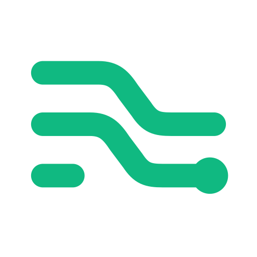
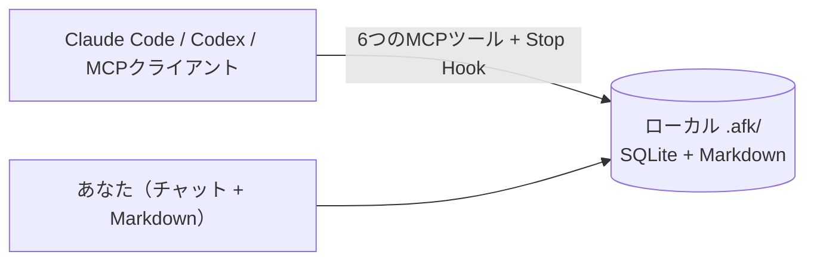

<div align="center">

<picture>
  <source media="(prefers-color-scheme: dark)" srcset="website/public/logo-dark.svg">
  <source media="(prefers-color-scheme: light)" srcset="website/public/logo.svg">
  
</picture>

# Agent Flow Kit

[](https://github.com/FooQoo/agent-flow-kit/actions/workflows/ci.yml)
[](https://github.com/FooQoo/agent-flow-kit/releases)

**AIエージェントが仕事をやり切るための、軽量ハーネス。**

Agent Flow Kit（AFK）は、Claude Code・Codex などの MCP クライアントに任せた作業を、計画・検証・途中の仕様追加・別セッションへの引き継ぎまで一貫して進めるためのツールです。計画、完了条件、質問、検証結果はすべてプロジェクト内の `.afk/` にローカル保存され、プランモードのように毎回計画をレビューして承認しなくてもそのまま動き出せます。

[English](README.md) · [ドキュメント](https://fooqoo.github.io/agent-flow-kit/ja/) · [クイックスタート](https://fooqoo.github.io/agent-flow-kit/ja/guide/quickstart) · [Releases](https://github.com/FooQoo/agent-flow-kit/releases)


</div>

```text
[AFK] Auth Refresh Flow [Doing] · ██████░░░░ 3/5 complete (60%)
  ✓ 1. Audit token expiry paths
  ✓ 2. Add refresh rotation endpoint
  ✓ 3. Persist rotation audit log
  ● 4. Update client retry interceptor
  ○ 5. Run end-to-end auth suite
```

## Agent Flow Kit とは

AI コーディングエージェントは大きな作業をこなせますが、長い仕事になるほど「会話ログに計画が埋もれる」「途中で追加した要望が漏れる」「検証が曖昧なまま完了扱いになる」「翌日の別セッションで最初から説明し直す」といった問題が起きがちです。

Agent Flow Kit はエージェントのそばで動く軽量な MCP サーバーと Hook です。人もエージェントも読める 4 つの記録をプロジェクトの `.afk/` に残します。

- **順番と完了条件のある計画。** 作業を依存関係のあるタスクに分け、各タスクの完了条件を確認してから次へ進みます。
- **プランモードのような事前レビューは不要。** 毎回長い計画書を読んで承認しなくても、依頼すれば計画を作ってそのまま着手します。先に確認したいときだけ「まず計画だけ作って」と伝えられます。
- **途中の追加依頼と明確な質問。** 作業中でもチャットから条件を追加でき、エージェントは自分で決められない判断だけを質問します。
- **別セッションへの引き継ぎ。** `handoff` で現在地とメモを残せば、翌日や別のセッションでも履歴を読み直すことなく続きから再開できます。

データはすべて手元の SQLite（状態の厳密な管理）と Markdown（人間が読める計画・タスク・質問・結果）に保存され、外部サーバーやアカウントは不要です。



## 作業の流れ

1. **やりたいことを伝える。** チャットで普通に依頼するか、AFK を呼び出します。
2. **計画を作ってすぐ動く。** エージェントが `.afk/` に完了条件つきのタスクを並べ、順に着手します（「計画だけ先に」と頼んだときだけ着手前に止まります）。
3. **途中で軌道修正する。** 作業中に追加の要望を送ったり質問に答えたりすると、AFK が依頼を記録して計画を更新します。
4. **進捗をひと目で確認する。** 状態が変わったターンだけ、Stop Hook が進捗バーとタスク一覧をクライアントに返します。
5. **引き継ぐ・完了する。** 途中で切り上げるときは `handoff` で引き継ぎメモを残し、最後まで終えたら全完了条件の検証結果つきでクローズします。

## クイックインストール

### Claude Code

```sh
claude plugin marketplace add "https://github.com/FooQoo/agent-flow-kit.git"
claude plugin install agent-flow-kit@afk
```

### Codex

```sh
codex plugin marketplace add "https://github.com/FooQoo/agent-flow-kit.git"
codex plugin add agent-flow-kit@afk
```

初回起動時に GitHub Releases から対象 OS（macOS `arm64`/`x86_64`・Linux `x86_64`/`arm64`・Windows `x86_64`）用のバイナリを自動取得し、`SHA256SUMS` で検証してローカルにキャッシュします。

手動インストールや Windows 環境の詳細は [インストールガイド](https://fooqoo.github.io/agent-flow-kit/ja/guide/installation) を参照してください。

## 日常の使い方

- **作業を頼む：** Claude Code なら `/agent-flow-kit:afk <依頼内容>`、Codex なら `$agent-flow-kit:afk` を選んで依頼します。
- **先に計画だけ見たいとき：** 「まず計画だけ作って」と添えると、着手前に確認できます。
- **別のセッションへ引き継ぐ：** Claude Code なら `/agent-flow-kit:afk handoff`、Codex なら `$agent-flow-kit:afk` を選んで `handoff` と送ります。
- **記録を直接読む：** `.afk/plans/` や `.afk/tasks/` の Markdown をいつでもエディタで確認できます。

## ドキュメント

- [ドキュメントサイト](https://fooqoo.github.io/agent-flow-kit/ja/) — ガイド・コンセプト・リファレンス一式。
- [Agent Flow Kit とは](https://fooqoo.github.io/agent-flow-kit/ja/guide/getting-started)（[原文](website/ja/guide/getting-started.md)） — 解決する課題とプランモードとの違い。
- [インストール](https://fooqoo.github.io/agent-flow-kit/ja/guide/installation)（[原文](website/ja/guide/installation.md)） — Claude Code / Codex / 単体 MCP / Windows での導入方法。
- [クイックスタート](https://fooqoo.github.io/agent-flow-kit/ja/guide/quickstart)（[原文](website/ja/guide/quickstart.md)） — 最初の計画から完了・引き継ぎまでの流れ。
- [開発・参照資料](docs/README.md) — 内部設計・検証手順。
