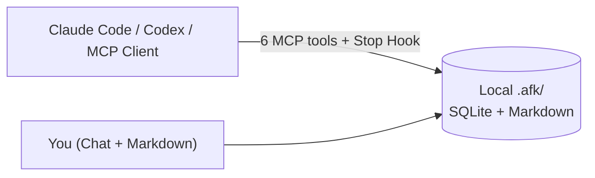

<div align="center">

<picture>
  <source media="(prefers-color-scheme: dark)" srcset="website/public/logo-dark.svg">
  <source media="(prefers-color-scheme: light)" srcset="website/public/logo.svg">
  
</picture>

# Agent Flow Kit

[](https://github.com/FooQoo/agent-flow-kit/actions/workflows/ci.yml)
[](https://github.com/FooQoo/agent-flow-kit/releases)

**A lightweight harness for AI agents to carry out work.**

Agent Flow Kit (AFK) gives Claude Code, Codex, and other MCP clients a structured way to plan, verify, revise mid-flight, and resume across sessions. Plans, acceptance criteria, questions, and checked results stay in `.afk/` right inside your repository — with zero hosted services and no upfront Plan Mode review bottleneck.

[日本語](README.ja.md) · [Documentation](https://fooqoo.github.io/agent-flow-kit/) · [Quickstart](https://fooqoo.github.io/agent-flow-kit/guide/quickstart) · [Releases](https://github.com/FooQoo/agent-flow-kit/releases)


</div>

```text
[AFK] Auth Refresh Flow [Doing] · ██████░░░░ 3/5 complete (60%)
  ✓ 1. Audit token expiry paths
  ✓ 2. Add refresh rotation endpoint
  ✓ 3. Persist rotation audit log
  ● 4. Update client retry interceptor
  ○ 5. Run end-to-end auth suite
```

## What is Agent Flow Kit?

AI coding agents can handle complex tasks, but long-running work often breaks down: plans drift in chat scrollback, mid-flight requirement changes get lost, completion is declared before checks pass, and starting a new session means re-explaining everything from scratch.

Agent Flow Kit sits alongside your agent as a lightweight MCP server and lifecycle hook. It keeps four things in `.afk/` that both you and your agent can read:

- **Ordered plans with acceptance criteria.** Work is split into dependency-ordered tasks, each with explicit acceptance checks verified before closing.
- **No upfront Plan Mode review required.** Unlike built-in Plan Mode, you don't have to sit and approve a wall of text before the agent moves — tell it what you want and let it plan and execute straight through, or ask for a plan-only draft when you do want to review first.
- **Mid-flight changes and clear questions.** Add requirements while the agent is working, and answer only the decisions it cannot settle on its own.
- **Clean session handoff.** Save a structured checkpoint (`handoff`) so the next session or another agent picks up the exact next task without re-reading the entire transcript.

Everything lives locally in SQLite (state and atomic transitions) and plain Markdown files (human-readable plans, tasks, questions, and results).



## How it works

1. **Give the goal.** Describe what you want in chat — or invoke AFK directly.
2. **Plan and move.** The agent drafts the plan and tasks with acceptance criteria in `.afk/` and starts working through them in order (or pauses for approval if you explicitly asked for a plan first).
3. **Steer mid-flight.** Send new requirements or answer questions in chat while the agent runs; AFK records requests and revises the plan cleanly.
4. **Watch live progress.** The Stop Hook prints a compact progress bar and task checklist directly in your client whenever state changes.
5. **Hand off or finish.** Run `handoff` to leave a structured checkpoint for tomorrow's session, or let the agent verify every acceptance criterion and close the plan.

## Quick install

### Claude Code

```sh
claude plugin marketplace add "https://github.com/FooQoo/agent-flow-kit.git"
claude plugin install agent-flow-kit@afk
```

### Codex

```sh
codex plugin marketplace add "https://github.com/FooQoo/agent-flow-kit.git"
codex plugin add agent-flow-kit@afk
```

On first launch, the plugin automatically downloads the matching macOS (`arm64` / `x86_64`), Linux (`x86_64` / `arm64`), or Windows (`x86_64`) binary from GitHub Releases, verifies `SHA256SUMS`, and caches it locally.

See [Installation](https://fooqoo.github.io/agent-flow-kit/guide/installation) for manual / offline installs and Windows notes.

## Everyday usage

- **Start work:** Run `/agent-flow-kit:afk <your request>` in Claude Code, or select `$agent-flow-kit:afk` in Codex.
- **Review first (optional):** Add "plan first" if you want to inspect the tasks before execution begins.
- **Hand off to the next session:** Run `/agent-flow-kit:afk handoff` in Claude Code, or choose `$agent-flow-kit:afk` and send `handoff` in Codex.
- **Inspect records:** Read `.afk/plans/` and `.afk/tasks/` directly in your editor at any time.

## Documentation

- [Documentation site](https://fooqoo.github.io/agent-flow-kit/) — Full guide, concepts, and reference.
- [Getting Started](https://fooqoo.github.io/agent-flow-kit/guide/getting-started) ([source](website/guide/getting-started.md)) — What AFK solves and how it compares to Plan Mode.
- [Installation](https://fooqoo.github.io/agent-flow-kit/guide/installation) ([source](website/guide/installation.md)) — Claude Code, Codex, standalone MCP, and Windows setup.
- [Quickstart](https://fooqoo.github.io/agent-flow-kit/guide/quickstart) ([source](website/guide/quickstart.md)) — End-to-end walkthrough of your first plan.
- [Development & reference notes](docs/README.md) — Architecture, internals, and verification.

## Source reuse

AFK's state enum and Markdown title helpers were adapted from [Agent Project](https://github.com/FooQoo/agent-project) at commit `095bc9bdad1c10cee9fb11ed25d616416e990167` under the MIT license. See [THIRD_PARTY_NOTICES.txt](THIRD_PARTY_NOTICES.txt).
