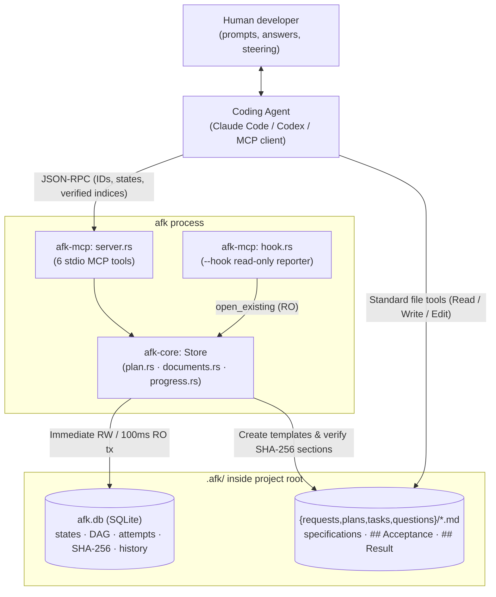
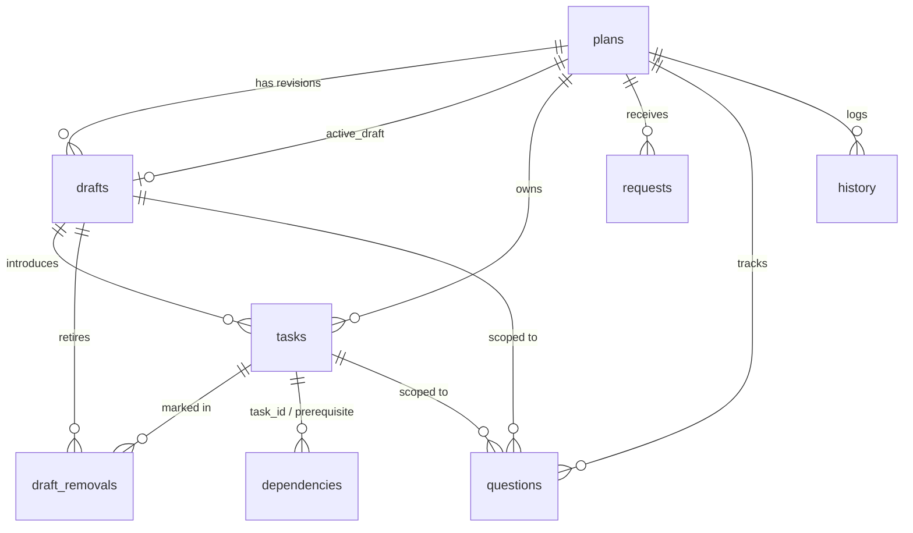

# Architecture and storage

AFK is built around a deliberate separation of concerns: **SQLite owns workflow state and invariants**, while **Markdown files own human- and agent-readable prose**. Cryptographic SHA-256 digests connect the two so specifications and answers cannot drift silently once confirmed.



## Why split state (SQLite) from prose (Markdown)?

Storing everything in Markdown checklists or storing everything inside SQLite both fail in real multi-step coding sessions:

- **Pure Markdown lacks atomic invariants.** Plain files cannot enforce acyclic prerequisites, block task execution when a new user request arrives mid-turn, serialize competing workers claiming the same task, or prove that a task's acceptance criteria were not rewritten right before completion.
- **Pure SQLite bloats model tool calls and hides prose.** Passing multi-kilobyte specifications, acceptance lists, and test logs inside JSON-RPC tool arguments forces the model to JSON-escape entire documents, inflating output tokens and making artifacts invisible to `git diff`, `rg`, and editor tabs.

AFK gives each medium the job it excels at:

| Concern | Owner | Mechanism |
| --- | --- | --- |
| Workflow state, DAG edges, worker leases, audit log | `.afk/afk.db` (SQLite) | Relational constraints, partial unique indexes, `BEGIN IMMEDIATE` transactions, `attempt` counters. |
| Requests, plan specs, task specs, questions, answers, evidence | `.afk/**/*.md` (Markdown) | Edited directly by the agent's native file tools (`Write`, `Edit`, `Read`); capped at `1 MiB` per document (`MAX_DOCUMENT_BYTES`). |
| Integrity boundary between state and prose | `crates/core/src/documents.rs` | Fence-aware heading split (`split_section`) + `Sha256::digest(text.trim_end().as_bytes())` stored in SQLite (`spec_hash`, `final_hash`, `digest`, `prompt_digest`, `answer_digest`). |

### How section splitting and sealing work (`documents.rs`)

Plans use `WORK_TEMPLATE` as shown below. Tasks use `TASK_TEMPLATE`, which adds an execution history section. Questions use `QUESTION_TEMPLATE`.

```markdown
# Concise plain title

Scope and implementation details.

## Acceptance

- First verifiable condition
- Second verifiable condition

## Result
```

When `Store::read_work` or `Store::read_question` validates a file:

1. **Fence-aware split (`split_section`)**: Scans lines tracking triple-or-longer backtick (```` ``` ````) and tilde (`~~~`) code fences so a literal `## Result` or `## Acceptance` inside a Markdown code example is never mistaken for the structural section boundary. Duplicate top-level target headings are rejected (`bail!("duplicate {marker} heading")`).
2. **Plain title extraction (`plain_title::first_line_plain`)**: Strips leading Markdown block markers (`#`, `>`, `- `, `1. `), unwraps `[text](url)` and ``, removes inline emphasis/code/strikethrough marks while preserving `snake_case` underscores and `2 * 3` asterisks, filters out control characters, and truncates to `100` characters.
3. **Acceptance bullet counting**: For plans and tasks, `split_section(spec, "Acceptance")` counts `- ` list items with non-empty text up to the next `## ` heading, requiring `1..=64` bullets (`MAX_CRITERIA`).
4. **Independent SHA-256 digests**: The specification *before* `## Result` (or `## Answer`) is hashed as `spec_hash` (or `prompt_digest`). Everything *after* the heading, once non-empty, is hashed as `final_hash` (or `answer_digest`). Because the specification slice excludes `## Result`, the agent can append completion evidence under `## Result` during execution without invalidating the confirmed `spec_hash`. Changes to the confirmed specification are detected by `check_work`. AFK omits its generated execution history from both hashes.

For full user-facing rules on the 6 MCP tools that drive these documents, see [MCP tools reference](../reference/mcp-tools.md).

## `.afk/` layout and project relocatability

Initializing a project creates `.afk/` (`0700` on Unix) with four document subdirectories (`plans`, `tasks`, `requests`, `questions`) and `afk.db`:

```text
<project-root>/.afk/
├── afk.db                   # SQLite database (PRAGMA user_version = 2)
├── requests/001.md          # Human instructions (# Title + body)
├── plans/001-r001.md        # Plan #1, draft #1 specification & ## Result
├── plans/001-r002.md        # Plan #1, draft #2 (new file per revision)
├── tasks/001.md             # Stable per-task specification & ## Result
└── questions/001.md         # Clarifying prompt & ## Answer
```

**Zero absolute paths are stored in SQLite.** Every `path` column in `schema.sql` is computed as a relative path from `.afk/` (`plans/001-r001.md`, `tasks/001.md`), and `Store::document` / `Store::plan_document` join that relative path onto `self.base` (`<canonical_root>/.afk`) at runtime.

To move, rename, or back up a project directory:
1. Ensure no `afk` MCP server process is actively holding the old path open.
2. Move or copy the project directory (including `.afk/`).
3. Open a new session at the new location—all returned file paths automatically resolve under the new canonical root.

> [!IMPORTANT]
> When `Store::initialize` sees an uninitialized database (`PRAGMA user_version == 0`), it checks that `plans/`, `tasks/`, `requests/`, and `questions/` are all empty before applying `schema.sql`. If Markdown files already exist alongside a missing or blank `afk.db`, initialization aborts rather than silently resetting IDs and clobbering existing prose.

## SQLite schema deep dive (`schema.sql`)

`schema.sql` defines the eight workflow tables below. The `execution.sql` migration adds `task_runs` for client and model names by attempt and `handoffs` for the latest task checkpoint. Initialization migrates existing workspaces from version 1 to version 2. Every connection enforces foreign keys.



### 1. `plans` — Top-level plan state and active specification seal

| Column | Type & Constraints | Purpose |
| --- | --- | --- |
| `id` | `INTEGER PRIMARY KEY AUTOINCREMENT` | Stable plan identifier (`1`, `2`, ...). |
| `status` | `TEXT NOT NULL DEFAULT 'backlog' CHECK(...)` | Kanban column: `'backlog'`, `'todo'`, `'doing'`, or `'done'`. |
| `revision` | `INTEGER NOT NULL DEFAULT 0` | Confirmed revision counter (`0` until the first draft is committed; increments by `1` on each `commit_plan`). |
| `active_draft` | `INTEGER REFERENCES drafts(id)` | Points to the currently accepted `drafts.id` (`NULL` when `revision == 0`). Determines the active plan file `plans/{id:03}-r{active_draft:03}.md`. |
| `title` | `TEXT` | Plain-text first line cached from the confirmed plan Markdown (`Plan #<id>` fallback before confirmation). |
| `spec_hash` | `TEXT` | SHA-256 hex digest of the confirmed plan text preceding `## Result`. |
| `final_hash` | `TEXT` | SHA-256 hex digest of `## Result` once `finish_plan` completes; reset to `NULL` if reopened by a new revision. |
| `criteria` | `INTEGER NOT NULL DEFAULT 0` | Count of `- ` bullets under `## Acceptance` (`1..=64` once confirmed). |

### 2. `drafts` — Staged plan revisions

| Column | Type & Constraints | Purpose |
| --- | --- | --- |
| `id` | `INTEGER PRIMARY KEY AUTOINCREMENT` | Monotonic draft identifier across all plans. |
| `plan_id` | `INTEGER NOT NULL REFERENCES plans(id)` | Owning plan. |
| `base_revision` | `INTEGER NOT NULL` | `plans.revision` value when `prepare_plan` ran; prevents stale commits if the plan changed concurrently. |
| `path` | `TEXT GENERATED ALWAYS AS (printf('plans/%03lld-r%03lld.md', plan_id, id)) STORED` | Relative path inside `.afk/`. Each draft gets its own immutable file path so superseded revisions remain intact on disk. |
| `state` | `TEXT NOT NULL DEFAULT 'open' CHECK(...)` | `'open'`, `'accepted'`, or `'discarded'`. |

- **Partial unique index `one_draft`**:
  ```sql
  CREATE UNIQUE INDEX one_draft ON drafts(plan_id) WHERE state='open';
  ```
  Guarantees at the database engine level that a plan can have at most **one** open draft at any instant, while allowing unlimited historical `'accepted'` and `'discarded'` rows.

### 3. `tasks` — Individual units of work and worker leases

| Column | Type & Constraints | Purpose |
| --- | --- | --- |
| `id` | `INTEGER PRIMARY KEY AUTOINCREMENT` | Stable task ID. Preserves chronological creation order across revisions. |
| `plan_id` | `INTEGER NOT NULL REFERENCES plans(id)` | Owning plan. |
| `draft_id` | `INTEGER NOT NULL REFERENCES drafts(id)` | Draft revision that originally introduced this task. |
| `path` | `TEXT GENERATED ALWAYS AS (printf('tasks/%03lld.md', id)) STORED` | Relative path inside `.afk/`. |
| `lifecycle` | `TEXT NOT NULL DEFAULT 'draft' CHECK(...)` | `'draft'` (uncommitted), `'active'` (in current confirmed plan), or `'retired'` (removed by replanning). |
| `status` | `TEXT NOT NULL DEFAULT 'backlog' CHECK(...)` | `'backlog'`, `'todo'`, `'doing'`, or `'done'`. |
| `title` | `TEXT` | Plain-text title extracted when the task's draft commits. |
| `spec_hash` | `TEXT` | SHA-256 digest of the task specification before `## Result`. |
| `final_hash` | `TEXT` | SHA-256 digest of `## Result` sealed on `finish_task`. |
| `criteria` | `INTEGER NOT NULL DEFAULT 0` | Count of `- ` acceptance bullets (`1..=64`). |
| `attempt` | `INTEGER NOT NULL DEFAULT 0` | Monotonic lease counter incremented every time a new worker starts or takes over the task. |
| `owner` | `TEXT` | UUID v4 string of the MCP server session currently holding the `'doing'` lease (`NULL` when unstarted or retired). |

- **Composite lookup index**: `CREATE INDEX task_plan ON tasks(plan_id, lifecycle, status, id);` accelerates progress aggregation and ready-task candidate scans.
- **Partial unique index `one_running`**:
  ```sql
  CREATE UNIQUE INDEX one_running ON tasks(plan_id) WHERE lifecycle='active' AND status='doing';
  ```
  Enforces AFK's single-piece-flow invariant: **at most one active task per plan may be in `doing` at a time**. Retired tasks (`lifecycle = 'retired'`) are excluded from the index predicate.

### 4. `dependencies` — Acyclic prerequisite edges

| Column | Type & Constraints | Purpose |
| --- | --- | --- |
| `task_id` | `INTEGER NOT NULL REFERENCES tasks(id)` | Dependent task that must wait. |
| `prerequisite` | `INTEGER NOT NULL REFERENCES tasks(id)` | Task that must be `'active'` and `'done'` first. |

- **Primary key & DAG invariant**:
  ```sql
  PRIMARY KEY(task_id, prerequisite),
  CHECK(task_id > prerequisite)
  ```
  Why does `CHECK(task_id > prerequisite)` guarantee a **directed acyclic graph (DAG)** with zero recursive graph-traversal queries? Because `tasks.id` is `AUTOINCREMENT`:
  - Retained active tasks from earlier revisions always have strictly smaller IDs than newly inserted draft tasks.
  - Within `prepare_plan`, new tasks are inserted sequentially, and negative dependency references (`-1`, `-2`, ...) resolve only to *earlier* new tasks in the `added` slice (`index = reference.unsigned_abs() - 1`).
  Every edge therefore points strictly from a larger ID to a smaller ID—forming a strict topological total order where self-loops and cycles are mathematically impossible.

### 5. `draft_removals` — Staged task retirements

| Column | Type & Constraints | Purpose |
| --- | --- | --- |
| `draft_id` | `INTEGER NOT NULL REFERENCES drafts(id)` | Open draft proposing the removal. |
| `task_id` | `INTEGER NOT NULL REFERENCES tasks(id)` | Unfinished `'active'` task (`status <> 'done'`) to retire when `draft_id` commits. |

 Composite `PRIMARY KEY(draft_id, task_id)`. Completed (`'done'`) tasks cannot be added to `draft_removals`—their evidence stays permanently part of the plan record.

### 6. `requests` — Human instructions and idempotency receipts

| Column | Type & Constraints | Purpose |
| --- | --- | --- |
| `id` | `INTEGER PRIMARY KEY AUTOINCREMENT` | Request ID. |
| `plan_id` | `INTEGER NOT NULL REFERENCES plans(id)` | Target plan (newly created when `source_plan` is `None`). |
| `receipt` | `TEXT UNIQUE` | Optional `1..=100` byte client retry token ensuring idempotent intake on transient transport retries. |
| `path` | `TEXT GENERATED ALWAYS AS (printf('requests/%03lld.md', id)) STORED` | Relative path inside `.afk/`. |
| `source_plan` | `INTEGER` | Original `plan_id` argument supplied at intake (`NULL` for initial plan creation, `Some(id)` for additional requests); verified on `receipt` replay. |
| `applied_revision` | `INTEGER` | Plan revision (`revision + 1`) that incorporated this request (`NULL` while pending). |
| `digest` | `TEXT` | SHA-256 digest of the request Markdown sealed when `commit_plan` applies it. |

Indexed by `request_plan(plan_id, applied_revision, id)` so `applied_revision IS NULL` pending checks are index-only scans.

### 7. `questions` — Clarifying questions and sealed human answers

| Column | Type & Constraints | Purpose |
| --- | --- | --- |
| `id` | `INTEGER PRIMARY KEY AUTOINCREMENT` | Question ID. |
| `plan_id` | `INTEGER NOT NULL REFERENCES plans(id)` | Owning plan. |
| `task_id` | `INTEGER REFERENCES tasks(id)` | Optional scope: active unfinished task (`task_id` and `draft_id` are mutually exclusive). |
| `draft_id` | `INTEGER REFERENCES drafts(id)` | Optional scope: open draft. |
| `path` | `TEXT GENERATED ALWAYS AS (printf('questions/%03lld.md', id)) STORED` | Relative path inside `.afk/`. |
| `title` | `TEXT` | Plain-text prompt title captured on `publish_question`. |
| `prompt_digest` | `TEXT` | SHA-256 digest of the prompt before `## Answer` (`NULL` while in draft state). |
| `answer_digest` | `TEXT` | SHA-256 digest of the human reply under `## Answer` (`NULL` until `answer_question` seals it). |
| `applied_revision` | `INTEGER` | Plan revision that reflected the sealed answer (`NULL` until committed in `commit_plan`). |

Indexed by `question_plan(plan_id, applied_revision, id)`. Once `prompt_digest` is set, the prompt text cannot change; once `answer_digest` is set, revising the answer requires preparing a new question so audit history remains intact.

### 8. `history` — Append-only transition and verification log

| Column | Type & Constraints | Purpose |
| --- | --- | --- |
| `id` | `INTEGER PRIMARY KEY` | Rowid sequence. |
| `plan_id` | `INTEGER NOT NULL REFERENCES plans(id)` | Plan context. |
| `event` | `TEXT NOT NULL` | Transition identifier (see list below). |
| `entity_id` | `INTEGER NOT NULL` | ID of the affected request, draft, question, task, or plan. |
| `acceptance_checked` | `INTEGER` | Number of verified `## Acceptance` bullets (`Some(criteria)` on `task_completed` and `plan_completed`, `None` otherwise). |
| `at` | `INTEGER NOT NULL DEFAULT (unixepoch())` | UTC Unix timestamp in seconds. |

Recorded `event` values across `lib.rs` and `plan.rs`:
- Intake & revisions: `request_received`, `request_applied`, `draft_prepared`, `draft_discarded`, `plan_confirmed`, `execution_authorized`, `plan_completed`
- Clarifications: `question_prepared`, `question_asked`, `question_answered`, `answer_applied`
- Tasks: `task_started`, `task_resumed`, `task_completed`

## Transactions, `busy_timeout`, and file reservation

`Store::connect` (`crates/core/src/lib.rs`) tunes locking asymmetrically for writers versus readers:

| Helper | SQLite flags | Transaction mode | `busy_timeout` | Rationale |
| --- | --- | --- | --- | --- |
| `Store::write` | `SQLITE_OPEN_READ_WRITE \| SQLITE_OPEN_NOFOLLOW` | `TransactionBehavior::Immediate` (`BEGIN IMMEDIATE`) | **3 seconds** | Acquires the reserved write lock *before* executing any `SELECT` precondition checks, preventing mid-transaction read-to-write lock upgrade deadlocks (`SQLITE_BUSY`) when two workers race. |
| `Store::read` | `SQLITE_OPEN_READ_ONLY \| SQLITE_OPEN_NOFOLLOW` | Deferred read transaction | **100 ms** | Gives read-only callers (`open_plan`, `progress`, and `afk --hook` on `Stop`) a consistent snapshot while ensuring `--hook` fails open well inside its 1-second client timeout if an exclusive lock is held. |

### Two-phase ID reservation and crash recovery

Filesystem creation cannot roll back inside a SQLite transaction, so AFK orders every document creation (`record_request`, `prepare_question`, `prepare_plan`) in two safe steps:

1. **Inside `Store::write` (`BEGIN IMMEDIATE`)**: Inserts rows to obtain `AUTOINCREMENT` IDs, calls `require_unowned_path_available` (`symlink_metadata` must return `NotFound` so existing unreferenced files are never adopted or overwritten), logs to `history`, and commits the SQLite transaction.
2. **Outside the SQLite transaction (`prepare_file`)**: Opens each reserved path with `create_new(true)` (`O_CREAT | O_EXCL`), `mode(0o600)`, and `O_NOFOLLOW`, writing the initial Markdown template. If `AlreadyExists` is returned (for example, on an idempotent `recover_draft` call where some files were already written), `check_path(&doc.path, false)` verifies the file is a safe regular file and leaves its contents untouched.

If a process is killed between step 1 and step 2, `open_plan` shows the open draft and `update_plan` with `{"op": "recover", "draft_id": ...}` (`Store::recover_draft`) recreates any missing template files without overwriting files the agent already edited. Calling `open_plan` with `check_files: true` runs `Store::orphan_documents`, scanning all four `.afk/` subdirectories against `UNION ALL` of known database paths and returning up to `32` sorted unreferenced `.md` paths.

## `Progress` and `NextAction` priority (`progress.rs`)

Every state-changing tool and every `Stop` hook report calls `Store::snapshot(tx, plan_id)` to compute a deterministic `Progress` struct and a single `NextAction` enum (`#[serde(tag = "action", rename_all = "snake_case")]`). Blockers strictly preempt execution in this exact waterfall order:

| Priority | Condition in SQLite | Returned `NextAction` | Why it preempts lower states |
| --- | --- | --- | --- |
| **1** | Published unanswered question exists (`prompt_digest IS NOT NULL AND answer_digest IS NULL`) | `wait_for_answer { id, title, count }` | Human judgment was requested; agent must wait for the reply. |
| **2** | Unpublished draft question exists (`prompt_digest IS NULL`) | `prepare_question { id }` | Agent reserved a question file and must finish writing and publishing it (or resolve it) first. |
| **3** | Unapplied requests or answered questions exist (`applied_revision IS NULL` in `requests` or `questions`) | `replan { requests, answers }` | New user instructions or newly sealed answers must be folded into a revised plan before work continues. |
| **4** | Open draft exists (`drafts.state = 'open'`) | `confirm_draft { id }` | Staged plan/task files must be written and committed before tasks can run. |
| **5** | `plans.status == 'done'` | `complete` | All tasks and plan-level acceptance criteria are verified and sealed. |
| **6** | `plans.status == 'backlog'` and `revision == 0` | `prepare_plan` | Brand-new plan with no pending requests (edge state); needs initial draft. |
| **7** | `plans.status == 'backlog'` and `revision > 0` | `await_start` | Plan was committed with `execute: false`; waiting for explicit human authorization (`authorize`). |
| **8** | `status` in `todo`/`doing` and an active `'doing'` task exists | `resume_task { id, title }` | `candidate()` always selects an in-progress `'doing'` task before any `'todo'` task. |
| **9** | `status` in `todo`/`doing` and an active `'todo'` task has all prerequisites `'active'` + `'done'` | `start_task { id, title }` | Picks the lowest-ID ready `'todo'` task (`ORDER BY (status='doing') DESC, id LIMIT 1`). |
| **10** | `status` in `todo`/`doing` and `candidate()` returns `None` | `verify_plan` | Every active task is `'done'`; the agent must now write `## Result` in the active plan file and call `update_plan` / `finish`. |

## Tracing changes end-to-end

To see how `server.rs`, `plan.rs`, `documents.rs`, and `schema.sql` cooperate in practice, let's trace three core mutations through the codebase.

### Walkthrough A: Preparing and committing a plan revision

Suppose Plan `#1` is at `revision = 0` (`status = 'backlog'`) with pending Request `#1` already written to `.afk/requests/001.md`.

1. **Reserve the draft (`update_plan` -> `Store::prepare_plan`)**:
   - The agent calls `update_plan` with `{"plan_id": 1, "change": {"op": "prepare", "revision": 0, "add": [[], [-1]], "remove": []}}`.
   - `prepare_plan` enforces `add.len() <= 32` (`MAX_DRAFT_TASKS`), opens `Store::write` (`BEGIN IMMEDIATE`), and verifies `plans.revision == 0` and `open_draft == replace_draft` (`None`).
   - Inserts `drafts(plan_id=1, base_revision=0)` -> `draft_id = 1` (`path = 'plans/001-r001.md'`), checking `require_unowned_path_available`.
   - Loops through `add`:
     - Task 1 (`[]`): inserts `tasks(plan_id=1, draft_id=1)` -> `task_id = 1` (`lifecycle='draft'`, `status='backlog'`), pushes `1` to `added`.
     - Task 2 (`[-1]`): inserts `tasks(plan_id=1, draft_id=1)` -> `task_id = 2`. Resolves `-1` to `added[0] == 1`, inserts `dependencies(task_id=2, prerequisite=1)` (satisfying `CHECK(2 > 1)`).
   - Appends `history(1, "draft_prepared", 1, None)` and commits SQLite.
   - Calls `prepare_draft_files`, writing `WORK_TEMPLATE` to `.afk/plans/001-r001.md` and `TASK_TEMPLATE` to `.afk/tasks/001.md` and `.afk/tasks/002.md`. AFK creates each file with mode `0600` and `O_NOFOLLOW` on Unix.
2. **Author specifications (standard file tools)**:
   - Using normal file tools, the agent writes `# Title`, scope details, and `- ` bullets under `## Acceptance` in all three Markdown files.
3. **Seal and activate (`update_plan` -> `Store::commit_plan`)**:
   - The agent calls `update_plan` with `{"plan_id": 1, "change": {"op": "commit", "draft_id": 1, "requests": [1], "answers": [], "execute": true}}`.
   - Inside `Store::write`:
     - Checks idempotency (`if active_draft == Some(1)` returns current snapshot immediately).
     - Verifies `model.base_revision == revision` (`0 == 0`), `drafts.state == 'open'`, `pending_requests == [1]`, and `pending_answers == []`.
     - Calls `read_request(1)` to verify `.afk/requests/001.md` has non-empty plain content, hashes it, updates `requests SET applied_revision=1, digest=?`, and logs `request_applied`.
     - Verifies total active + draft tasks `> 0` and confirms no retained task depends on a task listed in `draft_removals`.
     - Calls `read_work` on `plans/001-r001.md`, `tasks/001.md`, and `tasks/002.md`, extracting each plain `title`, `spec_hash`, and `criteria` count (`1..=64`).
     - Computes `new_status`: `(Backlog, execute=true) => Column::Todo` (had `execute` been `false`, both the plan and tasks would stay in `Column::Backlog` with `NextAction::AwaitStart`).
     - Promotes tasks `1` and `2`: `UPDATE tasks SET lifecycle='active', status='todo', title=?, spec_hash=?, criteria=?`.
     - Marks `drafts SET state='accepted'`, updates `plans SET status='todo', revision=1, active_draft=1, title=?, spec_hash=?, final_hash=NULL, criteria=?`, logs `plan_confirmed`, and returns `Progress` with `next: StartTask { id: 1, ... }`.

### Walkthrough B: Claiming and finishing a task with `attempt` protection

Suppose Session A (`worker = "uuid-A"`) starts Task `#1`, gets interrupted, and Session B (`worker = "uuid-B"`) takes over while stale Session A tries to report completion.

```mermaid
sequenceDiagram
  participant A as Session A (uuid-A)
  participant DB as afk-core / SQLite
  participant B as Session B (uuid-B)

  A->>DB: start_next(plan=1, take_over=false)
  Note over DB: tasks#1: status='doing', owner='uuid-A', attempt=1
  DB-->>A: TaskRun { id: 1, attempt: 1 }

  B->>DB: start_next(plan=1, take_over=false)
  DB-->>B: Error: "a different session owns this task..."

  Note over A,B: User restarts session; Session B passes take_over=true
  B->>DB: start_next(plan=1, take_over=true)
  Note over DB: tasks#1: status='doing', owner='uuid-B', attempt=2
  DB-->>B: TaskRun { id: 1, attempt: 2 }

  A->>DB: finish_task(id=1, owner='uuid-A', attempt=1, verified=[1])
  DB-->>A: Error: "task attempt changed; inspect before continuing"

  B->>DB: finish_task(id=1, owner='uuid-B', attempt=2, verified=[1])
  Note over DB: Verify spec_hash, ## Result, [1]==1..=1 -> status='done', final_hash
  DB-->>B: Progress { done: 1, next: StartTask { id: 2 } }
```

Inside `plan.rs`:

1. **`Store::start_next`**:
   - Calls `execution_ready(tx, plan)` — fails immediately if any pending request, unapplied question/answer, or open draft exists.
   - Calls `check_plan` to confirm the active plan's `spec_hash` on disk has not been altered.
   - Calls `candidate(tx, plan)` to pick `Doing` first or the lowest-ID prerequisite-satisfied `Todo` task.
   - Calls `check_task` on the candidate task (`finished = false`) *and* `check_task(..., finished = true)` on every prerequisite in `dependencies`, ensuring neither the task spec nor upstream completed task results were tampered with on disk.
   - If `assigned == Some(owner)` and `state == Doing`, returns the existing `attempt` without incrementing (idempotent resume within the same MCP server process).
   - If `state == Doing` and `assigned != Some(owner)`, rejects unless `take_over == true`.
   - Increments `attempt = old_attempt + 1`, updates `tasks SET status='doing', owner=?, attempt=?` and `plans SET status='doing'`, and logs `task_started` (or `task_resumed` on takeover).
2. **`Store::finish_task`**:
   - Checks `current == attempt && assigned.as_deref() == Some(owner)` first; stale completions from superseded sessions fail before touching any state.
   - Re-reads `tasks/001.md` via `check_task` and `read_work(&doc, true)`, verifying `spec_hash` still matches SQLite and `## Result` is non-empty (`result.final_hash.is_some()`).
   - Calls `verify(spec.criteria, verified)` — sorts `verified` and asserts exact equality with `1..=criteria` (so 3 bullets require `[1, 2, 3]`, rejecting duplicates, omissions, or out-of-range indices).
   - Re-checks `execution_ready` and `check_plan`, updates `tasks SET status='done', final_hash=?`, and records `history(plan, "task_completed", id, Some(spec.criteria))`.

### Walkthrough C: Mid-flight replanning rollback and task retirement

Suppose Task `#1` is `'done'`, Task `#2` is currently `'doing'` (owned by `uuid-A`), and Task `#3` (retained, not removed) were also in flight, when the user submits a scope change:

1. **Intake pauses execution (`record_request(Some(1), None)`)**:
   - Inserts `requests(plan_id=1, applied_revision=NULL)` (`id = 2`) and creates `.afk/requests/002.md`.
   - Immediately, `Progress.next` becomes `NextAction::Replan { requests: 1, answers: 0 }`, and `execution_ready` blocks `finish_task(task=2)` and `start_next(plan=1)`.
2. **Stage replacement (`prepare_plan(1, revision=1, add=&[vec![1]], remove=&[2], None)`)**:
   - Creates `draft_id = 2` (`plans/001-r002.md`).
   - Verifies Task `#2` is `'active'` and `status <> 'done'` (completed Task `#1` could *not* be passed in `remove`), inserting `draft_removals(draft_id=2, task_id=2)`.
   - Inserts replacement Task `#4` depending on completed Task `#1` (`dependencies(4, 1)`).
3. **Atomic switchover (`commit_plan(1, draft=2, requests=&[2], answers=&[], execute=true)`)**:
   - Verifies no retained active task still lists removed Task `#2` in `dependencies` (`"replace each retained task whose prerequisite is being removed"`).
   - Activates new Task `#4` as `lifecycle='active', status='todo'`.
   - **Retires superseded Task `#2`**:
     ```sql
     UPDATE tasks SET lifecycle='retired', owner=NULL
     WHERE id IN (SELECT task_id FROM draft_removals WHERE draft_id=?1);
     ```
     Because `lifecycle` becomes `'retired'`, the partial unique index `one_running` (`WHERE lifecycle='active' AND status='doing'`) is released, while `.afk/tasks/002.md` stays on disk for auditability.
   - **Rolls back any retained unfinished tasks**:
     ```sql
     UPDATE tasks SET status='todo', owner=NULL
     WHERE plan_id=?2 AND lifecycle='active' AND status<>'done';
     ```
     Completed Task `#1` (`status = 'done'`) keeps its `'done'` state and sealed `final_hash`, whereas any retained `'doing'` task returns cleanly to `'todo'` (`owner = NULL`) so the worker re-reads the updated plan before resuming.
   - Advances `plans` to `revision = 2`, `active_draft = 2`, `status = 'doing'`, `final_hash = NULL`.

## Next steps

- [Hooks, roots, and security](integrations.md) — How `afk` resolves workspaces, routes turn-scoped `Stop` progress messages, and defends `.afk/` against symlinks and oversized inputs.
- [Verification and benchmarks](verification.md) — Inspect the automated tests that assert every invariant described on this page.
