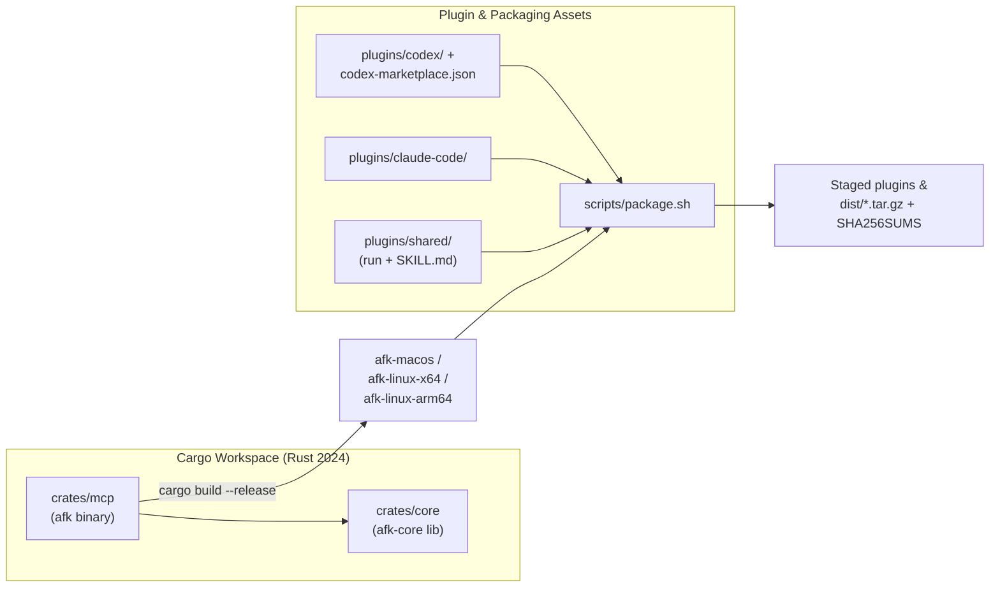

# Build and package

Agent Flow Kit (AFK) is a Rust 2024 Cargo workspace (`resolver = "3"`) that compiles into a single self-contained native executable (`afk`) paired with thin client plugin manifests for Claude Code and Codex. There is no background daemon, Node.js runtime, or external SQLite shared-library dependency at runtime.



## Workspace overview

The workspace root (`Cargo.toml`) defines two crates that enforce a strict boundary between storage invariants and transport mechanics:

- **`afk-core` (`crates/core/`)** — Pure synchronous workflow library. Owns the SQLite schema, transaction lifecycle, Markdown template generation, SHA-256 section fingerprinting, DAG dependency validation, worker `attempt` leases, and deterministic `Progress` / `NextAction` calculation. It knows nothing about MCP, JSON-RPC, async runtimes, or client hooks.
- **`afk-mcp` (`crates/mcp/`, binary `afk`)** — Thin protocol and CLI entrypoint. In default stdio mode, it runs a single-threaded Tokio runtime (`flavor = "current_thread"`) serving six MCP tools via `rmcp` (`=3.11.0`) and offloading blocking `afk-core` calls onto `tokio::task::spawn_blocking`. When invoked with `--hook`, it bypasses Tokio entirely and runs a synchronous, read-only client event handler.

## Code map

Use this map to locate any subsystem, invariant, or packaging rule in the repository.

### Rust workspace & `afk-core`

| Path | Responsibility |
| --- | --- |
| `Cargo.toml` | Workspace manifest (`edition = "2024"`, `resolver = "3"`, `version = "0.1.0"`, `publish = false`), shared dependency pins, and `[profile.release]` (`lto = "thin"`, `strip = true`). |
| `crates/core/Cargo.toml` | `afk-core` manifest; pulls in `rusqlite` `0.38` with `features = ["bundled"]`, `sha2`, `serde`, `anyhow`, and `libc`. |
| `crates/core/src/lib.rs` | `Store` initialization (`initialize`, `open_existing`), `Immediate` write vs read-only SQLite connection setup, symlink/file-type guards (`check_path`, `create_directory`), orphan Markdown discovery (`orphan_documents`), request intake (`record_request`), and question lifecycle (`prepare_question`, `publish_question`, `answer_question`). |
| `crates/core/src/schema.sql` | Base workflow DDL (`PRAGMA user_version = 1`): eight base tables (`plans`, `drafts`, `tasks`, `dependencies`, `draft_removals`, `requests`, `questions`, `history`), `STORED` generated relative paths, partial unique indexes (`one_draft`, `one_running`), and acyclic check constraint (`task_id > prerequisite`). |
| `crates/core/src/execution.sql` | Version 2 migration for per-attempt client details and the latest handoff saved by the task owner. |
| `crates/core/src/plan.rs` | Core revision and execution state machine: `inspect`, `prepare_plan`, `recover_draft`, `commit_plan`, `authorize_execution`, `start_next`, `finish_task`, `finish_plan`, plus `execution_ready`, acceptance bullet range checking (`verify`), and sealed specification verification (`check_work`). |
| `crates/core/src/documents.rs` | Secure Markdown file creation (`0600`, `O_NOFOLLOW`, `create_new`) and reading (`1 MiB` cap, `O_NONBLOCK`), initial templates (`REQUEST_TEMPLATE`, `WORK_TEMPLATE`, `QUESTION_TEMPLATE`), code-fence-aware heading splitter (`split_section`), `## Acceptance` bullet counting (`1..=64`), and SHA-256 section hashing. |
| `crates/core/src/progress.rs` | Read-only `Progress` snapshot and `NextAction` priority waterfall (`snapshot`), recent plan pagination (`recent_plans`), and ready-task selection (`candidate`, prioritizing `Doing` over `Todo` gated on completed active prerequisites). |
| `crates/core/src/plain_title.rs` | Extracts clean plain-text titles from Markdown first lines (`first_line_plain`, `strip_inline_markdown`) while preserving identifier underscores (`snake_case`) and arithmetic asterisks (`2 * 3`). Adapted from Agent Project. |
| `crates/core/src/column.rs` | Four-stage Kanban column enum (`Backlog`, `Todo`, `Doing`, `Done`) with lowercase serde/SQL representation (`as_str`) and capitalized UI display labels (`label`). Adapted from Agent Project. |
| `crates/core/tests/workflow.rs` | Multi-step Rust integration tests exercising clarification, dependencies, mid-flight replanning, directory relocation, multi-threaded task claim races, `take_over` stale-attempt rejection, symlink rejection, draft recovery, orphan detection, and template validation. |

### `afk-mcp` binary (`afk`)

| Path | Responsibility |
| --- | --- |
| `crates/mcp/Cargo.toml` | Binary crate manifest defining `[[bin]] name = "afk"`, `rmcp = "=3.11.0"` (`transport-io`), `tokio`, `schemars`, `uuid` (`v4`), and `url`. |
| `crates/mcp/src/main.rs` | CLI argument parser dispatching between stdio MCP mode (default or `--root <directory>`) and synchronous `--hook` mode. |
| `crates/mcp/src/server.rs` | `rmcp` `ServerHandler` exposing the 6 MCP tools (`record_request`, `open_plan`, `update_plan`, `update_question`, `start_next`, `finish_task`), 6-step project root resolution, `OnceCell<Store>` root pinning, UUID v4 worker identity, and `plan_id` / `afk_root` response injection. |
| `crates/mcp/src/hook.rs` | Stateless, fail-open hook processor (`UserPromptSubmit`, `PostToolUse`, `Stop`), recursive JSON route extraction, SHA-256 `(session_id, turn_id)` marker files, atomic `fs::rename` consumption, and `systemMessage` progress formatting. |

### Client plugins, scripts, tests, and benchmarks

| Path | Responsibility |
| --- | --- |
| `plugins/shared/run` | POSIX `/bin/sh` wrapper that detects `uname -s` / `uname -m` and `exec`s the matching bundled binary under `bin/`. |
| `plugins/shared/skills/afk/SKILL.md` | Shared agent workflow instructions (`disable-model-invocation: true`, 2,627 bytes) bundled into both Claude Code and Codex plugins. |
| `plugins/shared/README.md` | Concise end-user overview copied into assembled plugin directories. |
| `plugins/claude-code/.claude-plugin/plugin.json` | Claude Code plugin manifest (`agent-flow-kit` `0.1.0`). |
| `plugins/claude-code/.mcp.json` | Launches `/bin/sh ${CLAUDE_PLUGIN_ROOT}/run` over stdio. |
| `plugins/claude-code/hooks/hooks.json` | Registers `PostToolUse` (scoped regex matcher), `Stop`, and `UserPromptSubmit` hooks with a 1-second timeout. |
| `plugins/codex/.codex-plugin/plugin.json` | Codex compatibility manifest explicitly wiring `./skills/`, `./hooks/hooks.json`, `./.mcp.json`, and UI display metadata. |
| `plugins/codex/.mcp.json` | Launches `./run` with `cwd: "."` and `AFK_NEEDS_WORKSPACE=1` for plugin-cache safety. |
| `plugins/codex/hooks/hooks.json` | Registers `PostToolUse` (scoped regex matcher) and `Stop` hooks using `${PLUGIN_ROOT}/run --hook`. |
| `plugins/codex-marketplace.json` | Local Codex marketplace catalog (`afk-local`) staged at `codex/.agents/plugins/marketplace.json`. |
| `scripts/package.sh` | Stages `claude-code` and `codex` plugin trees from compiled binaries in `host` (local) or `all` (CI release) mode. |
| `.github/workflows/ci.yml` | 4-runner build matrix (Linux x64/arm64, macOS arm64/x64), universal macOS `lipo` merge, smoke test, and `SHA256SUMS` archive assembly. |
| `tests/integration/stdio_workflow.py` | Deterministic zero-dependency Python 3 harness running 21 MCP calls and 25 hook invocations per trial with byte and latency telemetry. |
| `THIRD_PARTY_NOTICES.txt` | MIT license attribution for upstream code adapted from Agent Project, copied into every packaged plugin. |

## Build and test commands

 CI pins **Rust `1.96.0`** (`rustfmt`, `clippy`) and requires only standard-library **Python 3** for the end-to-end stdio workflow test. Run the full local verification pipeline from the workspace root:

```sh
# 1. Check formatting and strict lints
cargo fmt --all --check
cargo clippy --locked --all-targets -- -D warnings

# 2. Run all unit and core workflow integration tests
cargo test --locked --workspace

# 3. Compile the optimized release binary (target/release/afk)
cargo build --locked --release

# 4. Run the deterministic stdio MCP + hook integration harness
python3 tests/integration/stdio_workflow.py target/release/afk
```

To repeat the integration harness across multiple isolated trials and inspect JSON byte budgets and median latencies, pass `--trials`:

```sh
python3 tests/integration/stdio_workflow.py target/release/afk --trials 5
```

## Release profile and static SQLite bundling

AFK plugins are distributed as archive directories extracted onto developer workstations and CI containers where system libraries vary widely. Two build choices keep `afk` portable and fast to spawn on every `--hook` invocation:

1. **Optimized, stripped binary (`Cargo.toml`)**:
   ```toml
   [profile.release]
   lto = "thin"
   strip = true
   ```
   Thin LTO enables cross-crate dead-code elimination and inlining between `afk-core` and `afk-mcp`, while `strip = true` removes debug symbols. On Apple Silicon, the resulting `target/release/afk` binary is ~5.6 MB (`5,614,016` bytes) and starts in a few milliseconds.
2. **Bundled SQLite (`crates/core/Cargo.toml`)**:
   ```toml
   rusqlite = { version = "0.38", features = ["bundled"] }
   ```
   Compiling SQLite from its C amalgamation guarantees identical support across macOS and Linux for features `schema.sql` and `progress.rs` rely on—specifically `GENERATED ALWAYS AS (...) STORED` columns, aggregate `FILTER (WHERE ...)` clauses, partial unique indexes, and `unixepoch()`—without linking against host `libsqlite3`. CI inspects every staged binary with `otool -L` (macOS) or `ldd` (Linux) to verify that only standard OS system libraries are linked.

## Cross-platform packaging workflow

Plugin archives bundle three platform binary names inside `plugins/agent-flow-kit/bin/` alongside a single POSIX `/bin/sh` launcher (`plugins/shared/run`).

### Target binaries and runtime dispatch (`plugins/shared/run`)

| `uname -s` : `uname -m` | Selected binary | CI build runner(s) |
| --- | --- | --- |
| `Darwin:arm64` or `Darwin:x86_64` | `bin/afk-macos` (Universal2 in CI, host slice in local `host` mode) | `macos-15` (`arm64`) + `macos-15-intel` (`x86_64`) merged via `lipo -create` |
| `Linux:x86_64` | `bin/afk-linux-x64` | `ubuntu-22.04` |
| `Linux:aarch64` or `Linux:arm64` | `bin/afk-linux-arm64` | `ubuntu-22.04-arm` |

When Claude Code or Codex launches `run` (either as the long-lived stdio MCP server or with `--hook`), `plugins/shared/run` resolves its own directory safely (`CDPATH= cd -- "$(dirname -- "$0")" && pwd`) so paths containing spaces or non-ASCII characters work unmodified, verifies `-x "$base/bin/$binary"`, and replaces the shell process via `exec "$base/bin/$binary" "$@"`.

### Assembling a local developer package (`host` mode)

`scripts/package.sh` takes three arguments: `BIN_DIR`, `OUTPUT_DIR`, and `host|all`. In `host` mode, you only need the binary for your current machine:

```sh
cargo build --locked --release

mkdir -p /tmp/afk-bin
# Use afk-macos on macOS, afk-linux-x64 on Linux x86_64, or afk-linux-arm64 on Linux arm64
install -m 755 target/release/afk /tmp/afk-bin/afk-macos

rm -rf /tmp/afk-pkg
scripts/package.sh /tmp/afk-bin /tmp/afk-pkg host

# Smoke-test the assembled plugin through the shell launcher
python3 tests/integration/stdio_workflow.py /tmp/afk-pkg/codex/plugins/agent-flow-kit/run
```

`scripts/package.sh` produces two ready-to-load client trees under `OUTPUT_DIR`:

```text
OUTPUT_DIR/
├── claude-code/
│   └── plugins/agent-flow-kit/
│       ├── .claude-plugin/plugin.json
│       ├── .mcp.json
│       ├── hooks/hooks.json
│       ├── skills/afk/SKILL.md
│       ├── README.md
│       ├── THIRD_PARTY_NOTICES.txt
│       ├── run
│       └── bin/afk-macos
└── codex/
    ├── .agents/plugins/marketplace.json
    └── plugins/agent-flow-kit/
        ├── .codex-plugin/plugin.json
        ├── .mcp.json
        ├── hooks/hooks.json
        ├── skills/afk/SKILL.md
        ├── README.md
        ├── THIRD_PARTY_NOTICES.txt
        ├── run
        └── bin/afk-macos
```

See [Install and set up](../reference/getting-started.md) for loading the staged directories into Claude Code (`claude --plugin-dir`), Codex (`codex plugin marketplace add`), or standalone MCP clients.

### Full CI release assembly (`all` mode and `SHA256SUMS`)

In `.github/workflows/ci.yml`, the `package` job downloads all four build artifacts (`afk-macos-arm64`, `afk-macos-x64`, `afk-linux-x64`, `afk-linux-arm64`) onto `macos-15` and runs:

1. **Universal macOS fat binary creation**: `lipo -create` combines `afk-macos-arm64` and `afk-macos-x64` into `binaries/afk-macos`, `lipo -verify_arch arm64 x86_64` asserts both slices are present, and `codesign --sign - --force` applies an ad-hoc signature required by macOS arm64 execution policy.
2. **Strict staging (`all` mode)**: `scripts/package.sh binaries packages all` requires all three platform binaries (`afk-macos`, `afk-linux-x64`, `afk-linux-arm64`) to exist, exiting `1` if any target is missing.
3. **Launcher smoke check**: Runs `tests/integration/stdio_workflow.py` directly against `packages/codex/plugins/agent-flow-kit/run`.
4. **Archive & checksum generation**: Produces `dist/afk-claude-code.tar.gz`, `dist/afk-codex.tar.gz`, standalone binary tarballs (`afk-macos.tar.gz`, `afk-linux-x64.tar.gz`, `afk-linux-arm64.tar.gz`), and records SHA-256 digests in `dist/SHA256SUMS` via `shasum -a 256 ./*.tar.gz > SHA256SUMS`.

## Prepare the Git marketplace

Stage the same three platform binaries used in the CI package job, then build the marketplace in a clean output directory.

```sh
scripts/package.sh BINARIES MARKETPLACE all git
```

The output has both clients' marketplace manifests at the root. They point to `plugins/claude-code/` and `plugins/codex/`, which each contain the runtime binaries and the AFK skill. Put the contents of `MARKETPLACE/`, including the hidden manifest directories, at the root of the distribution Git repository. Use that repository URL in the [installation guide](../../website/guide/index.md).

Use `host git` to stage a marketplace for testing on one platform.

## Developing the documentation site

The public site is in `website/`. Development and reference notes live in `docs/`.

```sh
pnpm --dir website install --frozen-lockfile
pnpm --dir website dev
pnpm --dir website build
```

The output is `website/.vitepress/dist/`. Set `DOCS_BASE=/your-subpath/` at build time when serving under a subpath.

## Upstream source reuse and licensing

AFK implements its own storage engine (`afk-core`) and MCP/hook server (`afk-mcp`), while reusing two focused modules adapted from [Agent Project](https://github.com/FooQoo/agent-project) at commit `095bc9bdad1c10cee9fb11ed25d616416e990167` under its MIT license (`Copyright (c) 2026 FooQoo`):

- `crates/core/src/column.rs` — Four-stage workflow column type (`Backlog`, `Todo`, `Doing`, `Done`).
- `crates/core/src/plain_title.rs` — Inline Markdown title stripper (`first_line_plain`, `strip_inline_markdown`) and its unit test suite.

`scripts/package.sh` copies `THIRD_PARTY_NOTICES.txt` into every staged plugin bundle to preserve upstream MIT attribution. Selecting AFK's own project-wide OSS license, completing Apple Developer ID notarization, and clearing public marketplace distribution remain tracked release gates—see [Verification and benchmarks](verification.md) for details.

## Next steps

- [Architecture and storage](architecture.md) — SQLite tables for plans, execution history, and handoffs, SHA-256 Markdown sealing, `NextAction` priority rules, and end-to-end state walkthroughs.
- [Hooks, roots, and security](integrations.md) — How project roots are pinned, how `hook.rs` routes turn-scoped `Stop` reports without touching model context, and how `O_NOFOLLOW` symlink guards work.
- [Verification and benchmarks](verification.md) — Automated test invariants, stdio benchmark metrics, and the 5-scenario client evaluation protocol.
