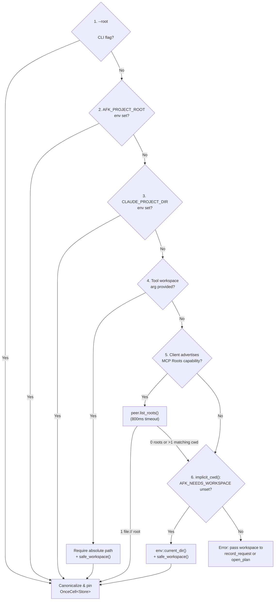
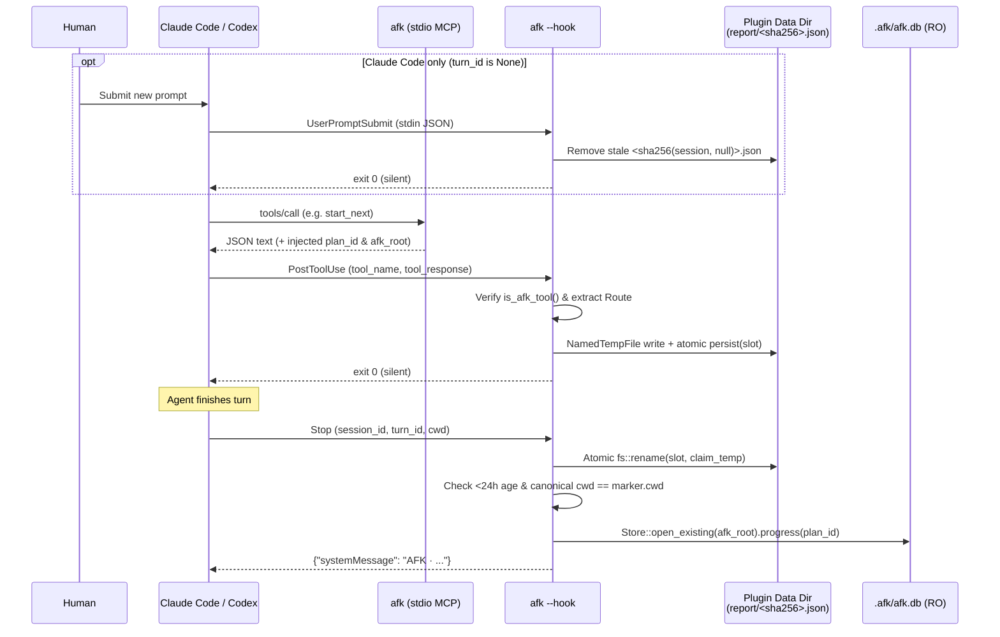

# Hooks, roots, and security

AFK ships as a single native executable (`afk`) that speaks MCP over stdio during agent turns and runs as a sub-10ms ephemeral CLI (`afk --hook`) during client lifecycle hooks. This page covers how `crates/mcp/` resolves and pins workspaces, routes turn-scoped progress reports without polluting model context, adapts to Claude Code and Codex plugin differences, and enforces local filesystem security boundaries.

## Dual-mode binary entrypoint (`main.rs`)

`crates/mcp/src/main.rs` inspects `std::env::args_os()` before initializing any runtime resources:

| Invocation | Runtime path | Database access | Purpose |
| --- | --- | --- | --- |
| `afk` | Single-threaded Tokio (`current_thread`) + `rmcp::transport::stdio()` | Read/write (`Store::initialize`) | Serves the 6 AFK MCP tools; resolves project root from env, tool `workspace`, MCP Roots, or `cwd`. |
| `afk --root <dir>` | Single-threaded Tokio (`current_thread`) + `rmcp::transport::stdio()` | Read/write (`Store::initialize`) | Eagerly binds and initializes `<dir>/.afk` in `initialize_explicit_root()` before accepting JSON-RPC traffic. |
| `afk --hook` | Synchronous `hook::run()` (exits immediately) | Read-only (`Store::open_existing` on `Stop` only) | Consumes client hook JSON from `stdin` and optionally prints `{"systemMessage": "..."}` on `stdout`. |

Any other CLI flag or extra positional argument fails fast with exit code `1`.

## 6-step project root resolution (`server.rs`)

Coding agents launch MCP servers in wildly different working directories—sometimes inside the user's repository, sometimes in `$HOME`, and sometimes (as in packaged Codex plugins) inside an immutable plugin cache directory. `Server::new` and `Server::initialize_store` resolve the project root using a strict 6-step priority chain:



### Detailed resolution rules

1. **`--root <directory>` CLI flag**: Highest priority. Resolved in `Server::new` and initialized eagerly in `initialize_explicit_root()` before stdio serving starts.
2. **`AFK_PROJECT_ROOT` environment variable**: Explicit user/client override when non-empty.
3. **`CLAUDE_PROJECT_DIR` environment variable**: Automatically populated by Claude Code when spawning plugin MCP servers.
4. **Explicit tool `workspace` parameter**: Accepted by `record_request` and `open_plan` (`Intake.workspace` and `Inspect.workspace`). Must be an **absolute** path (`path.is_absolute()`) and pass `safe_workspace(path.canonicalize()?)`.
5. **MCP `roots/list` negotiation (`peer.list_roots()`)**: Queried when the client advertises `capabilities.roots` during `initialize`, bounded by a strict **800 ms timeout** (`Duration::from_millis(800)`) so non-responsive clients never hang tool calls:
   - **Single root (`[root]`)**: Parsed via `url::Url::parse` and converted to a local filesystem path (`to_file_path()`).
   - **Empty list (`[]`)**: Falls through to `implicit_cwd()`.
   - **Multiple roots**: Resolves `implicit_cwd()` and verifies that at least one advertised root canonicalizes to `cwd`; otherwise returns `"multiple MCP roots; configure AFK_PROJECT_ROOT"`.
6. **Launch working directory (`implicit_cwd()`)**:
   - First checks `env::var_os("AFK_NEEDS_WORKSPACE").is_none()`. When `AFK_NEEDS_WORKSPACE=1` is set (as in `plugins/codex/.mcp.json` or global multi-project configs), `implicit_cwd()` refuses to guess and instructs the agent: `"provide the current project directory as workspace to record_request or open_plan"`.
   - Otherwise canonicalizes `env::current_dir()?` and validates it with `safe_workspace()`.

### Unsafe workspace rejection (`safe_workspace`)

To prevent AFK from accidentally creating `.afk/` in a user's home directory, filesystem root, or plugin installation folder, `safe_workspace(cwd)` rejects `cwd` whenever any of the following hold:
- `cwd.parent().is_none()` (filesystem root `/` or Windows drive root).
- `cwd` matches canonicalized `$HOME` or `%USERPROFILE%`.
- `cwd` is equal to or nested inside canonicalized `$PLUGIN_ROOT` or `$CLAUDE_PLUGIN_ROOT` (`cwd.starts_with(root)`).

### Per-process root pinning and UUID worker identity

Each `Server` instance holds two session-lifetime fields:

- **`store: Arc<OnceCell<Store>>`**: Once the first resolution initializes `Store`, that canonical root is pinned for the lifetime of the `afk` MCP server process. Note that `on_initialized` also spawns a background pre-initialization attempt when `AFK_NEEDS_WORKSPACE` is unset. If a later `record_request` or `open_plan` call supplies a `workspace` whose canonical path differs from `store.root()`, `Server::store` rejects it:
  `"AFK is already bound to <path>; start a new MCP session for another workspace"`.
- **`worker: String` (`Uuid::new_v4()`)**: Generated fresh on process startup. Passed as `owner` to `Store::start_next` and `Store::finish_task`, allowing AFK to distinguish idempotent same-session resumes from cross-session collisions that require explicit `take_over: true` (see [Architecture and storage](architecture.md)).

## Native hook architecture (`hook.rs`)

At the end of an agent turn that used AFK, users want a concise status summary (`AFK · Title [Doing] · 1/3 complete...`) without asking the model to spend tokens narrating routine bookkeeping—and without hearing noise on ordinary coding turns that never touched AFK.

`crates/mcp/src/server.rs` and `crates/mcp/src/hook.rs` coordinate through short-lived, turn-scoped route markers stored inside the client's plugin data directory.



### Step-by-step routing mechanics

1. **Route metadata injection (`server.rs`)**:
   Whenever any of the 6 MCP tools succeeds and returns a JSON object associated with a `plan_id` (either passed in tool arguments or returned in the payload, as in `record_request`), `Server::run` injects two routing keys into the top-level serialized JSON object:
   ```json
   {
     "plan_id": 1,
     "afk_root": "/Users/alice/my-repo"
   }
   ```
   (Note: calling `open_plan` with `plan_id: null` lists recent plans without targeting a single plan, so no `plan_id` or `afk_root` is injected and no Stop banner is triggered.)

2. **Plugin data directory selection**:
   `hook::run()` locates its scratch directory from the first non-empty environment variable in `["AFK_HOOK_DIR", "PLUGIN_DATA", "CLAUDE_PLUGIN_DATA"]` and appends `/report`.

3. **Two-layer tool filtering (`hooks.json` + `is_afk_tool`)**:
   - **Client-side filter**: Both `hooks/hooks.json` manifests set `"matcher": "mcp__.*afk__(record_request|open_plan|update_plan|update_question|start_next|finish_task)"` on `PostToolUse`, so the client does not even spawn `afk --hook` for file edits or shell commands.
   - **Binary-side filter (`is_afk_tool`)**: `hook.rs` strips `"mcp__"`, splits on the rightmost `"__"`, requires `server == "afk" || server.ends_with("_afk") || server.ends_with("-afk")` (matching both bare `mcp__afk__start_next` and plugin-namespaced `mcp__plugin_agent-flow-kit_afk__start_next`), and verifies the tool name is one of AFK's six tools.

4. **Envelope-agnostic JSON extraction (`route(value, depth)`)**:
   Different clients wrap `tool_response` differently in `PostToolUse` payloads—Codex passes an object (`{"content": [{"type": "text", "text": "{...}"}], "isError": false}`), while Claude Code may pass a content block array directly or `structuredContent`. `route(value, depth)` recursively inspects objects (skipping any object with `"isError": true`), arrays, known wrapper keys (`structuredContent`, `content`, `text`, `result`, `output`), and JSON-encoded strings up to **`depth <= 6`**, returning `Route { plan_id, afk_root }` only when `plan_id > 0` and `afk_root.is_absolute()`.

5. **Session and turn slot hashing**:
   `handle()` computes the marker filename from the tuple `(&event.session_id, &event.turn_id)`:
   ```rust
   let key = serde_json::to_vec(&(&event.session_id, &event.turn_id))?;
   let slot = base.join(format!("{:x}.json", Sha256::digest(key)));
   ```
   - **Codex** populates a distinct `turn_id` on every turn, automatically isolating each turn into its own `<sha256>.json` file.
   - **Claude Code** leaves `turn_id` unset (`None`). To prevent an unconsumed marker (for instance, from an interrupted turn) from leaking into a subsequent non-AFK turn, `plugins/claude-code/hooks/hooks.json` binds `UserPromptSubmit`, which removes `slot` whenever `event.turn_id.is_none()`.

6. **Atomic write and single-delivery `Stop` claim**:
   - On `PostToolUse`, `Marker { cwd: event.cwd.canonicalize()?, route }` is written to a `tempfile::NamedTempFile::new_in(base)`, flushed, and atomically persisted over `slot` (so multiple AFK tool calls in one turn cleanly update the marker to the latest plan touched).
   - On `Stop` (provided `!event.stop_hook_active && slot.is_file()`), `hook.rs` creates a fresh temporary path in `base` (`into_temp_path()`) and calls `fs::rename(slot, &claim)?`. Because `rename` on the same filesystem is atomic, if a client fires duplicate or concurrent `Stop` hooks, **exactly one process claims the file** (`TempPath` automatically unlinks the claimed file on drop), and every subsequent `Stop` sees `slot.is_file() == false` and stays silent.

7. **Validation and read-only progress queries**:
   - Rejects markers older than **24 hours** (`Duration::from_secs(24 * 3600)`), caps marker reads at **`8,192` bytes**, and requires `event.cwd.canonicalize()? == marker.cwd`.
   - Calls `Store::open_existing(&marker.route.afk_root)?.progress(marker.route.plan_id)?`—opening `.afk/afk.db` strictly `SQLITE_OPEN_READ_ONLY` with a `100 ms` `busy_timeout`.
   - Formats the two-line `AFK · <title> [<Status>] · ...` banner and prints `{"systemMessage": message}`.
   - The hook reports progress to the user through `systemMessage`.
   - **Fail-open**: Any `Err` in `hook::run()` is silently discarded (`exit 0`, zero `stdout`, zero `stderr`), guaranteeing a locked database or missing directory never interrupts the user's coding agent.

## Claude Code vs. Codex plugin manifests

Although both packages share the exact same `run` script, `afk` binary, and `skills/afk/SKILL.md`, their client manifests under `plugins/claude-code/` and `plugins/codex/` adapt to subtle host differences verified against Claude Code `2.1.331` and Codex `0.171.0`:

| Aspect | Claude Code (`plugins/claude-code/`) | Codex (`plugins/codex/`) |
| --- | --- | --- |
| **Plugin manifest** | `.claude-plugin/plugin.json` — Minimal `name`, `version`, `description`; Claude Code auto-discovers `.mcp.json`, `hooks/hooks.json`, and `skills/`. | `.codex-plugin/plugin.json` — Uses the **compatibility manifest** explicitly declaring `"skills": "./skills/"`, `"hooks": "./hooks/hooks.json"`, `"mcpServers": "./.mcp.json"`, and `"interface"` metadata. (On Codex `0.171.0`, the portable manifest exposed MCP tools but omitted lifecycle hooks from `hooks/list`.) |
| **MCP server launch (`.mcp.json`)** | Runs `/bin/sh` with `["${CLAUDE_PLUGIN_ROOT}/run"]`; Claude Code supplies `CLAUDE_PROJECT_DIR` so root binding succeeds immediately. | Runs `"./run"` with `"cwd": "."` (the plugin directory inside the plugin cache) and `"env": {"AFK_NEEDS_WORKSPACE": "1"}`. Prevents `.afk/` creation inside the plugin cache and forces first-call `workspace` binding. |
| **Hook environment vars** | `${CLAUDE_PLUGIN_ROOT}` for binary path; `CLAUDE_PLUGIN_DATA` for `report/` markers. | `${PLUGIN_ROOT}` for binary path; `PLUGIN_DATA` for `report/` markers. |
| **Registered hook events** | `PostToolUse`, `Stop`, and `UserPromptSubmit` (clears turnless `(session_id, null)` slots on new prompts). All use `"timeout": 1`. | `PostToolUse` and `Stop` (`"timeout": 1`). `UserPromptSubmit` is unneeded because Codex supplies a unique `turn_id` per turn. |
| **Distribution & UI surface** | Loaded directly via `claude --plugin-dir`; displays `Stop` `systemMessage` as an informational banner. | Staged with `.agents/plugins/marketplace.json` (`afk-local`); requires trusting the two plugin hooks; displays `Stop` report in interactive TUI and `app-server` (`hook/completed`), though `codex exec --json` omits hook reports in its JSON stream. |

## Security model

AFK operates inside local repositories that may contain untrusted test fixtures, symlinks, or adversarial filenames. Every filesystem and protocol boundary enforces defense-in-depth checks:

| Threat / Boundary | Enforcement in AFK | Code location |
| --- | --- | --- |
| **Symlink traversal on `.afk/` or Markdown files** | `check_path` inspects `fs::symlink_metadata` on `.afk/`, collection directories, `afk.db` / `-journal` / `-wal` / `-shm`, and every `.md` path, rejecting symlinks (`is_symlink()` on Unix; reparse point attribute `0x400` on Windows). | `crates/core/src/lib.rs` (`check_path`, `is_link`, `connect`) |
| **TOCTOU symlink races & FIFO/device hangs** | SQLite opens pass `OpenFlags::SQLITE_OPEN_NOFOLLOW`. Markdown writes pass `create_new(true)` (`O_EXCL`) + `libc::O_NOFOLLOW`. Markdown reads pass `libc::O_NOFOLLOW \| libc::O_NONBLOCK` and verify `file.metadata()?.is_file()` on the opened file descriptor. | `crates/core/src/lib.rs`, `crates/core/src/documents.rs` |
| **Local multi-user file exposure** | `.afk/` and its subdirectories are created with `DirBuilderExt::mode(0o700)` (`rwx------`). Markdown templates and `NamedTempFile` hook markers are created with `mode(0o600)` (`rw-------`). | `crates/core/src/lib.rs`, `crates/core/src/documents.rs`, `crates/mcp/src/hook.rs` |
| **Clobbering unreferenced or backup files** | `require_unowned_path_available` aborts ID reservation if any file or symlink already exists at the target path; `Store::initialize` aborts if `user_version == 0` while `.md` files exist. | `crates/core/src/lib.rs`, `crates/core/src/documents.rs` |
| **Accidental root creation outside a project** | `safe_workspace` rejects `/`, `$HOME`, `%USERPROFILE%`, `$PLUGIN_ROOT`, and `$CLAUDE_PLUGIN_ROOT`; `AFK_NEEDS_WORKSPACE` disables launch-`cwd` fallback. | `crates/mcp/src/server.rs` |
| **Memory exhaustion from oversized files or hook payloads** | Markdown reads cap at **`1 MiB`** (`MAX_DOCUMENT_BYTES = 1,048,576` via `file.take(MAX + 1)`). Hook `stdin` caps at **`1 MiB`**, claimed marker reads cap at **`8 KiB`**, and `route()` JSON recursion caps at **`depth <= 6`**. | `crates/core/src/documents.rs`, `crates/mcp/src/hook.rs` |
| **Malformed or unbounded tool parameters** | All 6 MCP input structs set `#[serde(deny_unknown_fields)]`. Drafts cap at `32` added/removed tasks and `32` prerequisites per task; acceptance lists cap at `1..=64` bullets; `receipt` keys require `1..=100` bytes; plain titles strip control characters and cap at `100` chars. | `crates/mcp/src/server.rs`, `crates/core/src/plan.rs`, `crates/core/src/documents.rs` |

## Next steps

- [Verification and benchmarks](verification.md) — See how symlink rejection, `BEGIN EXCLUSIVE` hook lock contention, root binding, and turn isolation are tested automatically.
- [MCP tools reference](../reference/mcp-tools.md) — Inspect the exact JSON schemas and `workspace` rules exposed to agents.
