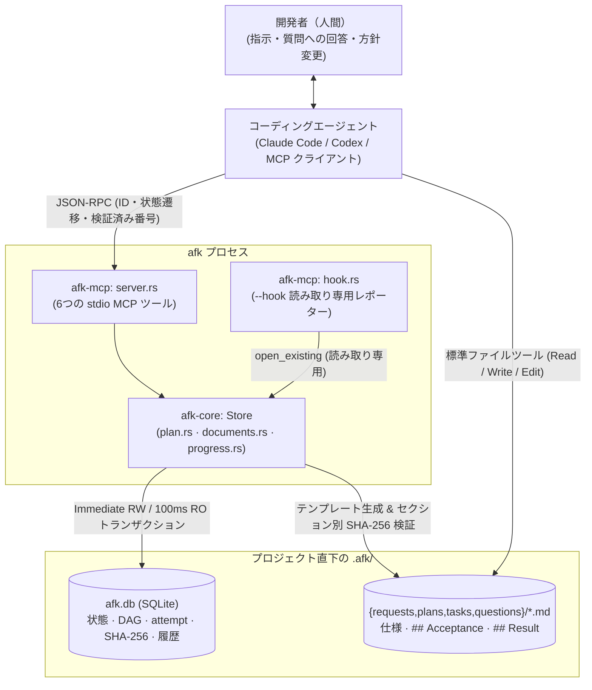
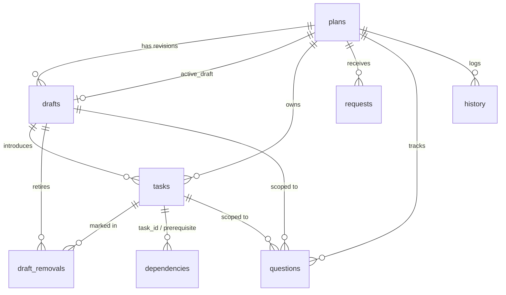

# アーキテクチャとデータ構造

AFK の中核にあるのは、**「状態と不変条件は SQLite が持ち、人間とエージェントが読む本文（散文）は Markdown ファイルが持つ」**という明確な責務分離です。両者の境界は SHA-256 ハッシュによって封印（シール）され、一度確定した仕様や回答が気づかないうちに書き換えられることを防ぎます。



## なぜ状態（SQLite）と本文（Markdown）を分けるのか？

すべてを Markdown のチェックリストだけで管理する方式も、すべてを SQLite のカラムに詰め込む方式も、実際のマルチステップ開発では破綻しやすくなります。

- **Markdown だけではアトミックな不変条件を守れない**: プレーンテキストだけでは、タスク依存関係の循環防止、作業途中に追加要望が入った際の開始・完了ブロック、複数ワーカーによる同時タスク取得の排他制御、完了直前の受け入れ条件の勝手な書き換え防止を強制できません。
- **SQLite だけではモデルのツール呼び出しが肥大化し、可読性も失われる**: 数キロバイトに及ぶ仕様書や受け入れ条件、テスト結果ログを JSON-RPC の引数に乗せると、モデルが全文を JSON エスケープして出力する必要があり、出力トークンを浪費するうえ、`git diff` やエディタ・`rg` で直接確認できなくなります。

AFK はそれぞれの強みに合わせて役割を分担しています。

| 関心事 | 管理主体 | 実現メカニズム |
| --- | --- | --- |
| 状態遷移、依存 DAG、ワーカーリース、監査ログ | `.afk/afk.db` (SQLite) | 外部キー・`CHECK` 制約、部分ユニークインデックス、`BEGIN IMMEDIATE` トランザクション、`attempt` カウンタ。 |
| 依頼文、プラン仕様、タスク仕様、質問、回答、完了証跡 | `.afk/**/*.md` (Markdown) | エージェント標準のファイルツール（`Write`、`Edit`、`Read`）で直接読み書き。1ファイル上限 `1 MiB`（`MAX_DOCUMENT_BYTES`）。 |
| 状態と本文を結ぶ改ざん検知境界 | `crates/core/src/documents.rs` | コードフェンスを考慮した見出し分割（`split_section`）と `Sha256::digest(text.trim_end().as_bytes())` による SQLite 側のハッシュ保持（`spec_hash`、`final_hash`、`digest`、`prompt_digest`、`answer_digest`）。 |

### セクション分割とハッシュ封印の仕組み（`documents.rs`）

下の例はプラン用の `WORK_TEMPLATE` です。タスク用の `TASK_TEMPLATE` には実行履歴欄もあります。質問には `QUESTION_TEMPLATE` を使います。

```markdown
# 簡潔なプレーンタイトル

作業スコープと詳細。

## Acceptance

- 検証可能な受け入れ条件 1
- 検証可能な受け入れ条件 2

## Result
```

`Store::read_work` や `Store::read_question` がファイルを検証する際、以下の処理を順に実行します。

1. **コードフェンス対応のセクション分割（`split_section`）**: 3連以上のバッククォート（```` ``` ````）やチルダ（`~~~`）の開閉を追跡しながら行を走査します。そのため、コードブロック内のサンプルとして書かれた `## Result` や `## Acceptance` を構造上の見出しと誤認しません。また、同名の見出しが2回以上登場した場合はエラー（`duplicate ## ... heading`）として拒否します。
2. **プレーンタイトルの抽出（`plain_title::first_line_plain`）**: 先頭の見出し記号・引用・リスト記号（`#`、`>`、`- `、`1. `）、リンク `[text](url)` や画像 ``、強調・インラインコード・取り消し線を除去しつつ、`snake_case` のアンダースコアや `2 * 3` のアスタリスクはそのまま残し、制御文字を除いて最大 `100` 文字に切り詰めます。
3. **受け入れ条件（`## Acceptance`）のカウント**: プランおよびタスクでは、`## Acceptance` 直下から次の `## ` 見出しまでの間にある非空の `- ` 箇条書き行を数え、`1..=64` 個（`MAX_CRITERIA`）であることを強制します。
4. **前後独立の SHA-256 ダイジェスト**: `## Result`（質問では `## Answer`）より**前**の仕様領域を `spec_hash`（質問では `prompt_digest`）としてハッシュ化し、見出しより**後ろ**に追記された非空テキストを `final_hash`（質問では `answer_digest`）としてハッシュ化します。仕様ハッシュに `## Result` 以降が含まれないため、確定後に `## Result` へ検証結果だけを追記しても `spec_hash` は一致します。確定した仕様や完了条件が変われば `check_work` が検知します。AFK が生成する実行履歴欄は、どちらのハッシュからも除きます。

エージェントが呼び出す6つの MCP ツールの仕様については [MCP ツールリファレンス](../reference/mcp-tools.md) を参照してください。

## `.afk/` のディレクトリ構成とプロジェクトの可搬性（Relocatability）

プロジェクトを初期化すると、ルート直下に `.afk/`（Unix ではパーミッション `0700`）と4つのサブディレクトリ（`plans`、`tasks`、`requests`、`questions`）、および `afk.db` が作成されます。

```text
<project-root>/.afk/
├── afk.db                   # SQLite データベース (PRAGMA user_version = 2)
├── requests/001.md          # 人間からの依頼内容 (# Title + 本文)
├── plans/001-r001.md        # Plan #1 / Draft #1 の仕様と ## Result
├── plans/001-r002.md        # Plan #1 / Draft #2 (リビジョンごとに別ファイル)
├── tasks/001.md             # タスク単位の不変 ID ドキュメントと ## Result
└── questions/001.md         # 確認質問プロンプトと ## Answer
```

**SQLite 内には絶対パスを一切保存しません。** `schema.sql` のすべての `path` 列は `.afk/` からの相対パス（`plans/001-r001.md` や `tasks/001.md`）として生成され、実行時に `Store::document` / `Store::plan_document` がその時点の正規化済み `<root>/.afk`（`self.base`）と結合して絶対パスを返します。

そのため、プロジェクトの移動・リネーム・バックアップは以下の手順だけで完了し、DB 内のパス書き換えは不要です。
1. 対象プロジェクトを開いている `afk` プロセスを終了する。
2. プロジェクトディレクトリ（または `.afk/` 丸ごと）を別の場所へ移動・コピーする。
3. 新しい場所でセッションを再開すると、返却されるすべてのパスが新しいルート配下に自動追従する。

> [!IMPORTANT]
> `Store::initialize` は DB が未初期化（`PRAGMA user_version == 0`）のとき、`schema.sql` を流し込む前に `plans/`・`tasks/`・`requests/`・`questions/` がすべて空であることを確認します。もし `afk.db` だけが消えて Markdown ファイルが残っている場合、ID が1番からリセットされて既存ファイルを上書き破壊しないよう、初期化を安全に中断します。

## SQLite スキーマ詳解（`schema.sql`）

`schema.sql` は基本の8テーブルを定義します。`execution.sql` は実行回ごとのクライアント名とモデル名を保持する `task_runs` と、最新の引き継ぎメモを保持する `handoffs` を追加し、スキーマをバージョン2に更新します。初期化時にはバージョン1から自動で移行します。すべての接続で外部キー制約が有効です。



### 1. `plans` — プラン全体の状態と確定仕様ハッシュ

| カラム | 型・制約 | 役割 |
| --- | --- | --- |
| `id` | `INTEGER PRIMARY KEY AUTOINCREMENT` | 不変のプラン ID（`1`, `2`, ...）。 |
| `status` | `TEXT NOT NULL DEFAULT 'backlog' CHECK(...)` | カンバン状態：`'backlog'`、`'todo'`、`'doing'`、`'done'`。 |
| `revision` | `INTEGER NOT NULL DEFAULT 0` | 確定済みリビジョン番号（初回コミット前は `0`、`commit_plan` のたびに `+1`）。 |
| `active_draft` | `INTEGER REFERENCES drafts(id)` | 現在有効な確定済み `drafts.id`（`revision == 0` の間は `NULL`）。有効なプランファイル `plans/{id:03}-r{active_draft:03}.md` を指す。 |
| `title` | `TEXT` | 確定プラン Markdown から抽出したプレーンタイトル（未確定時は `Plan #<id>` にフォールバック）。 |
| `spec_hash` | `TEXT` | 確定プランの `## Result` より前の SHA-256 ハッシュ。 |
| `final_hash` | `TEXT` | `finish_plan` 完了時に記録される `## Result` の SHA-256 ハッシュ（新リビジョンで再開された場合は `NULL` にリセット）。 |
| `criteria` | `INTEGER NOT NULL DEFAULT 0` | `## Acceptance` 配下の `- ` 箇条書き数（確定時は `1..=64`）。 |

### 2. `drafts` — プラン改訂ドラフト

| カラム | 型・制約 | 役割 |
| --- | --- | --- |
| `id` | `INTEGER PRIMARY KEY AUTOINCREMENT` | 全プランを通じた単調増加のドラフト ID。 |
| `plan_id` | `INTEGER NOT NULL REFERENCES plans(id)` | 所属プラン ID。 |
| `base_revision` | `INTEGER NOT NULL` | `prepare_plan` 時点での `plans.revision`。並行変更による古いドラフトの誤コミットを防止する。 |
| `path` | `TEXT GENERATED ALWAYS AS (printf('plans/%03lld-r%03lld.md', plan_id, id)) STORED` | `.afk/` 内の相対パス。ドラフトごとに固有ファイルとなるため、破棄・旧版化したプランファイルも証跡として残る。 |
| `state` | `TEXT NOT NULL DEFAULT 'open' CHECK(...)` | `'open'`（編集中）、`'accepted'`（確定済み）、`'discarded'`（破棄済み）。 |

- **部分ユニークインデックス `one_draft`**:
  ```sql
  CREATE UNIQUE INDEX one_draft ON drafts(plan_id) WHERE state='open';
  ```
  過去の `'accepted'` や `'discarded'` レコードを無制限に保持しつつ、**1つのプランにつき同時に開ける `'open'` ドラフトは最大1件**であることを DB レベルで保証します。

### 3. `tasks` — 個別作業単位とワーカーリース

| カラム | 型・制約 | 役割 |
| --- | --- | --- |
| `id` | `INTEGER PRIMARY KEY AUTOINCREMENT` | 不変のタスク ID。リビジョンをまたいでも作成順の順序性を保つ。 |
| `plan_id` | `INTEGER NOT NULL REFERENCES plans(id)` | 所属プラン ID。 |
| `draft_id` | `INTEGER NOT NULL REFERENCES drafts(id)` | このタスクを最初に導入したドラフト ID。 |
| `path` | `TEXT GENERATED ALWAYS AS (printf('tasks/%03lld.md', id)) STORED` | `.afk/` 内の相対パス。 |
| `lifecycle` | `TEXT NOT NULL DEFAULT 'draft' CHECK(...)` | `'draft'`（未確定）、`'active'`（現在の確定プランで有効）、`'retired'`（リプランにより退役）。 |
| `status` | `TEXT NOT NULL DEFAULT 'backlog' CHECK(...)` | `'backlog'`、`'todo'`、`'doing'`、`'done'`。 |
| `title` | `TEXT` | ドラフト確定時に抽出されたプレーンタイトル。 |
| `spec_hash` | `TEXT` | `## Result` より前のタスク仕様 SHA-256 ハッシュ。 |
| `final_hash` | `TEXT` | `finish_task` 完了時に封印された `## Result` の SHA-256 ハッシュ。 |
| `criteria` | `INTEGER NOT NULL DEFAULT 0` | `## Acceptance` の箇条書き数（`1..=64`）。 |
| `attempt` | `INTEGER NOT NULL DEFAULT 0` | 新規開始または `take_over` のたびに `+1` される単調増加リース番号。 |
| `owner` | `TEXT` | 現在 `'doing'` リースを保持している MCP サーバープロセスの UUID v4（未着手・退役時は `NULL`）。 |

- **複合インデックス**: `CREATE INDEX task_plan ON tasks(plan_id, lifecycle, status, id);` により進捗集計と実行候補検索を高速化します。
- **部分ユニークインデックス `one_running`**:
  ```sql
  CREATE UNIQUE INDEX one_running ON tasks(plan_id) WHERE lifecycle='active' AND status='doing';
  ```
  **1プランにつき同時に `'doing'` になれる `'active'` タスクは最大1件**という単一実行ルールを DB エンジンで強制します（退役した `'retired'` タスクは対象外）。

### 4. `dependencies` — 非巡回（DAG）を保証する前提タスク関係

| カラム | 型・制約 | 役割 |
| --- | --- | --- |
| `task_id` | `INTEGER NOT NULL REFERENCES tasks(id)` | 前提完了を待つ後続タスク ID。 |
| `prerequisite` | `INTEGER NOT NULL REFERENCES tasks(id)` | 先に `'active'` かつ `'done'` である必要がある前提タスク ID。 |

- **主キーと DAG 制約**:
  ```sql
  PRIMARY KEY(task_id, prerequisite),
  CHECK(task_id > prerequisite)
  ```
  なぜ `CHECK(task_id > prerequisite)` の1行だけで、再帰クエリによる閉路検出なしに **有向非巡回グラフ（DAG）** が完全に保証されるのでしょうか？ `tasks.id` が単調増加する `AUTOINCREMENT` だからです。
  - 前リビジョンから引き継いだ既存 `'active'` タスクは、今回新規追加されるタスクより必ず小さい ID を持ちます。
  - `prepare_plan` 内で同時追加される新タスク同士も先頭から順に INSERT され、負数参照（`-1`, `-2`, ...）はスライス内の*より前に追加された新タスク*（`added[index]`）しか指せません。
  したがって有効な依存辺は常に「大きい ID から小さい ID」への厳密な全順序となり、自己ループや循環依存は構造上発生し得ません。

### 5. `draft_removals` — ドラフトで退役予定のタスク

| カラム | 型・制約 | 役割 |
| --- | --- | --- |
| `draft_id` | `INTEGER NOT NULL REFERENCES drafts(id)` | 削除を提案している `'open'` ドラフト ID。 |
| `task_id` | `INTEGER NOT NULL REFERENCES tasks(id)` | コミット時に退役（`'retired'`）させる未完了 `'active'` タスク ID。 |

複合主キー `PRIMARY KEY(draft_id, task_id)` を持ちます。完了済み（`status = 'done'`）のタスクは削除対象に指定できず、完了証跡として常に保持されます。

### 6. `requests` — 人間からの依頼と冪等性レシート

| カラム | 型・制約 | 役割 |
| --- | --- | --- |
| `id` | `INTEGER PRIMARY KEY AUTOINCREMENT` | 依頼 ID。 |
| `plan_id` | `INTEGER NOT NULL REFERENCES plans(id)` | 対象プラン ID（`source_plan` が `None` の場合は新規採番されたプラン）。 |
| `receipt` | `TEXT UNIQUE` | 任意の冪等キー（`1..=100` bytes）。通信リトライ時に重複レコードが作られるのを防ぐ。 |
| `path` | `TEXT GENERATED ALWAYS AS (printf('requests/%03lld.md', id)) STORED` | `.afk/` 内の相対パス。 |
| `source_plan` | `INTEGER` | 受付時に渡された元の `plan_id` 引数（新規作成なら `NULL`、追加依頼なら `Some(id)`）。同じ `receipt` で再送された際の整合性チェックに使用。 |
| `applied_revision` | `INTEGER` | この依頼を反映したプランリビジョン番号（未反映の間は `NULL`）。 |
| `digest` | `TEXT` | `commit_plan` 適用時に封印された依頼 Markdown の SHA-256 ハッシュ。 |

`request_plan(plan_id, applied_revision, id)` インデックスにより、`applied_revision IS NULL` の未反映依頼を高速に抽出します。

### 7. `questions` — 確認質問と封印された人間の回答

| カラム | 型・制約 | 役割 |
| --- | --- | --- |
| `id` | `INTEGER PRIMARY KEY AUTOINCREMENT` | 質問 ID。 |
| `plan_id` | `INTEGER NOT NULL REFERENCES plans(id)` | 所属プラン ID。 |
| `task_id` | `INTEGER REFERENCES tasks(id)` | 任意の紐付け先：未完了の `'active'` タスク（`task_id` と `draft_id` の同時指定は不可）。 |
| `draft_id` | `INTEGER REFERENCES drafts(id)` | 任意の紐付け先：`'open'` ドラフト。 |
| `path` | `TEXT GENERATED ALWAYS AS (printf('questions/%03lld.md', id)) STORED` | `.afk/` 内の相対パス。 |
| `title` | `TEXT` | `publish_question` 時に抽出された質問タイトル。 |
| `prompt_digest` | `TEXT` | `## Answer` より前の質問プロンプト SHA-256 ハッシュ（公開前は `NULL`）。 |
| `answer_digest` | `TEXT` | `answer_question` 時に封印された `## Answer` 本文の SHA-256 ハッシュ（未回答時は `NULL`）。 |
| `applied_revision` | `INTEGER` | この回答を反映したプランリビジョン番号（`commit_plan` 反映前は `NULL`）。 |

`question_plan(plan_id, applied_revision, id)` でインデックス化されています。公開後の質問文変更や、封印後の回答上書きはハッシュ不一致で拒否され、回答を訂正したい場合は履歴保全のため新しい質問レコードを作成します。

### 8. `history` — 追記専用のイベント・検証履歴

| カラム | 型・制約 | 役割 |
| --- | --- | --- |
| `id` | `INTEGER PRIMARY KEY` | 自動採番シーケンス。 |
| `plan_id` | `INTEGER NOT NULL REFERENCES plans(id)` | 対象プラン ID。 |
| `event` | `TEXT NOT NULL` | イベント種別名（下記一覧）。 |
| `entity_id` | `INTEGER NOT NULL` | 対象の依頼・ドラフト・質問・タスク・プランの ID。 |
| `acceptance_checked` | `INTEGER` | 検証された `## Acceptance` 項目数（`task_completed` と `plan_completed` のみ記録、他は `None`）。 |
| `at` | `INTEGER NOT NULL DEFAULT (unixepoch())` | UTC Unix タイムスタンプ（秒）。 |

記録される全14種のイベント名：
- 依頼・プラン系：`request_received`、`request_applied`、`draft_prepared`、`draft_discarded`、`plan_confirmed`、`execution_authorized`、`plan_completed`
- 質問・回答系：`question_prepared`、`question_asked`、`question_answered`、`answer_applied`
- タスク実行系：`task_started`、`task_resumed`、`task_completed`

## トランザクション設計・`busy_timeout`・2段階ファイル予約

`Store::connect`（`crates/core/src/lib.rs`）は、書き込み側と読み取り側でロック戦略を非対称に設定しています。

| ヘルパー | オープンフラグ | トランザクション種別 | `busy_timeout` | 設計理由 |
| --- | --- | --- | --- | --- |
| `Store::write` | `SQLITE_OPEN_READ_WRITE \| SQLITE_OPEN_NOFOLLOW` | `TransactionBehavior::Immediate` (`BEGIN IMMEDIATE`) | **3 秒** | 事前条件の `SELECT` を実行する**前**に書き込み予約ロックを獲得することで、2つのワーカーが競合した際の共有ロック→排他ロック昇格デッドロック（即座の `SQLITE_BUSY`）を防ぎ、最大3秒間シリアライズ待機させる。 |
| `Store::read` | `SQLITE_OPEN_READ_ONLY \| SQLITE_OPEN_NOFOLLOW` | 通常の読み取りトランザクション | **100 ミリ秒** | `open_plan` や `Stop` Hook に一貫したスナップショットを提供しつつ、書き込みロック競合時にもクライアントの1秒 Hook タイムアウトより十分早くフェイルオープンさせる。 |

### 2段階の ID 予約とクラッシュ復旧

ファイルシステム上のファイル生成は SQLite のロールバックに含められないため、AFK のドキュメント作成（`record_request`、`prepare_question`、`prepare_plan`）は必ず以下の2段階で実行されます。

1. **`Store::write`（`BEGIN IMMEDIATE`）内**: レコードを INSERT して ID を確定させ、`require_unowned_path_available` で対象パスに未管理ファイルが存在しないこと（`NotFound`）を確認し、`history` を書いて SQLite をコミットします。
2. **トランザクションコミット後（`prepare_file`）**: 各パスに対して `create_new(true)`（`O_CREAT | O_EXCL`）、`mode(0o600)`、`O_NOFOLLOW` で初期テンプレートを書き込みます。すでにファイルが存在する場合（`recover_draft` 実行時に一部ファイルだけ書き込み済みだった場合など）は、`check_path` で安全な通常ファイルであることだけを確認し、既存の内容をそのまま保護します。

万が一ステップ1とステップ2の間でプロセスが強制終了しても、`open_plan` で開いているドラフトを確認し、`update_plan` の `recover`（`Store::recover_draft`）を呼べば、編集済みファイルを壊さずに欠損テンプレートだけを再生成できます。また `open_plan` に `check_files: true` を渡すと、`Store::orphan_documents` が4つのサブディレクトリを走査し、DB から参照されていない `.md` ファイルをソート順で最大 `32` 件返します。

## `Progress` と `NextAction` の優先度判定（`progress.rs`）

状態を更新する MCP ツールおよび `Stop` Hook は、`Store::snapshot(tx, plan_id)` を呼んで進捗スナップショット（`Progress`）と次に取るべき単一の行動（`NextAction`）を算出します。ブロッカーはタスク実行よりも常に優先され、上から順に判定されます。

| 優先度 | SQLite 上の判定条件 | 返却される `NextAction` | 下位より優先される理由 |
| --- | --- | --- | --- |
| **1** | 公開済みかつ未回答の質問がある（`prompt_digest IS NOT NULL AND answer_digest IS NULL`） | `wait_for_answer { id, title, count }` | 人間の判断待ちであり、回答なしに先へ進んではならないため。 |
| **2** | 未公開の下書き質問がある（`prompt_digest IS NULL`） | `prepare_question { id }` | 予約した質問ファイルの執筆・公開を先に完了させる必要があるため。 |
| **3** | 未反映の依頼または回答がある（`requests` / `questions` に `applied_revision IS NULL` が存在） | `replan { requests, answers }` | 追加要望や確定した回答を新しいプラン改訂へ反映してから作業を再開するため。 |
| **4** | `'open'` 状態のドラフトがある | `confirm_draft { id }` | 準備中のプラン・タスク仕様を書き上げてコミットする必要があるため。 |
| **5** | `plans.status == 'done'` | `complete` | 全タスクおよびプラン全体の受け入れ検証が完了済み。 |
| **6** | `plans.status == 'backlog'` かつ `revision == 0` | `prepare_plan` | 初回ドラフト作成が必要な初期状態。 |
| **7** | `plans.status == 'backlog'` かつ `revision > 0` | `await_start` | 「計画のみ（`execute: false`）」で確定されており、人間の開始承認（`authorize`）待ち。 |
| **8** | `status` が `todo`/`doing` かつ `'active'` な `'doing'` タスクが存在 | `resume_task { id, title }` | `candidate()` は未着手の `'todo'` より仕掛かり中の `'doing'` を常に最優先で選ぶ。 |
| **9** | `status` が `todo`/`doing` かつ全前提タスクが `'active'` + `'done'` の `'todo'` タスクが存在 | `start_task { id, title }` | 着手可能な `'todo'` タスクのうち最小 ID のものを選択（`ORDER BY (status='doing') DESC, id LIMIT 1`）。 |
| **10** | `status` が `todo`/`doing` かつ `candidate()` が `None` | `verify_plan` | 全 `'active'` タスクが `'done'` に到達。プラン本体の `## Result` を書いて `finish` を呼ぶ段階。 |

## 一つの変更を追う（Tracing changes end-to-end）

実際のコードベース（`server.rs`、`plan.rs`、`documents.rs`、`schema.sql`）をまたいで、代表的な3つの状態変更がどのように処理されるかをステップごとに追います。

### ウォークスルー A：プラン改訂の準備（`prepare`）と確定（`commit`）

プラン `#1` が `revision = 0`（`status = 'backlog'`）で、`.afk/requests/001.md` に依頼 `#1` の本文が書かれている状態から始めます。

1. **ドラフトと ID の予約（`update_plan` -> `Store::prepare_plan`）**:
   - エージェントが `{"plan_id": 1, "change": {"op": "prepare", "revision": 0, "add": [[], [-1]], "remove": []}}` を呼び出します。
   - `prepare_plan` は追加・削除数が上限 `32`（`MAX_DRAFT_TASKS`）以下であることを確認し、`Store::write`（`BEGIN IMMEDIATE`）を開始して `plans.revision == 0` および既存オープンドラフトが `replace_draft`（`None`）と一致することを検証します。
   - `drafts(plan_id=1, base_revision=0)` を INSERT して `draft_id = 1`（`plans/001-r001.md`）を採番し、`require_unowned_path_available` でファイル未存在を確認します。
   - `add` 配列を順に処理します：
     - 1つ目（`[]`）：`tasks` に `task_id = 1`（`lifecycle='draft'`, `status='backlog'`）を INSERT し、`added` ベクタへ追加。
     - 2つ目（`[-1]`）：`tasks` に `task_id = 2` を INSERT。`-1` を `added[0] == 1` に解決し、`dependencies(task_id=2, prerequisite=1)` を INSERT（`CHECK(2 > 1)` を満たす）。
   - `history` に `"draft_prepared"` を記録して SQLite をコミットした後、`prepare_draft_files` で `.afk/plans/001-r001.md` に `WORK_TEMPLATE`、`.afk/tasks/001.md` と `.afk/tasks/002.md` に `TASK_TEMPLATE` を書き込みます。
2. **Markdown 仕様の執筆（標準ファイルツール）**:
   - エージェントは通常のファイル編集ツールで3つのファイルに `# タイトル`、作業詳細、`## Acceptance` の `- ` 箇条書きを記入します。
3. **ハッシュ封印と有効化（`update_plan` -> `Store::commit_plan`）**:
   - エージェントが `{"plan_id": 1, "change": {"op": "commit", "draft_id": 1, "requests": [1], "answers": [], "execute": true}}` を呼び出します。
   - `Store::write` 内で以下を一括検証・更新します：
     - `active_draft == Some(1)` なら冪等リトライとみなして現在の `Progress` を即返却。
     - `base_revision == 0`、`drafts.state == 'open'`、未反映 `requests == [1]`、未反映 `questions == []` を照合。
     - `read_request(1)` で `.afk/requests/001.md` が空でないことを確認して SHA-256 を取り、`requests SET applied_revision=1, digest=?` と `"request_applied"` 履歴を記録。
     - 有効タスク総数が1件以上であること、および残存タスクが削除予定タスクに依存していないことを確認。
     - プランと2つのタスクを `read_work(..., finished=false)` でパースし、それぞれの `title`、`spec_hash`、`criteria`（`1..=64`）を取得。
     - `(Backlog, execute=true)` から遷移先ステータスを `Column::Todo` に決定（もし `execute: false` ならプラン・タスクともに `Backlog` に留まり、`NextAction::AwaitStart` になります）。
     - タスク `1`, `2` を `lifecycle='active', status='todo'` に昇格させ、`drafts.state='accepted'`、`plans` を `status='todo', revision=1, active_draft=1, final_hash=NULL` に更新し、`"plan_confirmed"` を記録して `StartTask { id: 1 }` を返します。

### ウォークスルー B：`attempt` リースによる安全なタスク開始・引き継ぎ・完了

セッション A（`worker = "uuid-A"`）がタスク `#1` を開始した後に中断し、新しいセッション B（`worker = "uuid-B"`）が引き継いだ直後に、古いセッション A が遅れて完了報告を試みるケースを追います。

```mermaid
sequenceDiagram
  participant A as セッション A (uuid-A)
  participant DB as afk-core / SQLite
  participant B as セッション B (uuid-B)

  A->>DB: start_next(plan=1, take_over=false)
  Note over DB: tasks#1: status='doing', owner='uuid-A', attempt=1
  DB-->>A: TaskRun { id: 1, attempt: 1 }

  B->>DB: start_next(plan=1, take_over=false)
  DB-->>B: Error: "a different session owns this task..."

  Note over A,B: ユーザーが再開を指示し、セッション B が take_over=true を指定
  B->>DB: start_next(plan=1, take_over=true)
  Note over DB: tasks#1: status='doing', owner='uuid-B', attempt=2
  DB-->>B: TaskRun { id: 1, attempt: 2 }

  A->>DB: finish_task(id=1, owner='uuid-A', attempt=1, verified=[1])
  DB-->>A: Error: "task attempt changed; inspect before continuing"

  B->>DB: finish_task(id=1, owner='uuid-B', attempt=2, verified=[1])
  Note over DB: spec_hash・## Result・[1]==1..=1 を検証 -> status='done', final_hash
  DB-->>B: Progress { done: 1, next: StartTask { id: 2 } }
```

`plan.rs` 内部の動作：

1. **`Store::start_next`**:
   - `execution_ready(tx, plan)` で未反映の依頼・質問・オープンドラフトがないことを確認します。
   - `check_plan` で確定プランの `spec_hash` が変更されていないことを検証します。
   - `candidate(tx, plan)` で `'doing'` タスク（なければ前提完了済みの最小 ID `'todo'` タスク）を選出します。
   - 対象タスクの `spec_hash` に加え、`dependencies` に登録された全前提タスクの `spec_hash` と `final_hash` も `check_task(..., true)` で照合し、上流成果物の改ざんがないことを確認します。
   - 同一プロセス（`assigned == Some(owner)` かつ `Doing`）からの再呼び出しなら、`attempt` を増やさずそのまま返却します。
   - 別セッション所有の `Doing` タスクに対して `take_over == false` ならエラーで拒否します。`take_over == true` の場合のみ `attempt = old_attempt + 1` にインクリメントし、`owner` を新しい UUID に書き換えて `"task_resumed"`（初回着手時は `"task_started"`）を記録します。
2. **`Store::finish_task`**:
   - 冒頭で `current == attempt && assigned.as_deref() == Some(owner)` を検査するため、古い `attempt` を持つセッション A からの遅延完了は状態変更前に確実に弾かれます。
   - `tasks/001.md` を再読み込みして `spec_hash` の不変性と空でない `## Result`（`final_hash`）を確認します。
   - `verify(spec.criteria, verified)` で、渡された1始まりの番号リストをソートした結果が `1..=criteria` と完全一致すること（3項目なら `[1, 2, 3]`）を検証します。
   - 再度 `execution_ready` と `check_plan` を通した上で、`status='done', final_hash=?` を保存し、`history` に `acceptance_checked = Some(criteria)` 付きで `"task_completed"` を記録します。

### ウォークスルー C：作業途中のリプランによるロールバックと退役

タスク `#1` が `'done'`、タスク `#2` が `'doing'`（作業中）のタイミングで、ユーザーから仕様変更が追加された場合を追います。

1. **追加依頼の登録が進行中タスクを停止させる（`record_request(Some(1), None)`）**:
   - `requests(plan_id=1, applied_revision=NULL)`（`id = 2`）が追加されると同時に、`Progress.next` は `NextAction::Replan { requests: 1, answers: 0 }` に切り替わり、`execution_ready` が `finish_task` も `start_next` も即座にブロックします。
2. **改訂ドラフトの準備（`prepare_plan(1, revision=1, add=&[vec![1]], remove=&[2], None)`）**:
   - 新しい `draft_id = 2`（`plans/001-r002.md`）を作成します。
   - タスク `#2` が未完了の `'active'` タスクであることを確認して `draft_removals(2, 2)` に登録し（完了済みの `#1` は削除不可）、完了済み `#1` に依存する代替タスク `#3` を追加します。
3. **アトミックなプラン切り替え（`commit_plan(1, draft=2, requests=&[2], answers=&[], execute=true)`）**:
   - 残存する有効タスクが削除対象の `#2` に依存していないことを検証します。
   - 新タスク `#3` を `lifecycle='active', status='todo'` で有効化します。
   - **不要になったタスク `#2` の退役**:
     ```sql
     UPDATE tasks SET lifecycle='retired', owner=NULL
     WHERE id IN (SELECT task_id FROM draft_removals WHERE draft_id=?1);
     ```
     `lifecycle` が `'retired'` に変わることで、`.afk/tasks/002.md` をディスク上に保全したまま部分ユニークインデックス `one_running`（`WHERE lifecycle='active' AND status='doing'`）の枠が解放されます。
   - **引き継がれた未完了タスクの安全な巻き戻し**:
     ```sql
     UPDATE tasks SET status='todo', owner=NULL
     WHERE plan_id=?2 AND lifecycle='active' AND status<>'done';
     ```
     完了済みのタスク `#1`（`status = 'done'`）の成果と `final_hash` は無傷のまま維持される一方、もし削除されずに残った `'doing'` タスクがあれば `'todo'`（`owner = NULL`）へ巻き戻され、改訂後のプラン前提のもとで改めて `start_next` から着手されます。
   - `plans` が `revision = 2`、`active_draft = 2`、`status = 'doing'`、`final_hash = NULL` に更新されます。

## 次のステップ

- [ネイティブ連携・Hook・セキュリティ](integrations.md) — プロジェクトルートの解決順序、`hook.rs` によるコンテキスト汚染ゼロの `Stop` 進捗通知、`O_NOFOLLOW` によるシンボリックリンク防御。
- [検証とベンチマーク](verification.md) — 本ページのすべての不変条件を検証している自動テストスイートとベンチマーク指標。
