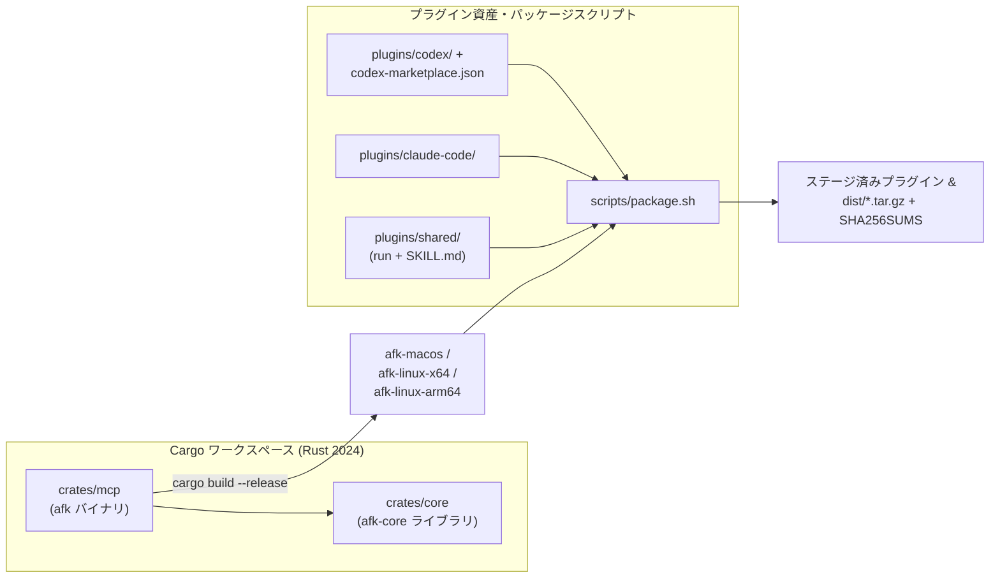

# ビルドとパッケージング

Agent Flow Kit (AFK) は Rust 2024 エディションの Cargo ワークスペース（`resolver = "3"`）で構成されており、単一の自己完結型ネイティブバイナリ（`afk`）と、Claude Code・Codex 向けの薄いプラグインマニフェストにコンパイルされます。常駐バックグラウンドデーモンや Node.js ランタイム、ホスト OS 側の `libsqlite3` 動的ライブラリへの依存は一切ありません。



## ワークスペース構成

ルートの `Cargo.toml` は、データ整合性（ストレージ不変条件）と通信プロトコルを明確に分離する2つのクレートを定義しています。

- **`afk-core` (`crates/core/`)** — 純粋な同期ワークフローライブラリ。SQLite スキーマ、トランザクション制御、Markdown テンプレート生成、SHA-256 によるセクション改ざん検知、DAG 依存グラフ検証、ワーカーの `attempt` リース管理、および決定論的な `Progress` / `NextAction` 算出を担います。MCP や JSON-RPC、非同期ランタイム、クライアント Hook の知識を一切持ちません。
- **`afk-mcp` (`crates/mcp/`、生成バイナリ名 `afk`)** — プロトコルおよび CLI エントリポイント。既定の stdio モードではシングルスレッド Tokio ランタイム（`flavor = "current_thread"`）上で `rmcp`（`=3.11.0`）により6つの MCP ツールを公開し、ブロッキングする `afk-core` の処理を `tokio::task::spawn_blocking` へオフロードします。`--hook` 引数で起動された場合は Tokio を使わず、同期・読み取り専用のイベントハンドラとして即座に実行・終了します。

## コードマップ（Code Map）

リポジトリ内のすべてのソースファイル・マニフェスト・スクリプトの役割一覧です。変更したい仕様や挙動の実装箇所を探す際の索引として使えます。

### Rust ワークスペース & `afk-core`

| パス | 責務 |
| --- | --- |
| `Cargo.toml` | ワークスペース定義（`edition = "2024"`、`resolver = "3"`、`version = "0.1.0"`、`publish = false`）、共通依存バージョン、および `[profile.release]`（`lto = "thin"`、`strip = true`）。 |
| `crates/core/Cargo.toml` | `afk-core` のクレート定義。`rusqlite` `0.38`（`features = ["bundled"]`）、`sha2`、`serde`、`anyhow`、`libc` に依存。 |
| `crates/core/src/lib.rs` | `Store` の初期化（`initialize`、`open_existing`）、書き込み用 `Immediate` / 読み取り専用 SQLite 接続設定、シンボリックリンク・特殊ファイル拒否（`check_path`、`create_directory`）、孤立 Markdown 検出（`orphan_documents`）、依頼登録（`record_request`）、質問ライフサイクル（`prepare_question`、`publish_question`、`answer_question`）。 |
| `crates/core/src/schema.sql` | SQLite スキーマ定義（`PRAGMA user_version = 1`）。基本の8テーブル（`plans`、`drafts`、`tasks`、`dependencies`、`draft_removals`、`requests`、`questions`、`history`）、`STORED` 生成相対パス列、部分ユニークインデックス（`one_draft`、`one_running`）、非巡回制約（`CHECK(task_id > prerequisite)`）。 |
| `crates/core/src/execution.sql` | バージョン2への移行。実行回ごとのクライアント情報と、担当セッションが保存した最新の引き継ぎメモを追加。 |
| `crates/core/src/plan.rs` | リビジョン管理とタスク実行の状態遷移エンジン：`inspect`、`prepare_plan`、`recover_draft`、`commit_plan`、`authorize_execution`、`start_next`、`finish_task`、`finish_plan`、および実行前提ガード（`execution_ready`）、受け入れ条件番号の網羅検証（`verify`）、確定済み本文のハッシュ照合（`check_work`）。 |
| `crates/core/src/documents.rs` | 安全な Markdown ファイル作成（`0600`、`O_NOFOLLOW`、`create_new`）と読み込み（上限 `1 MiB`、`O_NONBLOCK`）、初期テンプレート（`REQUEST_TEMPLATE`、`WORK_TEMPLATE`、`QUESTION_TEMPLATE`）、コードフェンス対応セクション分割（`split_section`）、`## Acceptance` 箇条書き数検証（`1..=64`）、SHA-256 ハッシュ算出。 |
| `crates/core/src/progress.rs` | 読み取り専用の `Progress` スナップショットと `NextAction` 優先度判定（`snapshot`）、直近プランのページング（`recent_plans`）、次に着手可能なタスクの選出（`candidate`：`Todo` より `Doing` を優先し、前提タスク完了を判定）。 |
| `crates/core/src/plain_title.rs` | Markdown の先頭非空行からプレーンテキストのタイトルを抽出（`first_line_plain`、`strip_inline_markdown`）。`snake_case` のアンダースコアや `2 * 3` のアスタリスクを保持。Agent Project から移植。 |
| `crates/core/src/column.rs` | 4段階のカンバン状態列挙型（`Backlog`、`Todo`、`Doing`、`Done`）。小文字の機械表現（`as_str`）と先頭大文字の表示ラベル（`label`）を提供。Agent Project から移植。 |
| `crates/core/tests/workflow.rs` | 確認質問、依存順序、作業途中のリプラン、プロジェクトディレクトリ移動、マルチスレッドでのタスク取得競合、`take_over` による古い `attempt` の拒否、シンボリックリンク拒否、ドラフト復旧、孤立ファイル検出、初期テンプレート検証を網羅する結合テスト。 |

### `afk-mcp` バイナリ (`afk`)

| パス | 責務 |
| --- | --- |
| `crates/mcp/Cargo.toml` | `[[bin]] name = "afk"` の定義。`rmcp = "=3.11.0"`（`transport-io`）、`tokio`、`schemars`、`uuid`（`v4`）、`url` に依存。 |
| `crates/mcp/src/main.rs` | CLI 引数パーサ。stdio MCP サーバーモード（引数なし、または `--root <directory>`）と同期 `--hook` モードを振り分ける。 |
| `crates/mcp/src/server.rs` | 6つの MCP ツール（`record_request`、`open_plan`、`update_plan`、`update_question`、`start_next`、`finish_task`）を公開する `rmcp` `ServerHandler`。6段階のプロジェクトルート解決、`OnceCell<Store>` によるルート固定、UUID v4 ワーカー識別子、レスポンスへの `plan_id` / `afk_root` 注入を実装。 |
| `crates/mcp/src/hook.rs` | ステートレスかつフェイルオープンな Hook 処理（`UserPromptSubmit`、`PostToolUse`、`Stop`）、再帰的 JSON ルート抽出、SHA-256 `(session_id, turn_id)` マーカー管理、`fs::rename` によるアトミック消費、`systemMessage` 進捗文字列整形。 |

### クライアントプラグイン・スクリプト・テスト・ベンチマーク

| パス | 責務 |
| --- | --- |
| `plugins/shared/run` | `uname -s` / `uname -m` から OS・CPU アーキテクチャを判定し、`bin/` 配下の対応バイナリを `exec` する POSIX `/bin/sh` ランチャー。 |
| `plugins/shared/skills/afk/SKILL.md` | Claude Code・Codex 両プラグインに同梱される共通スキル定義（`disable-model-invocation: true`、2,627 bytes）。 |
| `plugins/shared/README.md` | 配布プラグインディレクトリに同梱されるエンドユーザー向け概要。 |
| `plugins/claude-code/.claude-plugin/plugin.json` | Claude Code 用プラグインマニフェスト（`agent-flow-kit` `0.1.0`）。 |
| `plugins/claude-code/.mcp.json` | stdio 経由で `/bin/sh ${CLAUDE_PLUGIN_ROOT}/run` を起動する設定。 |
| `plugins/claude-code/hooks/hooks.json` | `PostToolUse`（正規表現 `matcher` 付き）、`Stop`、`UserPromptSubmit` の3イベントを1秒タイムアウトで登録。 |
| `plugins/codex/.codex-plugin/plugin.json` | `./skills/`、`./hooks/hooks.json`、`./.mcp.json`、および UI 表示メタデータを明示指定する Codex 互換マニフェスト。 |
| `plugins/codex/.mcp.json` | プラグインキャッシュ安全保護のため `cwd: "."` かつ `AFK_NEEDS_WORKSPACE=1` で `./run` を起動する設定。 |
| `plugins/codex/hooks/hooks.json` | `${PLUGIN_ROOT}/run --hook` を用いて `PostToolUse` と `Stop` を登録。 |
| `plugins/codex-marketplace.json` | `codex/.agents/plugins/marketplace.json` に配置されるローカルマーケットプレイスマニフェスト（`afk-local`）。 |
| `scripts/package.sh` | ビルド済みバイナリから `claude-code` / `codex` の配布ツリーを組み立てるスクリプト（開発用 `host` モード / CI リリース用 `all` モード）。 |
| `.github/workflows/ci.yml` | 4ランナーのビルドマトリクス（Linux x64/arm64、macOS arm64/x64）、macOS Universal バイナリ合成（`lipo`）、スモークテスト、`SHA256SUMS` 生成。 |
| `tests/integration/stdio_workflow.py` | 外部依存ゼロの Python 3 結合テスト兼ベンチマークハーネス。1試行あたり 21 回の MCP 呼び出しと 25 回の Hook 起動を実行し、バイト数とレイテンシを計測。 |
| `benchmarks/README.md` | 決定論的プリフライト手順と、5シナリオのクライアント比較実験プロトコル仕様。 |
| `benchmarks/task-759/run.py` | `codex app-server --stdio` を自動駆動して `probe` / `baseline` / `afk` を比較し、トークン消費・MCP 呼び出し回数・Hook レポート数を記録するドライバ。 |
| `benchmarks/task-759/verify.sh` | `task-759` 実験ワークツリーをオフラインビルドし Playwright 検証を実行するスクリプト。 |
| `benchmarks/task-759/acceptance.spec.ts` | デスクトップ幅・スマホ幅の双方でスリープ時間帯 UI と CLI の連動を検証する Playwright テスト。 |
| `THIRD_PARTY_NOTICES.txt` | Agent Project 由来の移植コードに対する MIT ライセンス表記。パッケージ時に各プラグインへ自動コピーされる。 |

## ビルドとテストの実行コマンド

CI は **Rust `1.96.0`**（`rustfmt`、`clippy` 同梱）を固定しており、結合テストには標準ライブラリのみの **Python 3** を使用します。リポジトリルートから以下の順序で全チェックを実行できます。

```sh
# 1. フォーマット検査と厳格な Clippy リント
cargo fmt --all --check
cargo clippy --locked --all-targets -- -D warnings

# 2. 全クレートの単体テスト・ワークフロー結合テスト
cargo test --locked --workspace

# 3. 最適化済みリリースバイナリのビルド (target/release/afk)
cargo build --locked --release

# 4. 決定論的 stdio MCP + Hook 結合テストハーネスの実行
python3 tests/integration/stdio_workflow.py target/release/afk
```

複数回の独立試行を回して JSON ペイロードのバイト数や Hook 応答時間の中央値を確認する場合は、`--trials` を指定します。

```sh
python3 tests/integration/stdio_workflow.py target/release/afk --trials 5
```

## リリースプロファイルと SQLite バンドル設計

AFK のプラグインは、開発者のローカル環境や CI コンテナへアーカイブ展開してそのまま動く必要があります。環境差異によるトラブルを防ぎつつ、毎ターンの `--hook` 起動を数ミリ秒に抑えるため、以下の2つのビルド設定を採用しています。

1. **Thin LTO とシンボル削除（`Cargo.toml`）**:
   ```toml
   [profile.release]
   lto = "thin"
   strip = true
   ```
   `lto = "thin"` により `afk-core` と `afk-mcp` をまたぐインライン化と不要コード削除を行い、`strip = true` でデバッグシンボルを除去します。Apple Silicon 上のリリースバイナリは約 5.6 MB（`5,614,016` bytes）に収まります。
2. **SQLite の静的バンドル（`crates/core/Cargo.toml`）**:
   ```toml
   rusqlite = { version = "0.38", features = ["bundled"] }
   ```
   SQLite の C アマルガメーションをバイナリ内に直接コンパイルするため、ホスト OS の `libsqlite3` バージョンに一切左右されません。これにより `schema.sql` や `progress.rs` が使用する `GENERATED ALWAYS AS (...) STORED` 列、集計 `FILTER (WHERE ...)` 句、部分ユニークインデックス、`unixepoch()` がすべての配布環境で同一に動作します。CI でも `otool -L`（macOS）および `ldd`（Linux）を実行し、OS 標準システムライブラリのみにリンクしていることを検査しています。

## クロスプラットフォーム・パッケージングの仕組み

配布用プラグインは `plugins/agent-flow-kit/bin/` 配下に3種類のプラットフォーム別バイナリを格納し、単一の POSIX `/bin/sh` スクリプト（`plugins/shared/run`）から起動します。

### ターゲットバイナリと実行時ディスパッチ（`plugins/shared/run`）

| `uname -s` : `uname -m` | 選択されるバイナリ | CI ビルドランナー |
| --- | --- | --- |
| `Darwin:arm64` または `Darwin:x86_64` | `bin/afk-macos`（CI では Universal2、ローカル `host` モードでは単一アーキテクチャ） | `macos-15` (`arm64`) + `macos-15-intel` (`x86_64`) を `lipo -create` で結合 |
| `Linux:x86_64` | `bin/afk-linux-x64` | `ubuntu-22.04` |
| `Linux:aarch64` または `Linux:arm64` | `bin/afk-linux-arm64` | `ubuntu-22.04-arm` |

Claude Code や Codex が `run` を起動すると（常駐 stdio MCP サーバーとしても `--hook` としても）、`plugins/shared/run` は `CDPATH= cd -- "$(dirname -- "$0")" && pwd` で自身のディレクトリを安全に解決し（空白や日本語を含むパスでも安全に動作）、`-x "$base/bin/$binary"` を確認した上で `exec "$base/bin/$binary" "$@"` でシェルプロセス自体を置き換えます。余分なラッパープロセスは残りません。

### ローカル開発用パッケージの組み立て（`host` モード）

`scripts/package.sh` は `BIN_DIR`、`OUTPUT_DIR`、`host|all` の3引数を取ります。`host` モードでは手元のマシン用バイナリ1つだけでプラグイン一式をステージングできます。

```sh
cargo build --locked --release

mkdir -p /tmp/afk-bin
# macOS は afk-macos、Linux x86_64 は afk-linux-x64、Linux arm64 は afk-linux-arm64 にリネーム
install -m 755 target/release/afk /tmp/afk-bin/afk-macos

rm -rf /tmp/afk-pkg
scripts/package.sh /tmp/afk-bin /tmp/afk-pkg host

# シェルランチャー経由でパッケージ済みプラグインをスモークテスト
python3 tests/integration/stdio_workflow.py /tmp/afk-pkg/codex/plugins/agent-flow-kit/run
```

出力先の `OUTPUT_DIR` には、そのまま各クライアントへ読み込ませられる2つのツリーが生成されます。

```text
OUTPUT_DIR/
├── claude-code/
│   └── plugins/agent-flow-kit/
│       ├── .claude-plugin/plugin.json
│       ├── .mcp.json
│       ├── hooks/hooks.json
│       ├── skills/afk/SKILL.md
│       ├── README.md
│       ├── THIRD_PARTY_NOTICES.txt
│       ├── run
│       └── bin/afk-macos
└── codex/
    ├── .agents/plugins/marketplace.json
    └── plugins/agent-flow-kit/
        ├── .codex-plugin/plugin.json
        ├── .mcp.json
        ├── hooks/hooks.json
        ├── skills/afk/SKILL.md
        ├── README.md
        ├── THIRD_PARTY_NOTICES.txt
        ├── run
        └── bin/afk-macos
```

生成したプラグインを Claude Code（`claude --plugin-dir`）や Codex（`codex plugin marketplace add`）へ導入する手順は [導入とセットアップ](../reference/getting-started.md) を参照してください。

### CI でのフルリリースアセンブリ（`all` モードと `SHA256SUMS`）

`.github/workflows/ci.yml` の `package` ジョブ（`macos-15` 上で実行）は、4つのビルド成果物（`afk-macos-arm64`、`afk-macos-x64`、`afk-linux-x64`、`afk-linux-arm64`）を集約して以下を行います。

1. **macOS Universal バイナリの生成**: `lipo -create` で `arm64` と `x86_64` のスライスを `binaries/afk-macos` に統合し、`lipo -verify_arch arm64 x86_64` で両アーキテクチャの格納を検証した上で、Apple Silicon の実行要件を満たすアドホック署名（`codesign --sign - --force`）を付与します。
2. **厳格なステージング（`all` モード）**: `scripts/package.sh binaries packages all` を実行します。`all` モードでは `afk-macos`・`afk-linux-x64`・`afk-linux-arm64` のいずれか1つでも欠けていると即座に `exit 1` で失敗します。
3. **ランチャースモークテスト**: ステージング済みの `packages/codex/plugins/agent-flow-kit/run` に対して `tests/integration/stdio_workflow.py` を通し、配布レイアウトそのものを検証します。
4. **アーカイブ作成とチェックサム記録**: `dist/afk-claude-code.tar.gz`、`dist/afk-codex.tar.gz`、および単体バイナリアーカイブを圧縮し、`shasum -a 256 ./*.tar.gz > SHA256SUMS` で `dist/SHA256SUMS` を出力します。

## Git マーケットプレイスを用意する

CI のパッケージ作成ジョブと同じ3種類の実行ファイルをそろえ、空の出力先にマーケットプレイスを作ります。

```sh
scripts/package.sh BINARIES MARKETPLACE all git
```

生成された2種類のマニフェストは、それぞれ実行ファイルと AFK スキルを含む `plugins/claude-code/` と `plugins/codex/` を参照します。隠しディレクトリも含め、`MARKETPLACE/` の中身を配布先 Git リポジトリのルートに置きます。そのリポジトリの URL を [インストールガイド](../../../website/ja/guide/index.md) で案内します。

手元の環境だけで試す場合は `host git` を指定します。

## ドキュメントサイト（VitePress）の開発とプレビュー

公開サイトのソースは `website/` にあります。開発・参照資料は `docs/` で管理します。

```sh
pnpm --dir website install --frozen-lockfile
pnpm --dir website dev
pnpm --dir website build
```

生成先は `website/.vitepress/dist/` です。サブパスで配信する場合はビルド時に `DOCS_BASE=/your-subpath/` を指定します。

## 上流コードの再利用とライセンス

AFK のコアストレージエンジン（`afk-core`）と MCP / Hook サーバー（`afk-mcp`）は独自実装ですが、以下の2モジュールは MIT ライセンス（`Copyright (c) 2026 FooQoo`）のもとで [Agent Project](https://github.com/FooQoo/agent-project)（コミット `095bc9bdad1c10cee9fb11ed25d616416e990167`）から移植・適合しています。

- `crates/core/src/column.rs` — 4段階のワークフロー状態型（`Backlog`、`Todo`、`Doing`、`Done`）。
- `crates/core/src/plain_title.rs` — Markdown 行からのプレーンテキスト・タイトル抽出ヘルパー（`first_line_plain`、`strip_inline_markdown`）および単体テスト。

`scripts/package.sh` は上流の著作権表示と許諾条項を保持するため、すべてのプラグインバンドル直下に `THIRD_PARTY_NOTICES.txt` をコピーします。AFK リポジトリ全体の OSS ライセンス選定、Apple Developer ID 署名・公証（Notarization）、公開マーケットプレイスへの提出はリリースゲートとして管理されています（詳細は [検証とベンチマーク](verification.md) を参照）。

## 次のステップ

- [アーキテクチャとデータ構造](architecture.md) — 計画、実行履歴、引き継ぎメモを保存する SQLite スキーマ、SHA-256 による Markdown 封印、`NextAction` の優先度判定、コードを通じた変更トレース。
- [ネイティブ連携・Hook・セキュリティ](integrations.md) — 6段階のルート解決、モデルコンテキストを汚さない `hook.rs` のターン単位ルーティング、`O_NOFOLLOW` によるシンボリックリンク防御。
- [検証とベンチマーク](verification.md) — 自動テストが保証する不変条件、stdio ベンチマーク実測値、5シナリオのクライアント評価手順。
