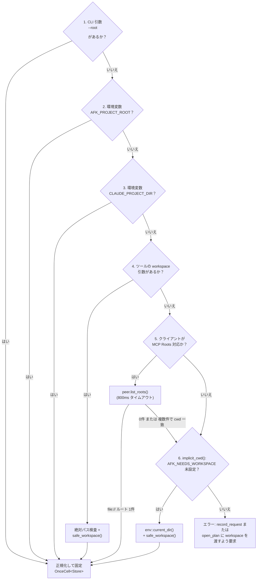
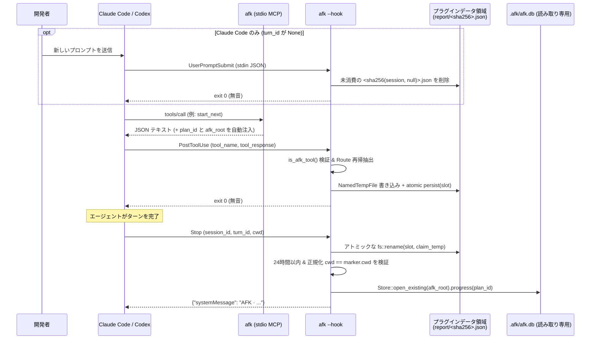

# ネイティブ連携・Hook・セキュリティ

AFK は単一のネイティブ実行ファイル（`afk`）だけで、エージェントのターン中は stdio MCP サーバーとして動作し、クライアントのライフサイクルイベント発生時は 10 ミリ秒未満で完結する短命 CLI（`afk --hook`）として動作します。本ページでは、`crates/mcp/` におけるプロジェクトルートの解決・固定、モデルのコンテキストを一切消費しないターン単位の進捗通知ルーティング、Claude Code と Codex のマニフェスト差異、およびローカルファイルシステムのセキュリティ境界を解説します。

## 単一バイナリのデュアルモード構成（`main.rs`）

`crates/mcp/src/main.rs` は、非同期ランタイムのリソースを初期化する前に `std::env::args_os()` を検査して動作モードを決定します。

| 起動コマンド | 実行パス | DB アクセス | 役割 |
| --- | --- | --- | --- |
| `afk` | シングルスレッド Tokio (`current_thread`) + `rmcp::transport::stdio()` | 読み書き (`Store::initialize`) | 6つの MCP ツールを公開。環境変数・ツール引数 `workspace`・MCP Roots・`cwd` からルートを解決する。 |
| `afk --root <dir>` | シングルスレッド Tokio (`current_thread`) + `rmcp::transport::stdio()` | 読み書き (`Store::initialize`) | JSON-RPC 待受開始前に `initialize_explicit_root()` で `<dir>/.afk` を即座に初期化・固定する。 |
| `afk --hook` | 同期関数 `hook::run()`（処理後即終了） | 読み取り専用（`Stop` 時のみ `Store::open_existing`） | `stdin` から Hook イベント JSON を読み取り、条件を満たす `Stop` のみ `{"systemMessage": "..."}` を `stdout` に出力する。 |

上記以外のフラグや余分な引数が渡された場合は即座に終了コード `1` でエラー終了します。

## 6段階のプロジェクトルート解決（`server.rs`）

コーディングエージェントが MCP サーバーを起動するカレントディレクトリはクライアントごとに大きく異なります。対象リポジトリ直下で起動されることもあれば、`$HOME` や（パッケージ版 Codex プラグインのように）プラグインキャッシュディレクトリ内で起動されることもあります。`Server::new` と `Server::initialize_store` は以下の6段階の優先順位でプロジェクトルートを決定します。



### 各ステップの詳細ルール

1. **`--root <directory>` CLI 引数**: 最優先。`Server::new` で保持され、stdio 接続受付前の `initialize_explicit_root()` で先行初期化されます。
2. **`AFK_PROJECT_ROOT` 環境変数**: 空でない値がある場合に採用される明示的なオーバーライド設定。
3. **`CLAUDE_PROJECT_DIR` 環境変数**: Claude Code がプラグイン MCP サーバー起動時に自動付与するプロジェクトディレクトリ。
4. **ツール引数 `workspace`**: `record_request` および `open_plan` が受け取る任意の絶対パス（`path.is_absolute()` 必須）。`canonicalize()` と `safe_workspace()` を通過する必要があります。
5. **MCP `roots/list` ネゴシエーション（`peer.list_roots()`）**: クライアントが `initialize` 時に `capabilities.roots` を通知している場合に問い合わせます。応答しないクライアントでハングしないよう **800 ミリ秒のタイムアウト**（`Duration::from_millis(800)`）を設けています。
   - **ルートが1件（`[root]`）**: `url::Url::parse` からローカルパス（`to_file_path()`）へ変換して採用。
   - **ルートが0件（`[]`）**: ステップ6の `implicit_cwd()` へフォールバック。
   - **ルートが複数件**: `implicit_cwd()` を取得し、通知されたルートのいずれかが正規化後の `cwd` と一致する場合のみ採用（一致しなければ `"multiple MCP roots; configure AFK_PROJECT_ROOT"` エラー）。
6. **起動時カレントディレクトリ（`implicit_cwd()`）**:
   - まず `AFK_NEEDS_WORKSPACE` 環境変数が未設定であることを確認します。`AFK_NEEDS_WORKSPACE=1` が設定されている場合（`plugins/codex/.mcp.json` や複数プロジェクトで共有するグローバル MCP 設定など）、勝手な推測を行わず `"provide the current project directory as workspace to record_request or open_plan"` と返してエージェントに明示指定を促します。
   - 未設定であれば `env::current_dir()?.canonicalize()?` を `safe_workspace()` で検証して採用します。

### 危険なワークスペースの拒否（`safe_workspace`）

ホームディレクトリやファイルシステムルート、プラグインキャッシュ内に誤って `.afk/` が作られる事故を防ぐため、`safe_workspace(cwd)` は以下のいずれかに該当するパスを拒否します。
- `cwd.parent().is_none()`（OS ルート `/` や Windows ドライブ直下）。
- 正規化後の `$HOME` または `%USERPROFILE%` と一致するパス。
- 正規化後の `$PLUGIN_ROOT` または `$CLAUDE_PLUGIN_ROOT` と一致、あるいはその配下（`cwd.starts_with(root)`）にあるパス。

### プロセス単位のルート固定と UUID ワーカー識別子

各 `Server` インスタンスはプロセス寿命と同じ2つの状態を保持します。

- **`store: Arc<OnceCell<Store>>`**: 初回解決で `Store` が初期化されると、その正規化ルートがプロセス終了まで固定されます（なお `AFK_NEEDS_WORKSPACE` 未設定時は `on_initialized` 通知でもバックグラウンド先行初期化が走ります）。後から別のディレクトリを `workspace` に指定して呼び出すと、`"AFK is already bound to <path>; start a new MCP session for another workspace"` で拒否されます。
- **`worker: String`（`Uuid::new_v4()`）**: MCP サーバープロセス起動時に毎回生成される一意なセッション識別子です。`Store::start_next` と `Store::finish_task` に `owner` として渡され、同一セッション内の再開と別セッションからの `take_over: true` 引き継ぎを厳密に区別します（詳細は [アーキテクチャとデータ構造](architecture.md) を参照）。

## ネイティブ Hook アーキテクチャ（`hook.rs`）

AFK を使ったターンの終了時には、モデルに出力トークンを使わせて進捗を語らせなくても `AFK · タイトル [Doing] · 1/3 complete...` のような簡潔なサマリを人間へ表示したい一方、AFK を一切使わない通常のコーディングターンでは完全に無音を保つ必要があります。

`crates/mcp/src/server.rs` と `crates/mcp/src/hook.rs` は、クライアントのプラグインデータ領域に置かれる短命なターン単位のルートマーカーファイルを介して連携します。



### ルーティングの内部ステップ

1. **ツール応答へのルート情報注入（`server.rs`）**:
   6つの MCP ツールのいずれかが成功し、`plan_id`（引数指定または `record_request` などの戻り値内の `plan_id`）を持つ JSON オブジェクトを返す際、`Server::run` がトップレベルに2つのフィールドを注入します。
   ```json
   {
     "plan_id": 1,
     "afk_root": "/Users/alice/my-repo"
   }
   ```
   （※ `open_plan` を `plan_id: null` で呼んでプラン一覧を取得した場合は特定プランに紐付かないため注入されず、`Stop` レポートも出ません。）

2. **プラグインデータディレクトリの決定**:
   `hook::run()` は環境変数 `["AFK_HOOK_DIR", "PLUGIN_DATA", "CLAUDE_PLUGIN_DATA"]` を先頭から順に探し、最初の非空パスに `/report` を連結したディレクトリを使用します。

3. **2段階のツール名フィルタリング（`hooks.json` + `is_afk_tool`）**:
   - **クライアント側フィルタ**: 両クライアントの `hooks/hooks.json` で `PostToolUse` に `"matcher": "mcp__.*afk__(record_request|open_plan|update_plan|update_question|start_next|finish_task)"` を設定しているため、通常のファイル編集やシェル実行では `afk --hook` プロセス自体が起動されません。
   - **バイナリ側フィルタ（`is_afk_tool`）**: `hook.rs` でも `"mcp__"` プレフィックスを剥がして最右の `"__"` で分割し、サーバー名が `"afk"` または `"_afk"` / `"-afk"` 終わりであること（プラグイン名前空間付きの `mcp__plugin_agent-flow-kit_afk__start_next` 等に対応）、かつツール名が AFK の6ツールのいずれかであることを再検証します。

4. **クライアント差異を吸収する再帰 JSON 抽出（`route(value, depth)`）**:
   `PostToolUse` の `tool_response` 構造はクライアントごとに異なります（Codex は `{"content": [{"type": "text", "text": "{...}"}], "isError": false}`、Claude Code はコンテンツ配列や `structuredContent` 等）。`route(value, depth)` は `"isError": true` のオブジェクトを除外しつつ、配列・ラッパーキー（`structuredContent`、`content`、`text`、`result`、`output`）・JSON 文字列を **最大深さ `depth <= 6`** まで再帰探索し、`plan_id > 0` かつ `afk_root.is_absolute()` を満たす `Route` を取り出します。

5. **セッション・ターン単位のスロットキー算出**:
   マーカーファイル名は `(&event.session_id, &event.turn_id)` タプルの SHA-256 ハッシュから決定されます。
   ```rust
   let key = serde_json::to_vec(&(&event.session_id, &event.turn_id))?;
   let slot = base.join(format!("{:x}.json", Sha256::digest(key)));
   ```
   - **Codex**: ターンごとに異なる `turn_id` を渡すため、自動的にターン別の `<sha256>.json` スロットへ分離されます。
   - **Claude Code**: `turn_id` が付与されない（`None`）ため、中断されたターンの未消費マーカーが次の通常ターンで誤発火しないよう、`plugins/claude-code/hooks/hooks.json` で `UserPromptSubmit` Hook を登録し、新しいプロンプト送信時に `slot` を削除（`fs::remove_file`）します。

6. **アトミック書き込みと1回限りの `Stop` 消費**:
   - `PostToolUse` では `Marker { cwd: event.cwd.canonicalize()?, route }` を同一ディレクトリ内の `NamedTempFile` に書き込んで `flush()` し、`persist(slot)` でアトミックに配置します（同一ターン内で複数回 AFK ツールを呼んだ場合は最新のプラン情報で上書きされます）。
   - `Stop`（`!event.stop_hook_active && slot.is_file()`）では、一時パスを生成して `fs::rename(slot, &claim)?` でマーカーをアトミックに奪取します。同一ファイルシステム上の `rename` は原子的であるため、万一クライアントが重複・並行して `Stop` を発火しても **必ず1プロセスだけが奪取に成功**し（ドロップ時に自動削除）、後続の `Stop` は無音で終了します。

7. **鮮度と CWD の検証、読み取り専用の進捗照会**:
   - 更新時刻から **24時間以上**経過した古いマーカーを破棄し、読み込みサイズを **`8,192` bytes** に制限し、`event.cwd.canonicalize()? == marker.cwd` を検証します。
   - `Store::open_existing(&marker.route.afk_root)?.progress(marker.route.plan_id)?` を呼び、`.afk/afk.db` を `SQLITE_OPEN_READ_ONLY`（`busy_timeout = 100ms`）で読み取ります。DB への書き込みや新規初期化は一切行いません。
   - 進捗は `systemMessage` でユーザーに表示します。
   - DB ロック競合や環境変数未設定など、いかなるエラーが発生しても `hook::run()` は何も出力せず終了コード `0` で静かに終了（フェイルオープン）し、エージェントの動作を決して妨げません。

## Claude Code と Codex のプラグインマニフェスト比較

両クライアント向けパッケージは同じ `run` スクリプト、`afk` バイナリ、`skills/afk/SKILL.md` を共有しつつ、Claude Code `2.1.331` と Codex `0.171.0` の仕様差に合わせてマニフェストを最適化しています。

| 項目 | Claude Code (`plugins/claude-code/`) | Codex (`plugins/codex/`) |
| --- | --- | --- |
| **プラグインマニフェスト** | `.claude-plugin/plugin.json` — 最小限の `name`・`version`・`description` のみ。`.mcp.json`、`hooks/hooks.json`、`skills/` は自動検出される。 | `.codex-plugin/plugin.json` — `"skills": "./skills/"`、`"hooks": "./hooks/hooks.json"`、`"mcpServers": "./.mcp.json"`、`"interface"` を明示列挙する**互換マニフェスト**を採用。（Codex `0.171.0` ではポータブル形式だと MCP ツールは見えるが Hook が `hooks/list` に載らないため。） |
| **MCP 起動設定 (`.mcp.json`)** | `/bin/sh` で `["${CLAUDE_PLUGIN_ROOT}/run"]` を起動。`CLAUDE_PROJECT_DIR` が渡されるため即座にルートが確定する。 | `"./run"` を `"cwd": "."`（プラグインキャッシュ内）かつ `"env": {"AFK_NEEDS_WORKSPACE": "1"}` で起動。キャッシュ内への `.afk/` 誤作成を防ぎ、初回ツール呼び出し時の `workspace` 指定を強制する。 |
| **Hook 用環境変数** | バイナリ参照は `${CLAUDE_PLUGIN_ROOT}`、マーカー保存先は `CLAUDE_PLUGIN_DATA`。 | バイナリ参照は `${PLUGIN_ROOT}`、マーカー保存先は `PLUGIN_DATA`。 |
| **登録 Hook イベント** | `PostToolUse`、`Stop`、`UserPromptSubmit`（`turn_id` なしスロットの掃除用）の3種。すべて `"timeout": 1`。 | `PostToolUse` と `Stop` の2種（`"timeout": 1`）。Codex はターンごとに一意な `turn_id` を渡すため `UserPromptSubmit` は不要。 |
| **配布形態と表示面の違い** | `claude --plugin-dir` で直接ロード可能。`Stop` の `systemMessage` は情報バナーとして表示される。 | `.agents/plugins/marketplace.json`（`afk-local`）同梱。初回に2つのプラグイン Hook の信頼承認が必要。対話型ターミナルと `app-server`（`hook/completed`）で進捗が表示される一方、`codex exec --json` の JSON 出力には含まれない。 |

## セキュリティモデル

AFK は信頼できないテストフィクスチャやシンボリックリンク、長大なファイルを含み得るローカルリポジトリ内で動作するため、すべてのファイル操作と入力境界に多層防御を実装しています。

| 脅威・境界 | AFK での防御機構 | 実装箇所 |
| --- | --- | --- |
| **`.afk/` や Markdown へのシンボリックリンク攻撃** | `check_path` が `.afk/`、各サブディレクトリ、`afk.db` / `-journal` / `-wal` / `-shm`、および全 `.md` パスに対して `fs::symlink_metadata` を検査し、シンボリックリンク（Unix の `is_symlink()`、Windows のリパースポイント属性 `0x400`）を拒否。 | `crates/core/src/lib.rs` (`check_path`, `is_link`, `connect`) |
| **TOCTOU 競合および FIFO・デバイスファイルによるハング** | SQLite 接続に `OpenFlags::SQLITE_OPEN_NOFOLLOW` を指定。Markdown 作成時は `create_new(true)` (`O_EXCL`) + `libc::O_NOFOLLOW`、読み込み時は `libc::O_NOFOLLOW \| libc::O_NONBLOCK` を付与し、開いたファイルディスクリプタに対して `file.metadata()?.is_file()` で通常ファイルであることを再確認。 | `crates/core/src/lib.rs`, `crates/core/src/documents.rs` |
| **ローカルマルチユーザー環境での情報露出** | `.afk/` と各サブディレクトリを `DirBuilderExt::mode(0o700)`（`rwx------`）で作成。Markdown テンプレートと Hook の `NamedTempFile` マーカーを `mode(0o600)`（`rw-------`）で作成。 | `crates/core/src/lib.rs`, `crates/core/src/documents.rs`, `crates/mcp/src/hook.rs` |
| **未管理ファイルやバックアップの誤上書き** | `require_unowned_path_available` により予約先パスに既存ファイルやリンクが1つでもあれば採番を中断。`user_version == 0` 時に既存 `.md` があれば `Store::initialize` を中断。 | `crates/core/src/lib.rs`, `crates/core/src/documents.rs` |
| **プロジェクト外ディレクトリへの誤初期化** | `safe_workspace` が `/`、`$HOME`、`%USERPROFILE%`、`$PLUGIN_ROOT`、`$CLAUDE_PLUGIN_ROOT` を拒否し、`AFK_NEEDS_WORKSPACE` が起動 `cwd` フォールバックを無効化。 | `crates/mcp/src/server.rs` |
| **巨大ファイル・巨大 Hook 入力によるメモリ枯渇** | Markdown 読み込み上限 **`1 MiB`**（`MAX_DOCUMENT_BYTES = 1,048,576`、`file.take(MAX + 1)`）。Hook の `stdin` 上限 **`1 MiB`**、マーカー読み込み上限 **`8 KiB`**、`route()` の JSON 再帰上限 **`depth <= 6`**。 | `crates/core/src/documents.rs`, `crates/mcp/src/hook.rs` |
| **不正フィールド・過剰な配列サイズ** | 全6ツールの入力構造体に `#[serde(deny_unknown_fields)]` を付与。1ドラフトあたりのタスク追加・削除数および1タスクあたりの前提数を各 `32` 件、`## Acceptance` を `1..=64` 件、`receipt` を `1..=100` bytes、タイトルを制御文字除去の上 `100` 文字に制限。 | `crates/mcp/src/server.rs`, `crates/core/src/plan.rs`, `crates/core/src/documents.rs` |

## 次のステップ

- [検証とベンチマーク](verification.md) — シンボリックリンク拒否、`BEGIN EXCLUSIVE` ロック競合下の Hook フェイルオープン、ルート固定、ターン分離を検証する自動テストスイートの詳細。
- [MCP ツールリファレンス](../reference/mcp-tools.md) — エージェントに公開される6つの MCP ツールの引数スキーマと `workspace` 指定ルール。
