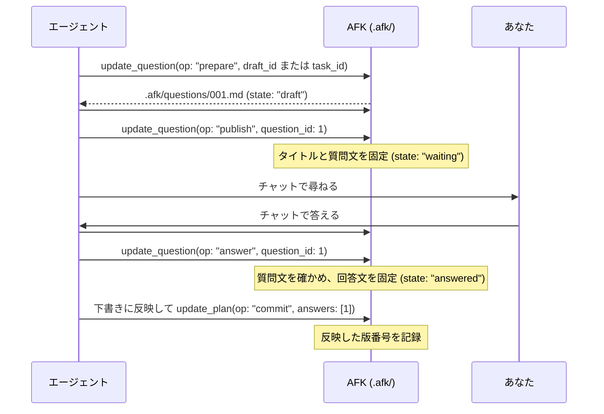
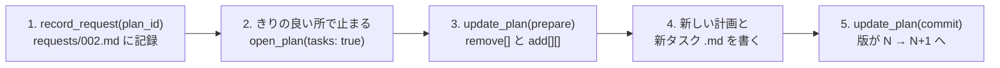

# 質問と途中変更（リプラン）

少し長い仕事では、最初の依頼だけで最後まで真っすぐ進むことはめったにありません。途中でよく起きるのは次の2つです。

1. **エージェントだけでは決められない分岐に出会う。**
2. **途中の結果を見て、あなたが条件を足したり変えたりしたくなる。**

Agent Flow Kit（AFK）では、このどちらもチャット上の口約束で済ませず、`.afk/` に記録して計画へ反映します。

---

## エージェントが質問する4つの基準

細かいことで何度も手を止めず、かといって大事なことを勝手に決めないために、エージェントが質問を出すのは **次の4つの場面だけ** です。

| 基準 | **止まって質問する** 例 | **聞かずに自分で進める** 例 |
| --- | --- | --- |
| **1. 意図が分からない** | 依頼の中で条件が食い違っている、または大事な振る舞いが書かれておらずコードを見ても決まらない。 | 既存のコードを読んで、どの関数がヘッダーを処理しているか調べる。 |
| **2. 好みで決まる** | オプション名、JSON の形、画面の見せ方、使うライブラリなど、どれでも動くが好みや方針で選ぶもの。 | 既存コードの書き方に合わせたローカル変数名や、テストコードの分け方。 |
| **3. 取り消せない操作** | テーブル列の削除、データファイルの消去、公開 API の変更、外部への送信など元に戻せない操作。 | 作業フォルダ内の新しいファイルの編集や、手元でのテスト実行。 |
| **4. 頼まれた範囲を超える** | 不具合をきちんと直そうとすると、頼まれていない別のパッケージまで大きく作り替える必要がある。 | 実装を頼まれた関数に対するユニットテストを一緒に書く。 |

---

## 質問してから再開するまでの流れ

質問は `.afk/questions/NNN.md` に作られ、4つのステップで進みます。



### 質問の結び付け先

質問を作るとき（`op: "prepare"`）、状況に合わせて次のどれかに結び付けます。
- **準備中の下書き（`draft_id`）：** 最初の計画や計画変更を書いているときの質問。
- **未完了のタスク（`task_id`）：** 作業中に見つかった迷いについての質問（有効な未完了タスクにだけ付けられます）。
- **プラン全体（両方省略）：** プラン全体に関わる質問。

`task_id` と `draft_id` を同時には指定できません。また、すでに終わった（`Done`）プランについて質問するときは、先に `record_request` で追加の依頼を登録します。

### 質問文と回答文はどう守られるか

1. **公開する前（`"draft"`）：** 質問ファイルを作ったまま忘れないよう、AFK は `prepare_question` を示して作業の開始を止めます。
2. **公開したとき（`"waiting"`）：** `publish` を呼ぶと、`## Answer` より上の質問文のハッシュ（`prompt_digest`）が記録され、あとから質問文を変えられなくなります。状態は回答待ち（`wait_for_answer`）になります。
3. **答えたとき（`"answered"`）：** チャットで返事をすると、エージェントが `## Answer` の下に答えを書いて `answer` を呼びます。回答文のハッシュ（`answer_digest`）も固定され、その答えを計画に取り込む（`replan` → `commit`）まで次の作業には進めません。
4. **計画を確定したとき（`commit`）：** `answers: [1]` を渡して確定すると、どの版の計画に反映したかが記録されます。

### 一度答えたあとで、考えを変えたくなったら

確定した回答を、元の `questions/001.md` の上で直接書き換えることはできません（`"record a new question to revise a sealed answer"` エラーになります）。

あとから方針を変えるときは、次のようにします。
- `questions/001.md` は「最初にどう聞かれ、どう答えたか」の記録としてそのまま残します。
- あなたから変更を伝えるなら `record_request(plan_id)` で追加の依頼にし、エージェントから聞き直すなら新しく `questions/002.md` を作って回答を記録したうえで、新しい版の計画を確定します。

---

<a name="mid-flight-replanning"></a>

## 作業中の計画変更（リプラン）

プランが `Backlog`・`Todo`・`Doing` のどこにあっても（さらには `Done` で終わったあとでも）、条件の追加や変更があれば計画を組み直せます。すでに終わったタスクの記録は消えません。



### ステップ 1: 追加の依頼を残し、いまのタスクを見る

途中で新しい注文を出すと、エージェントは既存の `plan_id` を指定して `record_request` を呼び、`.afk/requests/002.md` に書き残します。

すると AFK はすぐにタスクの開始や完了を止め、`Progress.next` を `replan` に変えます。エージェントはきりの良いところで手を止め、`open_plan(plan_id: 1, tasks: true)` で「どのタスクが終わっていて、どれがまだ残っているか」を確認します。

### ステップ 2: 下書きを用意する（`add` と `remove`）

一度確定したタスクの本文はハッシュで守られているため、**既存のタスクファイルを直接書き換えることはしません**。代わりに `update_plan(prepare)` で次のように組み直します。

| タスクの種類 | `prepare` での扱い | 確定（`commit`）するとどうなるか |
| --- | --- | --- |
| **終わったタスク（`Done`）** | `remove` には **入れません**。新しいタスクの前提にするときは正の番号で指定します。 | `Done` のまま、本文も `## Result` も一切変わらず引き継がれます。 |
| **内容が変わらない未完了タスク** | `remove` には **入れません**。 | 同じ番号・同じ内容のまま残ります（前提タスクが外されない限り）。 |
| **内容を変える・不要になった未完了タスク** | `remove: [...]` に番号を入れます。 | 対象外（`retired`）になり、必要なら変更後のタスクを `add` で新しく足します。 |
| **新しく足すタスク** | `add: [[...], ...]` に前提リストを並べます。 | 新しい連番の `.afk/tasks/NNN.md` が用意されます。 |

#### `add` での正の番号と負の番号

`add`（1回に最大32件、各タスクの前提も最大32件）の中では、先に終わらせるタスクを2通りの数字で書きます。
- **正の数字（`1`, `3`, ...）：** プランに残っている既存のタスク番号を指します。
- **負の数字（`-1`, `-2`, ...）：** **同じ `add` の中で先に並べた新タスク** を指します（`-1` は `add` の1番目、`-2` は `add` の2番目）。

たとえば、終わったタスク `#1` は残し、未完了の `#2` を外して、代わりに2つの新タスク（「`#1` のあとに動くタスク」と「さらにそのあとに動くタスク」）を入れるときはこう書きます。

```json
{
  "plan_id": 1,
  "change": {
    "op": "prepare",
    "revision": 1,
    "remove": [2],
    "add": [
      [1],
      [-1]
    ]
  }
}
```

> [!IMPORTANT]
> **外すタスクを待っていた後続タスクの扱い：** 未完了のタスク `#4` がタスク `#2` の完了を前提にしているとき、`#2` だけを `remove` に入れて `#4` をそのまま残すことはできません（`"replace each retained task whose prerequisite is being removed"` エラーになります）。この場合は `#4` も一緒に `remove` へ入れ、新しい前提で `add` に作り直します。

### ステップ 3: 新しい版として確定する（`commit`）

新しい計画（`.afk/plans/001-r002.md`）と新タスクを書き終えたら、未反映の依頼番号（`requests`）と回答番号（`answers`）をすべて渡して `update_plan(commit)` を呼びます。

確定すると、データベースの中で一度に次の更新が行われます。
1. 未反映の依頼や回答に漏れがないことと、有効なタスクが1件以上あることを確かめます。
2. 新しい計画と新タスクの仕様ハッシュ（`spec_hash`）を記録します。
3. `remove` のタスクを対象外（`retired`）にします（ファイルは記録として残ります）。
4. 残った未完了タスク（作業途中だった `Doing` も含む）をいったん `Todo`（開始承認前なら `Backlog`）に戻し、担当をリセットします。
5. `Done` のタスクはそのまま保ち、版（`revision`）を 1 進めます。

---

## 終わった（`Done`）プランにもう一度仕事を足す

一度 `Done` まで終わったプランに「これも追加でやってほしい」と頼むときも、同じプランに続けて足せます。

1. 終わったプランの `plan_id` を指定して `record_request(plan_id: 1)` を呼び、追加の依頼を書きます。
2. `open_plan(plan_id: 1, tasks: true)` で終わったタスクを確認します。
3. 既存タスクのあとに続く新タスクを `prepare`（例：`add: [[2]]`, `remove: []`）で用意し、計画とタスクを書いて `commit` します。

これまでの計画ファイルや完了済みタスクの記録はすべて残ったまま、プランが `Done` から `Doing`（次の版）へ戻り、新しく足したタスクから進められます。

次は、新しいセッションから続きを始めるときや、途中で止まった作業・手編集してしまったファイルを直す方法を **[再開・引き継ぎと復旧](resuming-and-recovery.md)** で見ます。
