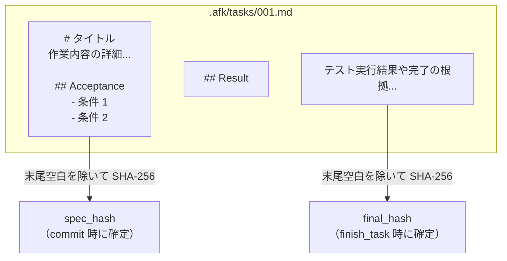

# Markdown 形式とテンプレート

Agent Flow Kit（AFK）で扱う依頼・計画・タスク・質問は、すべて `.afk/` 配下の普通の UTF-8 Markdown ファイルです。エージェントだけでなく、人間も普段のエディタでそのまま開いて読めます。

このページでは、`.afk/` 内のファイル構成、自動生成される初期テンプレート、タイトルや `## Acceptance` の読み取りルール、そして SHA-256 ハッシュがどの範囲を保護しているかをまとめます。

---

## `.afk/` 内のファイル一覧

プロジェクトが初期化されると `.afk/`（Unix 系では権限 `0700`）が作られ、次の5種類が管理されます（ファイル権限は `0600`）。

| パス形式 | 作成されるタイミング | 内容 |
| --- | --- | --- |
| `.afk/afk.db` | ストア初期化時 | 状態、タスク順序、`attempt` 番号、SHA-256 ハッシュ、実行履歴、引き継ぎメモを保持する SQLite データベース。 |
| `.afk/requests/NNN.md` | `record_request` | 人間からの初回依頼や追加要望の本文（`001.md`, `002.md`, ...）。 |
| `.afk/plans/NNN-rMMM.md` | `update_plan(prepare)` | プラン全体の仕様・完了条件・結果。`NNN` は `plan_id`、`MMM` は `draft_id` です。 |
| `.afk/tasks/NNN.md` | `update_plan(prepare)` | 個別タスクの仕様・完了条件・結果証跡（`001.md`, `002.md`, ...）。プランが改訂されてもタスク ID は変わりません。 |
| `.afk/questions/NNN.md` | `update_question(prepare)` | `## Answer` より上が質問文、下が人間の回答です。 |

※ 連番は `999` まで3桁ゼロ埋め（`001`）で表記され、`1000` 以降はそのまま桁が増えます（`1000.md`）。

---

## 初期テンプレートと未記入チェック

AFK が新しいファイルを用意するときは、最小限の初期テンプレートを書き込みます。**テンプレートを埋める前に確定しようとしても必ずエラーになる** ため、空のまま素通りすることはありません。

### 1. 依頼テンプレート（`requests/NNN.md`）

```markdown
# 
```

- **初期文字列：** `"# \n"`
- **チェック内容：** Markdown 記号を除いた実質的な文字が1行以上必要です。`# ` のままだと `"write the request to ..."` で止まります。

### 2. プランとタスクのテンプレート（`plans/NNN-rMMM.md` / `tasks/NNN.md`）

```markdown
# 

## Acceptance

- 

## Result
```

- **プランの初期文字列** `"# \n\n## Acceptance\n\n- \n\n## Result\n"`
- **未記入のまま通らない理由：**
  - 1行目が `# ` だけだとタイトルが空になり `"add a title to ..."` で止まります。
  - `- ` の後ろに文字がないと完了条件が `0` 件と判定され `"write 1–64 acceptance bullets in ..."` で止まります。
  - `## Result` の下が空のままだと、完了時に `"write a nonempty ## Result in ..."` で止まります。

タスクのテンプレートには、先頭行の直後に **Execution agents** 欄もあります。新しい実行回ごとに MCP クライアント名と、指定された場合はモデル名を記録します。取得できない値は `Unknown` と表示します。引き継いでも以前の記録は残ります。旧テンプレートのタスクも着手時に、取得できた記録からこの欄を生成します。

AFK がマーカーで囲まれた範囲を管理します。タスクを編集するときはこの欄を残してください。仕様と結果のハッシュを確認するとき、AFK はこの欄を除外します。

### 3. 質問テンプレート（`questions/NNN.md`）

```markdown
# 

## Answer
```

- **初期文字列：** `"# \n\n## Answer\n"`
- **チェック内容：** 公開（`publish`）には `## Answer` より上に空でないタイトルが必要で、回答確定（`answer`）には `## Answer` の下に空でない回答文が必要です。

---

## タイトルの抽出ルール

進捗表示（`Progress`）やターン末尾の `Stop` Hook に出るタイトルは、YAML フロントマターではなく **仕様部分の最初の空でない1行**（`## Result` や `## Answer` より上）から自動で作られます。

1. **行頭の見出し・リスト記号を取り除く：** `# タイトル` や `## 見出し`（空白なしの `#hashtag` はそのまま保持）、引用 `>`、箇条書き `- ` / `* ` / `+ `、番号付きリスト `1. ` / `12) ` などを先頭から順に取り除きます。
2. **リンクや画像は表示テキストだけを残す：** `[**公式ドキュメント**](https://example.com)` は `公式ドキュメント` に、`` は `構成図` になります。
3. **インライン装飾を取り除く：** バッククォート `` ` ``、打ち消し線 `~~`、強調 `**` / `__` / `*` / `_` を外します。一方、単語中のアンダースコア（`snake_case_name`）や前後に空白がある掛け算記号（`2 * 3 = 6`）はそのまま残ります。
4. **制御文字の除去と文字数上限：** 制御文字を除いたうえで、先頭 **100文字**（Unicode 文字単位）に切り詰められます。

---

## `## Acceptance` の書き方とコードブロックの扱い

プランとタスクでは、「何を確認できたら完了か」を `## Acceptance` セクションに箇条書きで並べます。

```markdown
# Webhook 署名の検証を実装する

イベント本体をパースする前に HMAC-SHA256 署名を検証する。

## 補足

記述例の中にコードブロックを含めても誤認識されません：
```markdown
## Result
- コードフェンス内の見出しや箇条書きは無視されます
```

## Acceptance

- 正しい署名のとき検証を通過し、パース済みイベントを返すこと
- 署名の欠落や改ざん時はハンドラを呼ばずにエラーを返すこと
- 5分以上前のタイムスタンプを再送エラーとして拒否すること

## Result

`cargo test webhook_signature` を実行し、全6件のテスト成功を確認。
```

押さえておくポイントは4つです。

- **1〜64件の `- ` 箇条書きが必須：** `## Acceptance` の直後から次の `## ` 見出し（または `## Result`）までの間で、行頭が `"- "`（ハイフン＋半角スペース）で始まり中身が空でない行を数えます。件数は **1件以上・64件以下** である必要があります。
- **1始まりの番号で確認する：** `finish_task` や `update_plan(finish)` を呼ぶ際は、項目数に応じた 1 始まりの連番（3項目なら `[1, 2, 3]`）を `verified` に渡します。
- **コードフェンス内の見出しは無視される：** `## Result`・`## Answer`・`## Acceptance` の位置を探す際、3つ以上のバッククォート（`` ``` ``）またはチルダ（`~~~`）で囲まれたコードブロック内は無視されます。一方、コードブロックの外に本物の `## Result` が2つある場合は重複エラーになります。
- **インデントした補足行は件数に含まれない：** 字下げしたサブ項目（`  - 補足`）や `* ` の行は、カウント対象の受け入れ項目ではなく補足説明として扱われます。

---

## SHA-256 ハッシュの境界（`spec_hash` と `final_hash`）

「確定後に仕様の書き換えを禁じているのに、なぜ後から `## Result` や `## Answer` を書き足せるのか？」——その理由は、最終セクションの見出し（`## Result` または `## Answer`）を境にハッシュを前後に分けているためです。



- **見出しより上（`spec_hash` / `prompt_digest`）：** `## Result`（質問なら `## Answer`）の行より前の文字列に対し、末尾の空白・改行を `trim_end()` で除いて SHA-256 を計算します。ドラフト確定後に `## Result` の下へ結果を書き足しても、上側の `spec_hash` は一切変わりません。
- **見出しより下（`final_hash` / `answer_digest`）：** `## Result`（または `## Answer`）の見出し行より後ろの文字列に対し、同じく `trim_end()` したうえで SHA-256 を計算します。完了後（または回答確定後）はこちらのハッシュも検証されるため、記録済みの結果や回答があとから密かに書き換えられることも防ぎます。

---

## 上限値とファイル制約の一覧

ローカルでの動作と Hook の応答速度（数ミリ秒）を保つため、AFK には次の明確な上限があります。

| 項目 | 上限・制約 | チェックされるタイミング |
| --- | --- | --- |
| 1ファイルの最大サイズ | **1 MiB**（`1,048,576` バイト・UTF-8） | 全 `.md` ファイルの読み取り時 |
| `## Acceptance` の項目数 | **1 〜 64 件**（行頭 `- `） | ドラフト確定時・タスク／プラン完了時 |
| 抽出されるタイトルの長さ | **最大 100 文字**（Unicode 文字数） | プラン・タスク・質問の読み取り時 |
| 1回のドラフトで追加できるタスク数（`add`） | **最大 32 件** | `update_plan(prepare)` |
| 1回のドラフトで外せるタスク数（`remove`） | **最大 32 件** | `update_plan(prepare)` |
| 1タスクに設定できる前提タスク数 | **最大 32 件** | `update_plan(prepare)` |
| `record_request` の `receipt` 長 | **1 〜 100 バイト** | `record_request` |
| 未参照ファイル検査の返却上限 | **最大 32 件**（パス順） | `open_plan(check_files: true)` |
| 最近のプラン一覧の1ページ件数 | **最大 10 件** | `open_plan`（`plan_id` 省略時） |
| シンボリックリンク・特殊ファイル | **すべて拒否**（通常ファイルのみ） | `.afk/` 配下の全アクセス時 |
