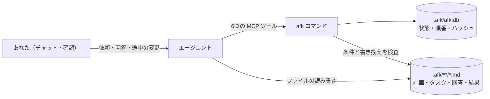
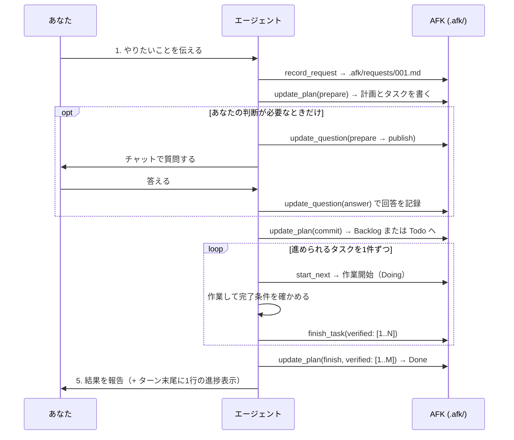

# はじめに

Agent Flow Kit（**AFK**）は、Claude Code・Codex・Antigravity などのコーディングエージェントに、手順の多い仕事を安心して任せるための仕組みです。

やり取りの途中で計画や質問がターミナルのログに流れてしまわないよう、プロジェクト直下の `.afk/` フォルダに、SQLite データベースと普通の Markdown ファイルとして保存します。

---

## 長い仕事をそのまま任せると起きること

いまのエージェントは、ファイルの読み書きもコマンド実行も自分でこなせます。小さな修正なら、そのまま頼むだけで十分です。

ただ、ステップが多い仕事になると、次の4つがよく起きます。

1. **順番が前後する。** 土台ができる前に先の作業へ手を出して、手戻りが増えます。
2. **聞かずに推測で決める。** 本来は人が決めるべき仕様の分岐でも、ログの途中で勝手に仮定を置いて進みます。
3. **確かめきらずに「完了」と言う。** 1つのテストが通っただけで、最初に頼んだ細かい条件を忘れたまま終えてしまいます。
4. **次のセッションに引き継げない。** 会話が長くなったりターミナルを閉じたりすると、新しいセッションでは「何が決まっていて、どこまで終わったか」を一から説明し直すことになります。

プロンプトのお願いだけでこれを防ぐのは簡単ではありません。プロンプトそのものには、状態を覚えておく場所も、ルール違反を止める仕組みもないからです。AFK はワークフロー用の Skill と **6つの MCP ツール** を組み合わせ、これらの決まりを手元のファイルとデータベースで守ります。

---

## AFK が行う4つのこと

AFK は、あなたとエージェントの両方が読んで確かめられる4つの仕組みを `.afk/` に用意します。

| 4つの柱 | `.afk/` で行われること |
| --- | --- |
| **1. 分けて、順番を決める** | 依頼を版付きのプラン（`.afk/plans/NNN-rMMM.md`）とタスク（`.afk/tasks/NNN.md`）に分け、進める順番を決めます。同時に進めるタスクは、1つのプランにつき **1件だけ** です。 |
| **2. 終わりを先に決める** | 始める前に、プランと各タスクの `## Acceptance` に完了条件（1〜64個の `- ` 箇条書き）を書きます。すべての条件を確かめ、`## Result` に結果を残すまで完了になりません。 |
| **3. 決める前に聞く** | 意図が分からないとき、好みで決まるとき、取り消せない操作をするとき、頼まれた範囲を超えるときは、`.afk/questions/NNN.md` に質問を書いてあなたの返事を待ちます。 |
| **4. やったことを手元に残す** | 状態や順番は `.afk/afk.db`（SQLite）に、仕様や結果は Markdown に残ります。外部サービスやアカウント登録は不要で、すべて自分のマシン内で完結します。 |

---

## 仕事を任せる5つのステップ

AFK を呼び出すと、仕事は次の5ステップで進みます。

1. **依頼を伝える。** 普段の言葉でやりたいことを伝えます。エージェントは `.afk/requests/001.md` にその言葉を記録します。
2. **計画を立て、必要なことだけ聞く。** エージェントは計画（`plans/001-r001.md`）とタスク（`tasks/001.md`、`tasks/002.md`）を書き、それぞれに完了条件を並べます。自分では決められない点があるときだけ、`questions/001.md` を作ってチャットで尋ねます。
3. **すぐ始めるか、`Backlog` で待つか。** 作業まで頼んだときは、そのまま未着手（`Todo`）へ進みます。「まずは計画だけ立てて」と頼んだときは `Backlog` に置かれ、あなたが「始めて」と指示するまで勝手に動き出しません。
4. **1つずつ進め、いつでも途中で注文を足す。** エージェントは順番が来たタスクを1つ始め、条件をすべて確かめて `## Result` に結果を書き、完了にします。作業の途中で条件を追加したくなったら、そのままチャットで伝えてください。きりの良いところで立ち止まり、終わったタスクは残したまま残りの計画だけを組み直します。
5. **プラン全体を完了にする。** すべてのタスクが終わったら、プラン自身の完了条件を確かめて `## Result` を書き、プランを閉じます。Claude Code と Codex では、ターンの終わりに1行の進捗メッセージが静かに表示されます。

---

## 具体例：途中で注文が増えても、やり直しにならない

たとえば、次のように頼んだとします。

> 「認証サービスにリフレッシュトークンの更新処理を入れて、同時アクセスのテストも書いて」

AFK があると、途中のやり取りは次のように進みます。

- **最初の迷いを質問で解消：** 計画を書きながら、空のトークンに HTTP `400` と `401` のどちらを返すか決める必要が出てきます。エージェントは推測で進めず、`questions/001.md` を出して止まります。あなたが「`401` で」と答えると、回答を記録して計画の第1版（`001-r001.md`）を確定します。
- **終わった仕事はそのまま守られる：** タスク `#001`（「有効期限と時刻ずれの判定」）が2つの完了条件を満たし、`Done` になります。
- **作業中に条件を足す：** タスク `#002` の途中で、あなたが「古いトークンが再利用されたら監査ログも出して」と伝えます。エージェントは `requests/002.md` を記録します。新しい依頼が計画に反映されるまで、AFK は完了処理を止めます。エージェントは計画の第2版（`001-r002.md`）を作り、終わった `#001` はそのまま残して、これから進めるタスクだけを組み直します。
- **翌日、別のセッションから再開：** `#003` を始める前に PC を閉じても、翌日の新しいセッションで `open_plan` を呼べば、すぐに `#003` の続きから始まります。

---

## 聞かれたら答える。気になったらいつでも口を出す

毎回細かいコマンド承認を求められると疲れますし、逆に放置すると意図と違うものが出来上がります。AFK は「普段の進行」と「人が決める場面」を分けます。

- **細かい確認で何度も止めない：** いったん動き始めたら、完了条件を満たすたびに次のタスクへ自分で進みます。
- **大事な場面では確実に止まる：** 未回答の質問があるとき、`Backlog` で開始待ちのとき、追加の依頼を計画に反映していないときは、AFK 側で作業の開始や完了を止めます。
- **作業中でも方針を変えられる：** 最後まで終わるのを待つ必要はありません。途中で思いついた変更を伝えれば、新しい版の計画として取り込まれます。
- **モデルの入力枠を汚さない：** Claude Code と Codex の進捗表示（Hook）は、AFK を使ったターンだけで動き、モデルのプロンプトには余計な文字を送らない仕組みです。

---

## 最初に読む順番

はじめて使う方は、次の4ページを順に読むと全体がつかめます。

1. **[ワークスペースの設定](getting-started.md)** — Claude Code・Codex・Antigravity などに AFK をつなぎます。
2. **[クイックスタート](quickstart.md)** — 10分ほどの例題で、依頼・質問への回答・途中の変更・別セッションでの再開までを試します。
3. **[仕事のモデル](work-model.md)** — 計画・タスク・質問の関係と、「AFK が守る決まり」「まだエージェント頼みのところ」を整理します。
4. **[質問と途中変更（リプラン）](decisions-and-replanning.md)** — どんなときに質問が出るかと、途中で計画を組み直すときの動きを見ます。

---

## 目的から探す

| やりたいこと・知りたいこと | ページ |
| --- | --- |
| Claude Code・Codex・Antigravity で使えるようにしたい | [導入とセットアップ](getting-started.md) |
| 小さな題材で最初から最後まで試してみたい | [クイックスタート](quickstart.md) |
| `.afk/` を Git に入れるか迷っている | [導入とセットアップ — `.afk/` の Git 管理](getting-started.md#afk-の-git-管理) |
| AFK が自動で守ることと、エージェント頼みの境目を知りたい | [仕事のモデル](work-model.md) |
| すぐ実装させず、まず `Backlog` で計画だけ見たい | [クイックスタート](quickstart.md#step-4-backlog-vs-immediate-execution) · [仕事のモデル](work-model.md) |
| 質問が来る条件や、回答の扱いを知りたい | [質問と途中変更（リプラン）](decisions-and-replanning.md) |
| 作業の途中で条件を足したり変えたりしたい | [質問と途中変更 — 作業中の計画変更（リプラン）](decisions-and-replanning.md#mid-flight-replanning) |
| 新しいセッションで続きから始めたい／止まった作業を引き継ぎたい | [再開・引き継ぎと復旧](resuming-and-recovery.md) |
| 消えた下書きや、手で書き換えてしまったファイルを直したい | [再開・引き継ぎと復旧](resuming-and-recovery.md) |
| 6つの MCP ツールの引数やエラーメッセージを調べたい | [MCP ツールリファレンス](mcp-tools.md) |
| `.afk/` の Markdown の書き方や文字数・件数の上限を知りたい | [Markdown 形式とテンプレート](file-format.md) |
| ソースからビルドしたい／内部の仕組みを知りたい | [開発者ガイド](../dev/index.md) |
