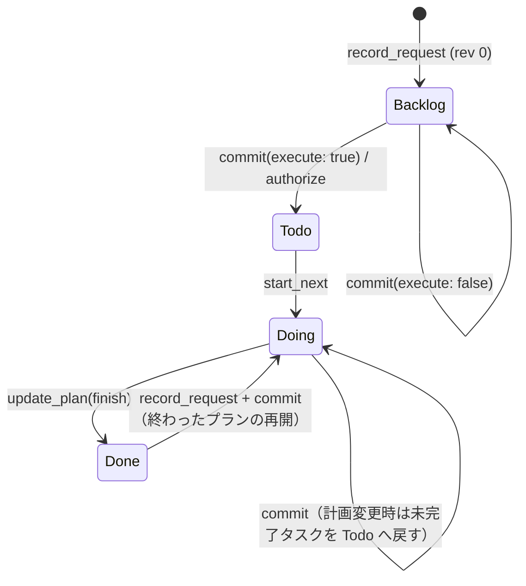
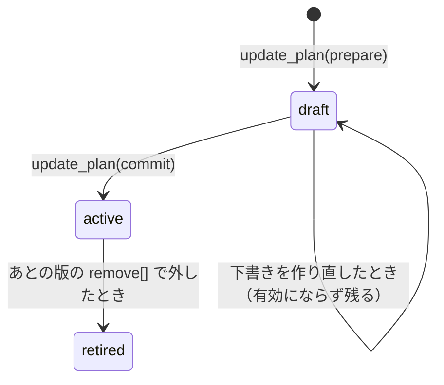
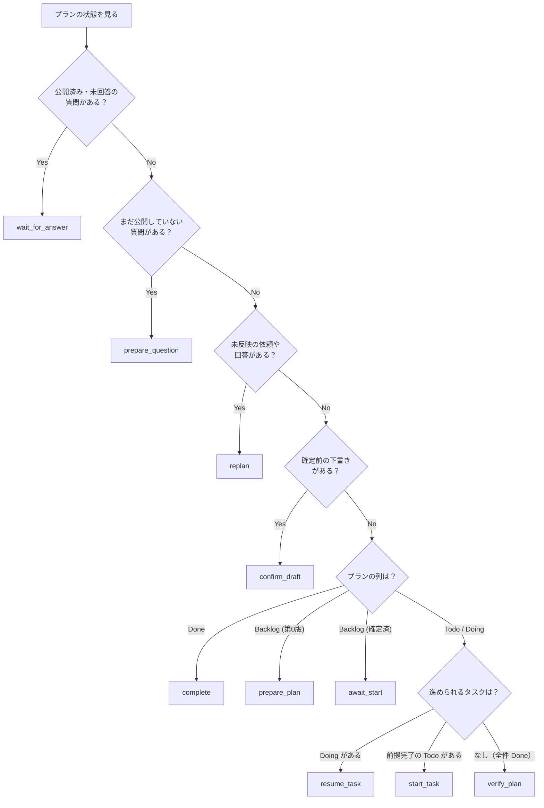

# 仕事のモデル

AFK は、計画、タスクの状態、次に取れる行動を `.afk/` に記録します。別のセッションも、この記録から作業の続きを始められます。いつ質問するか、何を引き継ぎメモに残すかは、エージェントが判断します。

[クイックスタート](quickstart.md) で一通りの流れを試したら、一度このページを読んでみてください。ほかのページの説明は、すべてこの考え方に沿っています。

---

## 要素

| 要素 | 内容 | エージェントにとっての役割 |
| --- | --- | --- |
| **プロジェクト（`.afk/`）** | 作業フォルダ直下に作られる単位で、`afk.db` と4つの Markdown フォルダを持ちます。 | 作業の範囲を1つに定めます。プロジェクトが決まらないときは、推測せずに止まって知らせます。 |
| **依頼（Request）** | あなたがエージェントに渡す指示（`.afk/requests/NNN.md`）。 | 新しい仕事や、途中の追加・変更を渡します。 |
| **プランと版（Plan & Revision）** | 仕事全体の目的と、版ごとの仕様（`.afk/plans/NNN-rMMM.md`）。 | 全体の状態を持ち、計画を組み直すたびに版（`revision`: `1, 2, ...`）が進みます。 |
| **下書き（Draft）** | 確定する前の準備中の計画（`open` / `accepted` / `discarded`）。 | 書きかけの計画でエージェントが勝手に動き出さないようにします。 |
| **タスクと順番（Task）** | 1つずつ進めて確かめる作業（`.afk/tasks/NNN.md`）と、先に終わらせる前提タスクの指定。 | 一度に取り組む単位と、進める順番を決めます。プランの版が進んでもタスクの番号は変わりません。 |
| **完了条件（Acceptance）** | プランと各タスクの `## Acceptance` に書く `1〜64` 個の `- ` 箇条書き。 | 終わったと言える基準になります。 |
| **質問（Question）** | エージェントがあなたに求める判断（`.afk/questions/NNN.md`）。 | 回答が出て計画に反映されるまで、作業を止めて待たせます。 |
| **履歴（History）** | 起きたことと日時、確かめた条件の数を `afk.db` に時系列で残したもの。 | 別のセッションが前の続きから再開できるようにします。 |

---

## 状態

### プランとタスクの4つの列（`Backlog` / `Todo` / `Doing` / `Done`）

プランとタスクは、4つの状態（JSON では小文字の `"backlog"`, `"todo"`, `"doing"`, `"done"`）のどれかにあります。

| 状態 | プランでの意味 | 有効なタスクでの意味 |
| --- | --- | --- |
| **`Backlog`** | 依頼直後（`revision = 0`）、または「まだ始めない」計画として確定した状態（`execute: false`）。あなたが開始を指示する（`authorize`）まで動きません。 | `Backlog` のプランに含まれ、開始の指示を待っている状態。 |
| **`Todo`（未着手）** | 開始が認められ、最初のタスクに取りかかる前の状態。 | 前提となるタスクがすべて `Done` になれば始められる状態。 |
| **`Doing`（進行中）** | 作業が始まった状態（または終わったプランに追加の依頼が来て再開した状態）。 | いまのセッションが担当している状態（`owner` と `attempt` が付きます）。1つのプランで同時に `Doing` になるタスクは **1件だけ** です。 |
| **`Done`（完了）** | すべてのタスクが終わり、プラン自身の完了条件と `## Result` も確かめられた状態。 | 完了条件をすべて満たし、`## Result` が記録された状態。あとで計画を組み直しても `Done` のまま残ります。 |

> [!NOTE]
> `Doing` の途中で計画を組み直したとき、**プラン全体** は `Doing` のままですが、残された未完了の **タスク**（途中で止めた `Doing` タスクを含む）はいったん `Todo` に戻ります。新しい計画に沿って、きりの良いところから再開するためです。

### タスクの所属状態（`draft` / `active` / `retired`）

過去の記録を消さずに計画を組み直せるよう、タスクにはもう1つ `lifecycle` という区分があります。

- **`draft`（下書き）：** 準備中の計画で作られたタスク。確定するまでは実行されず、タスク数にも数えられません。
- **`active`（有効）：** いまの確定済みプランに入っているタスク。実行と進捗カウントの対象です。
- **`retired`（対象外）：** 計画変更のときに `remove` で外された未完了タスクです。これ以上実行されませんが、`.afk/tasks/NNN.md` ファイル自体は記録として残ります。なお、すでに終わった（`Done`）タスクは外せません。

---

## AFK が保証すること

次の決まりは、エージェントの善意ではなく、AFK 本体（Rust と SQLite）が守ります。

- **準備中の下書きは1つだけです。** 1つのプランで同時に開ける下書きは1件だけです（`one_draft` 制約）。作り直すときは、いまの下書き番号を `replace_draft` で明示します。
- **同時に走るタスクは1つだけです。** 1つのプランで `Doing` になる有効タスクは最大1件です（`one_running` 制約）。
- **順番飛ばしや堂々巡りは起きません。** 前提タスクには自分より小さい番号しか指定できないため（`task_id > prerequisite`）、順番がループすることはありません。`start_next` は進行中の `Doing` を最優先し、前提タスクがすべて `Done` になったタスクから順に始めます。
- **確定した条件は、あとから黙って書き換えられません。** 計画を確定すると、`## Result` より上の文章のハッシュ値（`spec_hash`）が記録されます。完了時には仕様が書き変わっていないことをもう一度確かめ、`## Result` のハッシュ値（`final_hash`）も固定します。
- **回答や反映が済むまで、エージェントは待ちます。** 計画に入れていない依頼、まだ答えていない質問、確定前の下書きが1つでもある間は、タスクの開始も完了もすべて拒まれます。
- **回答は一度だけ記録されます。** 質問を出すと質問文が固定され、回答を記録すると回答文も固定されます。あとから答えを変えるときは、元のファイルを上書きせず、新しい質問や依頼として残します。
- **完了は、すべての条件と結果が揃ったことを意味します。** 完了条件が `1〜64` 個あり、その番号（`1..=N`）をすべて渡し、`## Result` に結果が書かれているときだけ `Done` になります。
- **終わった仕事は、終わったまま守られます。** あとから計画を組み直しても、`Done` になったタスクとその結果はそのまま残ります。
- **止まった古いセッションが、あとから結果を壊すことはありません。** セッションごとに固有の ID が付き、引き継ぐたびに番号（`attempt`）が増えます。別セッションが `take_over: true` なしで割り込むことはできず、古い番号からの完了報告も拒まれます。
- **危ないパスやシンボリックリンクは拒みます。** `.afk/` 内のシンボリックリンクはすべてエラーにし、1 MiB を超えるファイルも読み込みません。

---

## まだエージェント頼みのところ

次の点はデータベースやハッシュだけでは判定できないため、エージェントが Skill に従うことに頼っています。大事な仕事では、あなた自身でも Markdown を覗いてみてください。

- **`## Result` の中身が本当に正しいか。** AFK は「仕様が変わっていないこと」「条件の番号がすべて揃っていること」「`## Result` が空でないこと」を確かめますが、そこに書かれたテスト結果の文章が本当に十分かまでは判断しません。
- **チャットの返事をそのまま写しているか。** チャットで答えたとき、`.afk/questions/NNN.md` の `## Answer` に書き込むのはエージェントです。ファイルはいつでも開いて確認でき、一度確定すれば書き換えられません。
- **最初に「質問しよう」と気づくかどうか。** 質問ファイルが作られれば回答まで確実に止まりますが、そもそも依頼の曖昧さに気づいて質問を作るかどうかはエージェントの判断によります。
- **同じ下書きを2つのエージェントで同時に書き換えないこと。** データベースの更新は順番待ちで守られますが、下書き中の `.md` 編集は通常のファイル書き込みです。同じ公開中ドラフトを複数セッションから同時に編集しないでください。
- **プラン全体の「中止（Canceled）」状態。** いまの状態は `Backlog`・`Todo`・`Doing`・`Done` の4つです。個別の未完了タスクは計画変更で対象外（`retired`）にできますが、プラン全体をやめるときは専用の中止レーンへ移すのではなく、そのまま残す形になります。

---

## 次にやること（`Progress.next`）の決まり方

`open_plan` などが返す `Progress.next` は、次の優先順位で1つに決まります。

次は **[質問と途中変更（リプラン）](decisions-and-replanning.md)** で、質問の出し方と計画の組み直し方を詳しく見ます。
