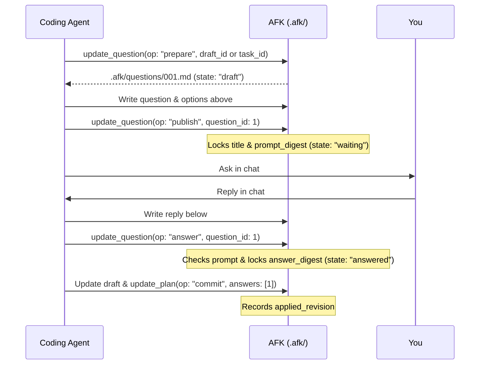
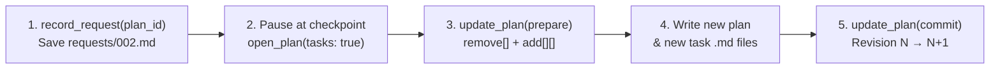

# Questions and replanning

Long tasks rarely go straight from the first message to `Done`. Along the way, two things happen:

1. **The agent hits a choice that belongs to you.**
2. **You add or change requirements after seeing the work take shape.**

Agent Flow Kit handles both on the record inside `.afk/`, rather than leaving them scattered across chat messages.

---

## When the agent asks you: the 4 criteria

So the agent neither pesters you about small details nor guesses on big ones, AFK limits questions to **four cases**:

| Case | When the agent **asks** | When the agent **decides on its own** |
| --- | --- | --- |
| **1. Unclear intent** | Two parts of your request conflict, or a behavior is missing and the codebase gives no clue. | Reading existing files to see how headers or errors are already handled. |
| **2. Human preference** | Multiple valid flag names, JSON shapes, UI layouts, or library choices where taste or team convention decides. | Naming local helpers or structuring unit tests in the repo's existing style. |
| **3. Irreversible action** | Dropping a database column, deleting user fixtures, changing a public API contract, or touching external systems. | Editing new files in the working tree or running local tests. |
| **4. Scope expansion** | Fixing the issue cleanly requires changing three other packages you did not ask to touch. | Writing unit tests for the function you asked to build. |

---

## How a question works from start to finish

Every question lives in `.afk/questions/NNN.md` and moves through four steps:



### Attaching a question to a draft or task

When creating a question (`op: "prepare"`), the agent can scope it in one of three ways:
- **To an open draft (`draft_id`):** Used while writing or revising a plan.
- **To a running or waiting task (`task_id`):** Used when an unexpected choice comes up mid-task (must be an `active` unfinished task).
- **To the plan as a whole (both omitted):** Used for general plan-level questions.

You cannot pass both `task_id` and `draft_id` on the same question. And if a plan is already `Done`, a new request must be recorded first before asking a new question.

### Locking the question and the answer

1. **Before `publish` (`"draft"`):** AFK sets `next` to `prepare_question` and blocks execution so an empty question file cannot be forgotten.
2. **At `publish` (`"waiting"`):** AFK checks the title and locks the SHA-256 hash (`prompt_digest`) of everything above `## Answer`. The question text can no longer be edited, and `next` becomes `wait_for_answer`.
3. **At `answer` (`"answered"`):** After you reply, the agent writes your answer below `## Answer` and calls `answer`. AFK checks that the prompt above `## Answer` is untouched, checks that `## Answer` is not empty, and locks `answer_digest`. Next becomes `replan`, requiring the agent to fold your decision into a plan revision before continuing.
4. **At `commit`:** Passing `answers: [1]` re-checks both hashes on disk and marks the answer applied in the new revision.

### Changing an answer later

Once an answer is locked, editing `## Answer` in `questions/001.md` fails with `"record a new question to revise a sealed answer"`.

If you change your mind later:
- Keep `questions/001.md` as it is, so the history stays accurate.
- Either record your new instruction with `record_request(plan_id)`, or have the agent prepare `questions/002.md` to ask and lock the updated decision, then commit a new plan revision.

---

## Mid-flight replanning

You can add, trim, or change requirements at any point—while a plan is in `Backlog`, `Todo`, `Doing`, or even `Done`. AFK updates the plan in one clean step without throwing away completed work.



### Step 1: Save the request and inspect current tasks

When you send a change mid-flight, the agent calls `record_request` with the existing `plan_id` and writes `.afk/requests/002.md`.

Right away, AFK blocks `start_next`, `finish_task`, and `update_plan(finish)`, and sets `Progress.next` to `replan`. The agent stops at a safe boundary in your code and calls `open_plan(plan_id: 1, tasks: true)` to see which tasks are `done` and which are still unfinished.

### Step 2: Prepare the new draft (`add` and `remove`)

Because confirmed tasks have locked `spec_hash` digests, **the agent never edits an existing confirmed task file**. Instead, `update_plan(prepare)` builds the revised task list like this:

| Kind of task | What to pass in `prepare` | What happens on commit |
| --- | --- | --- |
| **Finished tasks (`Done`)** | Leave out of `remove`. Use their positive IDs in `add` if new tasks build on them. | Kept `active` and `Done` with their original specs and `## Result` untouched. |
| **Unchanged unfinished tasks** | Leave out of `remove`. | Kept `active` with the same task IDs (as long as none of their prerequisites were removed). |
| **Changed or unneeded unfinished tasks** | Put their IDs in `remove: [...]`. | Marked `retired` on commit. Add updated replacement tasks in `add`. |
| **New tasks** | Add one prerequisite list per new task in `add: [[...], ...]`. | Given new `.afk/tasks/NNN.md` files. |

#### Positive vs. negative IDs in `add`

Each entry in `add` lists what that new task waits for (up to 32 new tasks, up to 32 prerequisites each):
- **Positive numbers (`1`, `3`, ...)** point to kept `active` tasks already in the plan.
- **Negative numbers (`-1`, `-2`, ...)** point to earlier new tasks in **this same `add` array** (`-1` is the first new task in `add`, `-2` is the second).

For example, if Task `#1` is `Done`, and you want to replace unfinished Task `#2` with two new tasks where the first waits for `#1` and the second waits for the first:

```json
{
  "plan_id": 1,
  "change": {
    "op": "prepare",
    "revision": 1,
    "remove": [2],
    "add": [
      [1],
      [-1]
    ]
  }
}
```

> [!IMPORTANT]
> **Replacing tasks that depend on removed tasks:** If unfinished Task `#4` waits for Task `#2` and you put `2` in `remove`, you must also put `4` in `remove` (and re-add it in `add` with updated prerequisites if you still want it). Otherwise `commit` refuses with `"replace each retained task whose prerequisite is being removed"`.

### Step 3: Commit the new revision

After writing the new plan file (`.afk/plans/001-r002.md`) and new task files, the agent calls `update_plan(commit)` with all pending `requests` and `answers` IDs.

In one database transaction, AFK:
1. Checks that every pending request and answered question is listed, and that the resulting plan has at least one active task.
2. Locks the SHA-256 `spec_hash` for the new plan and new tasks.
3. Marks `remove` tasks as `retired` (leaving their `.md` files on disk).
4. Resets any kept unfinished task (including one that was `Doing`) back to `Todo` (or `Backlog` if not yet authorized) and clears its `owner`.
5. Leaves all `Done` tasks untouched, bumps `revision` by 1, and clears the plan's `final_hash` until the revised plan finishes.

---

## Reopening a `Done` plan

If follow-up work comes up after a plan is already `Done`, you can continue the same plan instead of starting over:

1. Call `record_request(plan_id: 1)` with the finished plan's ID and write `.afk/requests/NNN.md`.
2. Call `open_plan(plan_id: 1, tasks: true)` to see the finished tasks.
3. Prepare a new draft (`add: [[2]]`, `remove: []`), write the updated plan and follow-up task(s), and call `commit`.

AFK moves the plan from `Done` back to `Doing` at `revision + 1`, keeps every earlier plan file and `Done` task intact, and lines up the new follow-up task to run next.

Next, see how to pick up work in a new session or recover from interruptions in **[Resuming and recovery](resuming-and-recovery.md)**.
