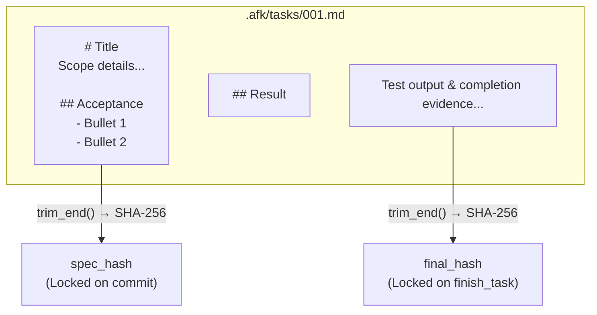

# Markdown format & templates

Every request, plan revision, task, and clarifying question in Agent Flow Kit is stored as a plain UTF-8 Markdown file under `.afk/`. Both you and your coding agent can read them directly in any editor.

This page explains the `.afk/` directory layout, the exact starter templates AFK creates, how titles and `## Acceptance` bullets are parsed, and which parts of each file are locked by SHA-256 hashes.

---

## `.afk/` directory overview

When AFK initializes a project, it creates `.afk/` (`0700` permissions on Unix) and manages five items (`0600` file permissions on Unix):

| Path pattern | Created by | What it holds |
| --- | --- | --- |
| `.afk/afk.db` | Store initialization | SQLite database storing states, task order, ownership attempts, SHA-256 hashes, execution history, and handoff notes. |
| `.afk/requests/NNN.md` | `record_request` | Your original or follow-up request in plain Markdown (`001.md`, `002.md`, ...). |
| `.afk/plans/NNN-rMMM.md` | `update_plan(prepare)` | Plan specification, acceptance bullets, and final result. `NNN` is `plan_id`; `MMM` is `draft_id` (both zero-padded to at least 3 digits). |
| `.afk/tasks/NNN.md` | `update_plan(prepare)` | Per-task specification, acceptance bullets, and completion evidence (`001.md`, `002.md`, ...). Task IDs stay stable across plan revisions. |
| `.afk/questions/NNN.md` | `update_question(prepare)` | Clarifying question prompt above `## Answer`, and your recorded reply below `## Answer`. |

*(Numbers use 3-digit zero-padding up to `999` and expand naturally to `1000.md` and beyond.)*

---

## Built-in starter templates

When AFK reserves a new Markdown path, it writes a minimal starter template. **AFK intentionally rejects unfilled starter templates** so an agent can never commit an empty stub by accident.

### 1. Request template (`requests/NNN.md`)

```markdown
# 
```

- **Exact string:** `"# \n"`
- **Validation rule:** At least one line must contain visible text after stripping Markdown markers. Leaving `# ` blank fails `commit` with `"write the request to ..."`.

### 2. Plan and task templates (`plans/NNN-rMMM.md` and `tasks/NNN.md`)

```markdown
# 

## Acceptance

- 

## Result
```

- **Plan template:** `"# \n\n## Acceptance\n\n- \n\n## Result\n"`
- **Why an unfilled template is rejected:**
  - `# ` strips down to an empty title → `"add a title to ..."`.
  - `- ` has nothing after the dash-space prefix, so its acceptance bullet count is `0` → `"write 1–64 acceptance bullets in ..."`.
  - Nothing follows `## Result` → finishing fails with `"write a nonempty ## Result in ..."`.

Task templates also include an **Execution agents** section after the first line. AFK records the MCP client name and the model, when supplied, on every new attempt. Missing values appear as `Unknown`. A takeover retains existing entries. Starting a task created with an older template adds the section based on available records.

AFK manages this section between its execution markers. Keep it in place when editing a task. AFK excludes the section when checking the specification and result hashes.

### 3. Question template (`questions/NNN.md`)

```markdown
# 

## Answer
```

- **Exact string:** `"# \n\n## Answer\n"`
- **Validation rule:** Publishing requires a non-empty title above `## Answer` (`"add a title to ..."`). Answering requires non-empty text beneath `## Answer` (`"write a nonempty ## Answer in ..."`).

---

## Title extraction rules

AFK displays plan, task, and question titles in `Progress` snapshots and native `Stop` hook lines. Rather than forcing YAML frontmatter, AFK derives a clean plain-text title from **the first non-empty line** of the specification (above `## Result` or `## Answer`):

1. **Leading block markers are stripped repeatedly:** Heading hashes followed by whitespace (`# Title`, `## Heading` — while `#hashtag` without a space is kept as-is), blockquotes (`>`), bullet markers (`- `, `* `, `+ `), and numbered list prefixes (`1. `, `12) `).
2. **Links and images keep their label:** `[the **docs**](https://example.com)` becomes `the docs`, and `` becomes `diagram`.
3. **Inline formatting marks are stripped:** Code backticks (`` ` ``), strikethrough (`~~`), and emphasis (`**`, `__`, `*`, `_`) are removed—while plain underscores inside identifiers (`snake_case_name`) and asterisks surrounded by spaces (`2 * 3 = 6`) are preserved intact.
4. **Control characters and length cap:** Control characters are filtered out, and the resulting title is capped at **100 Unicode characters**.

---

## `## Acceptance` rules and code fences

Every plan and task file defines what "done" means in its `## Acceptance` section:

```markdown
# Validate webhook signatures

Verify HMAC-SHA256 signatures before parsing event payloads.

## Context

Example payload header format:
```markdown
## Result
- This heading and bullet are inside a code fence, so AFK ignores them
```

## Acceptance

- Valid signatures pass verification and return the parsed event
- Missing or tampered signatures fail without invoking handlers
- Replay timestamps older than 5 minutes are rejected

## Result

`cargo test webhook_signature` passed (6/6 tests).
```

Keep four parsing rules in mind:

- **1 to 64 bullets required:** AFK counts top-level lines starting with `"- "` (dash + space) followed by non-empty text, stopping at the next `## ` heading (or `## Result`). Every plan and task must have **between 1 and 64** bullets.
- **1-based verification numbers:** When calling `finish_task` or `update_plan(finish)`, `verified` must contain every bullet's 1-based position (for 3 bullets: `[1, 2, 3]`).
- **Fenced code block awareness:** When splitting a document at `## Result`, `## Answer`, or `## Acceptance`, AFK tracks fenced code blocks opened by 3 or more backticks (`` ``` ``) or tildes (`~~~`). A `## Result` or `## Acceptance` line inside a code example will never split your document early, while two real `## Result` headings outside fences are rejected (`"duplicate ## Result heading"`).
- **Use `- ` for acceptance bullets:** Indented sub-bullets (`  - detail`) or `* ` bullets under `## Acceptance` are treated as descriptive context rather than counted top-level acceptance items.

---

## SHA-256 hash boundaries (`spec_hash` vs. `final_hash`)

How can an agent append `## Result` (or `## Answer`) to a Markdown file without breaking the sealed specification hash? AFK splits the file cleanly at the final section heading (`## Result` for plans/tasks, `## Answer` for questions):



- **Above the heading (`spec_hash` / `prompt_digest`):** Everything strictly before the `## Result` (or `## Answer`) line has trailing whitespace trimmed (`trim_end()`) and is hashed with SHA-256 when committed (or published). If `## Result` is omitted during drafting, the entire file text is hashed as the specification—and the agent simply appends `\n\n## Result\n...` later when finishing!
- **Below the heading (`final_hash` / `answer_digest`):** Everything after the `## Result` (or `## Answer`) heading line has trailing whitespace trimmed (`trim_end()`) and is hashed when the task/plan finishes (or when the question is answered). Once locked, `final_hash` and `answer_digest` are also verified on subsequent checks so completed evidence cannot be quietly altered.

---

## File and size limits

AFK keeps hard bounds small and predictable so local SQLite queries and hook checks stay fast (single-digit milliseconds):

| Limit | Value | Enforced when |
| --- | --- | --- |
| Maximum Markdown file size | **1 MiB** (`1,048,576` bytes, UTF-8) | Reading any request, plan, task, or question |
| Acceptance bullets per plan or task | **1 – 64** (`- ` bullets) | Committing a draft & finishing a task/plan |
| Extracted plain-text title length | **100** Unicode characters | Reading plans, tasks, and questions |
| New tasks (`add`) per draft | **32** tasks | `update_plan(prepare)` |
| Retired tasks (`remove`) per draft | **32** tasks | `update_plan(prepare)` |
| Prerequisites per new task | **32** task IDs | `update_plan(prepare)` |
| Request `receipt` key length | **1 – 100** bytes | `record_request` |
| Orphan paths returned per check | **32** sorted paths | `open_plan(check_files: true)` |
| Recent plans returned per page | **10** plans | `open_plan` (without `plan_id`) |
| Symlinks / non-regular files | **0 allowed** (`O_NOFOLLOW`) | Every `.afk/` directory, DB, and `.md` access |
