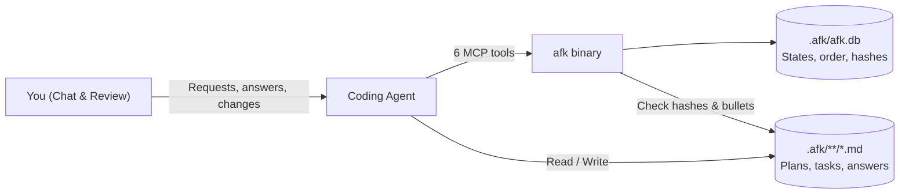
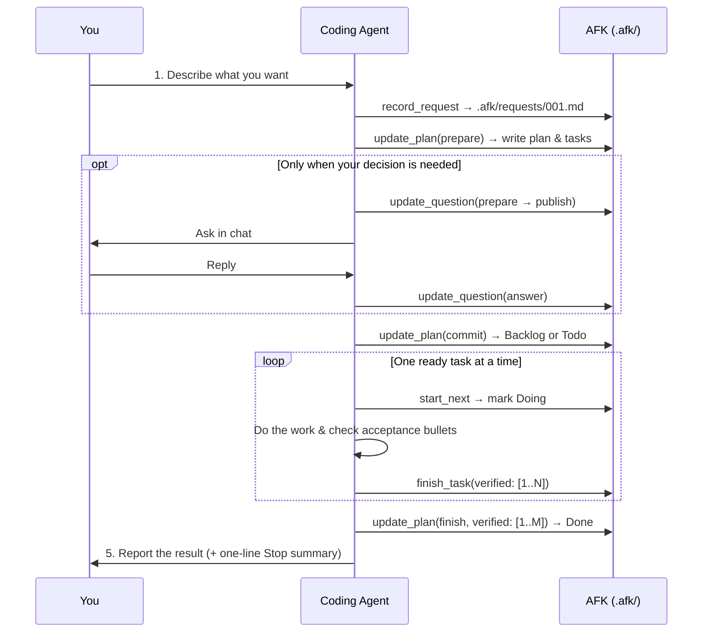

# Introduction

Agent Flow Kit (**AFK**) helps you hand off multi-step work to coding agents—like Claude Code, Codex, and Antigravity—without losing track of the plan, the choices that belong to you, or whether the work is truly finished.

Instead of letting plans and questions scroll away in terminal logs, AFK saves them inside your project under `.afk/` as a local SQLite database and plain Markdown files.

---

## Why long agent jobs drift

Coding agents already have file tools, shell commands, and an execution loop. On small edits, they work fine on their own. On longer jobs with several steps, four problems show up again and again:

1. **Steps run out of order.** Without clear task boundaries, an agent jumps into later steps before earlier ones are working.
2. **The agent guesses instead of asking.** Faced with two valid status codes or a risky change, it quietly picks one in the middle of a long tool log.
3. **Work is called "done" too early.** One test passes, two edge cases from your prompt are forgotten, and the agent says it is finished.
4. **The next session starts from zero.** When a chat grows too long or you close your terminal, a new session cannot tell what was agreed, what is finished, or what changed along the way.

Prompt rules alone cannot fix this, because prompts have no memory or checks of their own. AFK pairs a small workflow skill with **six MCP tools** backed by SQLite and SHA-256 file checks.

---

## What AFK is: four pillars

AFK keeps four things in `.afk/` where both you and the agent can read and check them:

| Pillar | What happens on disk |
| --- | --- |
| **1. Ordered plans and tasks** | Requests turn into numbered plan revisions (`.afk/plans/NNN-rMMM.md`) and tasks (`.afk/tasks/NNN.md`) with clear prerequisites. Only **one task per plan** runs at a time. |
| **2. A definition of done** | Every plan and task lists `1–64` `- ` bullets under `## Acceptance` before work begins. A task moves to `Done` only when every bullet is checked and `## Result` is filled in. |
| **3. Questions before deciding** | When your intent is unclear, your preference decides, an action cannot be undone, or scope grows, the agent writes a question to `.afk/questions/NNN.md` and waits for your answer. |
| **4. A verified local record** | `.afk/afk.db` tracks states, order, and file hashes, while Markdown holds the text. Nothing leaves your machine—no cloud account or background daemon is needed. |

---

## How delegation works in 5 steps

When you invoke AFK, a job moves through five clear steps:

1. **Send your request.** Describe the outcome you want in plain words. The agent saves your request to `.afk/requests/001.md`.
2. **Plan and ask.** The agent writes a plan (`plans/001-r001.md`) and ordered tasks (`tasks/001.md`, `tasks/002.md`), each with `## Acceptance` bullets. If something needs your call, it publishes a question (`questions/001.md`) and asks you in chat.
3. **Start now, or wait in `Backlog`.** If you asked the agent to do the work, the plan moves straight to `Todo`. If you asked for a plan only, AFK keeps it in `Backlog` until you say to start (`authorize`).
4. **Run one task at a time—and steer anytime.** The agent starts the next ready task, checks every acceptance bullet, writes what it verified under `## Result`, and finishes the task. If you add a new requirement mid-flight, AFK pauses at a clean boundary and updates the plan without losing finished tasks.
5. **Finish the plan.** Once every task is `Done`, the agent checks the plan's own `## Acceptance` bullets, writes the final `## Result`, and closes the plan. In Claude Code and Codex, a `Stop` hook prints a short status line without adding tokens to the model's prompt.

---

## Example: changing course mid-flight

Suppose you tell your agent:

> *"Add refresh-token rotation to the auth service and test concurrent requests."*

Here is how AFK handles twists along the way:

- **A question upfront:** While writing the plan, the agent sees that empty tokens could return HTTP `400` or `401`. Instead of guessing, it writes `questions/001.md` and waits. You reply *"Return 401"*, and the agent records your answer and builds revision 1 around it.
- **Finished work stays finished:** Task `#001` (*"Check token expiry and clock skew"*) passes both of its acceptance checks and moves to `Done`.
- **A new requirement mid-work:** While Task `#002` is underway, you add: *"Also log an audit event when an old token is reused."* The agent saves `requests/002.md`. While that request is waiting to be folded in, AFK blocks early completion. The agent writes `plans/001-r002.md`, keeps `#001` (`Done`) as-is, and updates only the remaining tasks.
- **Continuing tomorrow:** If you close your laptop before `#003` starts, a fresh session tomorrow calls `open_plan` and picks up right at `#003`.

---

## Answer when asked, step in anytime

Many workflows force a bad choice: approve every tiny command by hand, or let the agent run blind. AFK splits routine work from human decisions:

- **No step-by-step nagging.** Once a plan is running, the agent moves from one task to the next on its own as acceptance bullets pass.
- **Hard stops when you are needed.** Work stops automatically when a question is waiting for your answer, when a plan is held in `Backlog`, or when a new request needs a revised plan.
- **Steer while it works.** You can add or change requirements at any moment. AFK turns each change into a new plan revision.
- **Quiet progress lines.** Native hooks in Claude Code and Codex show a one-line summary only on turns that use AFK, and stay silent during ordinary chat.

---

## Where to start

Read these four pages in order to get comfortable with AFK:

1. **[Workspace configuration](getting-started.md)** — Connect AFK to Claude Code, Codex, Antigravity, or another MCP client.
2. **[Quickstart](quickstart.md)** — Run a 10-minute example from first request to mid-flight change and session resume.
3. **[The work model](work-model.md)** — See how plans, tasks, and questions fit together, what AFK enforces itself, and what still relies on the agent.
4. **[Questions and replanning](decisions-and-replanning.md)** — Learn when the agent asks you and how mid-flight plan changes work.

---

## Find by goal

| What you want to do | Page |
| --- | --- |
| Set up AFK in Claude Code, Codex, or Antigravity | [Install and set up](getting-started.md) |
| Try one complete task end to end | [Quickstart](quickstart.md) |
| Decide whether to track `.afk/` in Git | [Install and set up — Versioning `.afk/`](getting-started.md#versioning-afk) |
| Check what AFK guarantees vs. what depends on the agent | [The work model](work-model.md) |
| Review a plan in `Backlog` before letting it run | [Quickstart](quickstart.md#step-4-backlog-vs-immediate-execution) · [The work model](work-model.md) |
| See when the agent asks questions and how answers are locked | [Questions and replanning](decisions-and-replanning.md) |
| Change requirements while work is already in progress | [Questions and replanning — Mid-flight replanning](decisions-and-replanning.md#mid-flight-replanning) |
| Resume in a new session or take over a stopped `Doing` task | [Resuming and recovery](resuming-and-recovery.md) |
| Recover missing draft files, stray `.md` files, or hand-edited specs | [Resuming and recovery](resuming-and-recovery.md) |
| Look up MCP tool arguments, JSON responses, and error fixes | [MCP tools reference](mcp-tools.md) |
| Check `.afk/` Markdown templates, `## Acceptance` rules, and limits | [Markdown format & templates](file-format.md) |
| Build AFK from source or read about hooks and SQLite internals | [Developer guide](../dev/index.md) |
