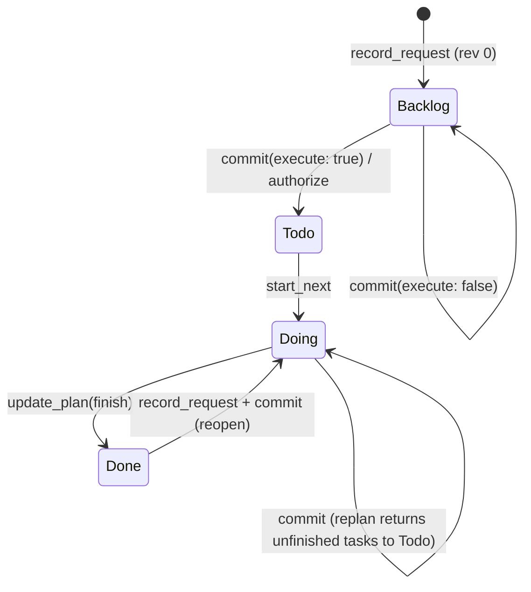
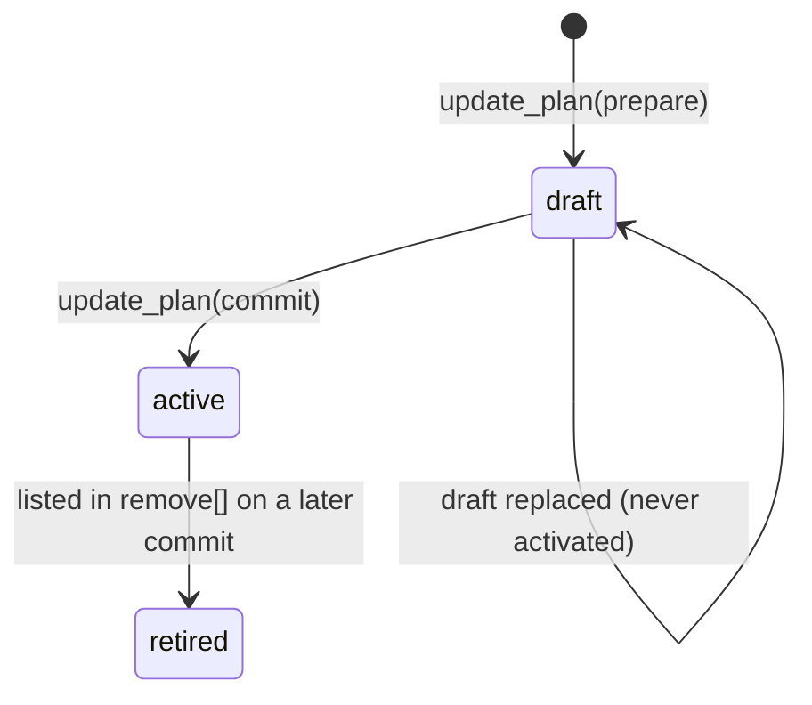
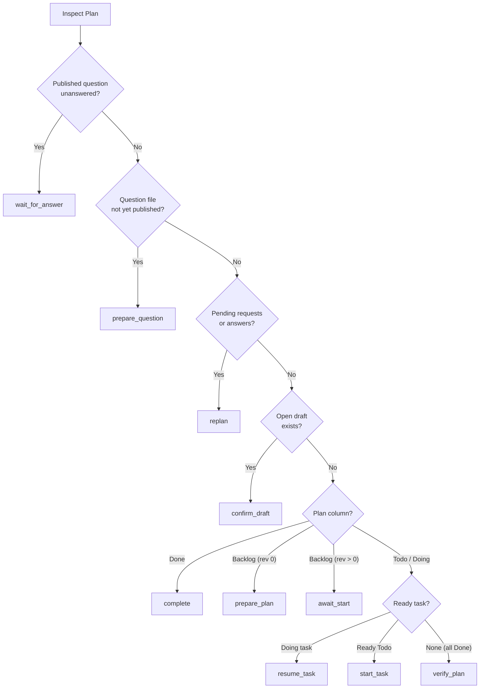

# The work model

AFK stores the plan, task status, and next available action in `.afk/`. A new session can read that state and continue from the current task. The agent decides when to ask a question and what to record for the next session.

Read this page once you have seen the loop in the [Quickstart](quickstart.md). Every other page builds on the ideas here.

---

## The elements

| Element | What it is | What it does for the agent |
| --- | --- | --- |
| **Project (`.afk/`)** | One workspace folder containing `.afk/afk.db` and four Markdown folders. | Fixes the scope of work. Each MCP server session binds to one project and stops rather than guessing if none is set. |
| **Request** | A message from you, saved in `.afk/requests/NNN.md`. | Hands new work—or a mid-flight change—to the agent. |
| **Plan & Revision** | A goal and its versioned specification (`.afk/plans/NNN-rMMM.md`). | Tracks overall status (`Backlog`, `Todo`, `Doing`, `Done`) and increments `revision` (`1, 2, ...`) on every confirmed change. |
| **Draft** | An uncommitted plan revision (`open`, `accepted`, or `discarded`). | Gives the agent a place to write or revise a plan and tasks before making them active. |
| **Task & Prerequisites** | One piece of work in `.afk/tasks/NNN.md`, ordered by prerequisite task IDs. | Sets the unit of work and the exact order to take it in. Task IDs never change across plan revisions. |
| **Acceptance bullets** | `1–64` `- ` bullets under `## Acceptance` on every plan and task. | Defines what "done" means before work starts. |
| **Question** | A decision the agent asks you for in `.afk/questions/NNN.md`. | Stops execution until you answer and the answer is folded into the plan. |
| **History** | A time-ordered table in `afk.db` of every state change and verification count. | Records what happened and when, so another session can pick up cleanly. |

---

## States

### Plan and task columns (`Backlog`, `Todo`, `Doing`, `Done`)

Plans and tasks move across four columns (written in lowercase JSON as `"backlog"`, `"todo"`, `"doing"`, `"done"`):

| Column | For a Plan | For an active Task |
| --- | --- | --- |
| **`Backlog`** | Created (`revision = 0`), or confirmed for review only (`execute: false`). Agents do not start it until you say so (`authorize`). | Waiting on a `Backlog` plan to be authorized. |
| **`Todo`** | Authorized to run, waiting for its first task to start. | Waiting for its prerequisite tasks to reach `Done`. |
| **`Doing`** | Work has started (or a `Done` plan was reopened by a new request). | Claimed by the current agent session (`owner` + `attempt`). At most **one** task per plan can be `Doing`. |
| **`Done`** | Every active task is `Done`, and the plan's own acceptance bullets and `## Result` are verified. | Every acceptance bullet is checked and `## Result` is locked. Stays `Done` across future plan revisions. |

> [!NOTE]
> When a `Doing` plan is revised mid-flight, the **plan** stays in `Doing`, while any kept **task** that was in `Doing` goes back to `Todo` (with its `owner` cleared) so work resumes cleanly against the updated plan.

### Task lifecycles (`draft`, `active`, `retired`)

Because plans can be revised without erasing old files, each task also has a `lifecycle`:

- **`draft`:** Created inside an open draft. Ignored by `start_next` and task counts until the draft is committed.
- **`active`:** Part of the current confirmed plan revision.
- **`retired`:** An unfinished task that was replaced (`remove`) in a newer revision. AFK stops scheduling it and leaves its `.md` file on disk as part of the record. Finished (`Done`) tasks cannot be retired—they stay `active` and `Done`.

---

## What AFK guarantees

These rules are kept by `afk` itself in Rust and SQLite—not left to the agent's good manners:

- **One open draft at a time.** SQLite enforces at most one `open` draft per plan (`one_draft` unique index). Replacing an open draft requires passing its exact ID (`replace_draft`).
- **One running task at a time.** At most one `active` task per plan can be in `Doing` (`one_running` unique index).
- **Tasks cannot form loops or run out of order.** SQLite enforces `task_id > prerequisite`, making dependency cycles impossible. `start_next` finishes an existing `Doing` task first, and starts a `Todo` task only when all its active prerequisites are `Done` (with intact hashes).
- **Confirmed conditions cannot be quietly rewritten.** Committing a draft locks the SHA-256 hash (`spec_hash`) of everything above `## Result`. Finishing a task or plan checks that `spec_hash` has not changed and locks `final_hash` over `## Result`.
- **The agent waits when you have not answered.** If a plan has any unapplied request, an unpublished or unanswered question, or an open draft, AFK refuses `authorize`, `start_next`, `finish_task`, and `update_plan(finish)`.
- **An answer is locked once.** Publishing a question locks `prompt_digest`, and recording your reply locks `answer_digest`. Changing an answer later requires a new question or request rather than overwriting the old file.
- **`Done` requires every bullet and a result.** Tasks and plans need `1–64` acceptance bullets, all `1`-based bullet numbers passed in `verified`, and a non-empty `## Result`.
- **Stopped sessions cannot overwrite new ones.** Each MCP server process gets a unique worker ID, and each task claim bumps `attempt` (`1, 2, ...`). Another session cannot claim a `Doing` task without `take_over: true`, and an older `attempt` can never finish the task later.
- **Unsafe paths and symlinks are refused.** AFK rejects symlinks across `.afk/`, uses `O_NOFOLLOW` / `SQLITE_OPEN_NOFOLLOW`, and caps Markdown files at `1 MiB`.

---

## What still relies on the agent

Some things are not checked by SQLite or SHA-256. They rely on the agent following its `SKILL.md` instructions—and are worth checking yourself when the stakes are high:

- **Whether `## Result` truly proves the work.** AFK checks that the spec was not edited, every bullet number (`1..=N`) was listed, and `## Result` is not empty. It does not run your tests itself or judge whether the text in `## Result` is convincing.
- **Recording your chat answer accurately.** When you reply in chat, the agent writes your words under `## Answer` in `.afk/questions/NNN.md`. You can open that file anytime to check it, and once locked it cannot be altered.
- **Choosing when to ask.** Once a question file is created, AFK blocks execution until it is answered and committed. Spotting an ambiguity in your prompt and deciding to create that question in the first place relies on the agent.
- **Two agents editing the same open draft at once.** SQLite serializes database writes, but agents edit `.md` drafts with ordinary file tools outside database transactions. Do not point two agents at the same open draft at the same time.
- **Canceling a whole plan.** There is no separate `Canceled` column yet (`Backlog`, `Todo`, `Doing`, and `Done` are the four states). Individual unfinished tasks can be `retired` during replanning, while an abandoned plan stays in its last column.

---

## How `Progress.next` picks the next step

Every `open_plan` and state update returns a `Progress` summary whose `next` field follows this exact priority order:

Next, read **[Questions and replanning](decisions-and-replanning.md)** to see how questions and mid-flight changes work in practice.
